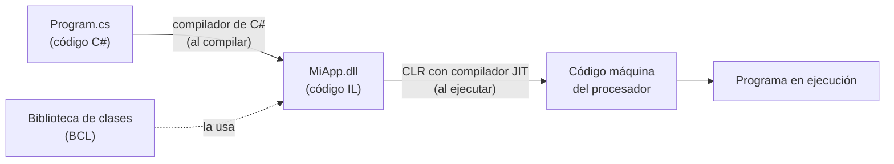
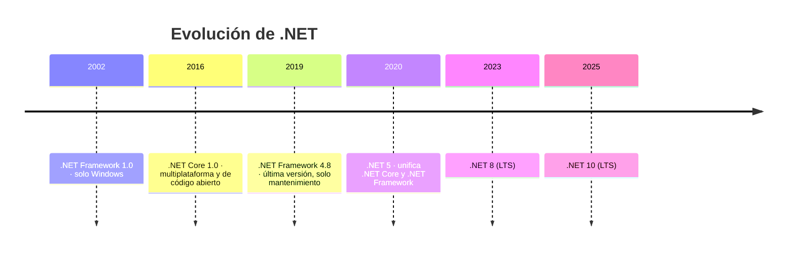
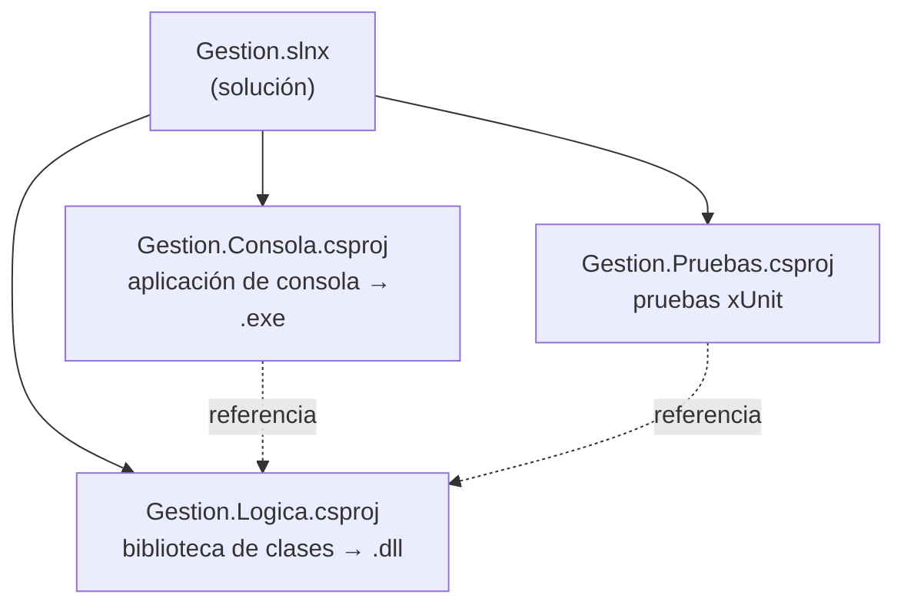

# 1. El entorno de trabajo: .NET y Visual Studio

[⬅️ Volver a la unidad](./README.md)

**CE que trabaja este tema:** prepara RA1 a, b.

## Índice

- [1.1. Por qué un entorno y no solo un lenguaje](#11-por-qué-un-entorno-y-no-solo-un-lenguaje)
- [1.2. Qué es .NET](#12-qué-es-net)
  - [1.2.1. Del código fuente al programa en ejecución](#121-del-código-fuente-al-programa-en-ejecución)
  - [1.2.2. La biblioteca de clases](#122-la-biblioteca-de-clases)
  - [1.2.3. Versiones: .NET Framework, .NET, LTS y STS](#123-versiones-net-framework-net-lts-y-sts)
  - [1.2.4. SDK y entorno de ejecución](#124-sdk-y-entorno-de-ejecución)
- [1.3. Instalar Visual Studio 2026 Community](#13-instalar-visual-studio-2026-community)
- [1.4. Soluciones y proyectos](#14-soluciones-y-proyectos)
  - [1.4.1. El fichero del proyecto](#141-el-fichero-del-proyecto)
  - [1.4.2. Plantillas de proyecto](#142-plantillas-de-proyecto)
- [1.5. La solución de tres proyectos](#15-la-solución-de-tres-proyectos)
- [1.6. Ejecutar un programa](#16-ejecutar-un-programa)
- [1.7. El editor te ayuda](#17-el-editor-te-ayuda)
- [1.8. Paquetes NuGet](#18-paquetes-nuget)
- [1.9. Tu primera prueba automática](#19-tu-primera-prueba-automática)
- [1.10. La línea de órdenes: `dotnet`](#110-la-línea-de-órdenes-dotnet)
- [1.11. Convenciones de código y `.editorconfig`](#111-convenciones-de-código-y-editorconfig)
- [Resumen](#resumen)
- [Ejercicios de reflexión](#ejercicios-de-reflexión)

---

## 1.1. Por qué un entorno y no solo un lenguaje

En primer curso aprendiste a programar con un lenguaje orientado a objetos. Seguramente escribías el código, lo compilabas y lo ejecutabas con unas pocas herramientas. En este módulo vas a construir **aplicaciones de escritorio**, y para eso necesitas tres cosas que trabajan juntas:

| Pieza | En este módulo | Para qué |
|-------|----------------|----------|
| Un **lenguaje** | C# | Escribir la lógica |
| Una **plataforma** | .NET | Ejecutar el programa y darle miles de clases ya hechas (ficheros, fechas, colecciones, red…) |
| Un **entorno de desarrollo** (IDE) | Visual Studio 2026 Community | Escribir, compilar, depurar y probar |

Este tema te enseña lo **justo** de las dos últimas para trabajar con comodidad. El resto de herramientas de Visual Studio (el depurador, por ejemplo, en el tema 12) las verás cuando las necesites.

> 📝 **Nota del Profesor**: No hace falta que memorices todos los menús. Quédate con la idea: **solución → proyectos → ficheros**, y con los atajos que más usarás (F5, Ctrl+F5, Ctrl+. y Ctrl+K, Ctrl+D). Lo demás lo irás encontrando.

---

## 1.2. Qué es .NET

**.NET** es la plataforma de desarrollo de Microsoft, gratuita y de código abierto. Funciona en Windows, Linux y macOS, y con ella se hacen aplicaciones de escritorio, web, móviles, servicios en la nube y juegos. Se programa sobre todo en **C#**, aunque admite otros lenguajes (F#, Visual Basic).

### 1.2.1. Del código fuente al programa en ejecución

El compilador de C# **no** genera código máquina para un procesador concreto. Genera un código intermedio, el **IL** (*Intermediate Language*), que se guarda en un fichero `.dll`. Al ejecutar el programa, el **CLR** (*Common Language Runtime*, el entorno de ejecución de .NET) traduce ese IL a código máquina **justo antes de usarlo**: es la compilación **JIT** (*Just-In-Time*).



El mismo `.dll` funciona en cualquier sistema que tenga el entorno de ejecución de .NET: el CLR de cada sistema hace la última traducción.

El CLR hace, además, otras tareas por ti:

- **Gestión de memoria**: reservas objetos con `new` y el **recolector de basura** (*garbage collector*) los libera cuando nadie los usa. No hay que liberar memoria a mano.
- **Seguridad de tipos**: no se puede tratar un objeto como si fuera de otro tipo incompatible.
- **Excepciones**: los errores se propagan de forma controlada, con una traza que dice dónde ocurrieron.

> 🔁 **Transferencia**: Java funciona igual: el compilador genera *bytecode* (`.class`) y la JVM lo traduce con su propio JIT. Python también compila a un código intermedio (`.pyc`), aunque lo interpreta. C y C++, en cambio, compilan directamente a código máquina de un procesador y un sistema concretos.

### 1.2.2. La biblioteca de clases

Con .NET viene la **BCL** (*Base Class Library*): miles de clases organizadas en **espacios de nombres** (*namespaces*). Algunas que usarás en esta unidad:

| Espacio de nombres | Para qué |
|--------------------|----------|
| `System` | Tipos básicos (`int`, `string`, `DateTime`), `Console`, `Math`, excepciones |
| `System.Collections.Generic` | `List<T>`, `Dictionary<TKey, TValue>`, `HashSet<T>` |
| `System.Linq` | Consultas sobre colecciones (tema 10) |
| `System.IO` | Ficheros y carpetas |
| `System.Text.Json` | Leer y escribir JSON |
| `System.Threading.Tasks` | Programación asíncrona (tema 11) |

Lo que no está en la BCL se añade con **paquetes NuGet** (apartado 1.8).

### 1.2.3. Versiones: .NET Framework, .NET, LTS y STS



- **.NET Framework** (2002-2019) solo funciona en Windows. Ya no evoluciona, pero verás mucho código antiguo hecho con él (y muchos apuntes en Internet que lo usan).
- **.NET** (antes .NET Core) es el actual: multiplataforma y con una versión nueva **cada noviembre**.
- Las versiones **pares** son **LTS** (*Long Term Support*): tienen soporte durante tres años. Las impares son **STS** (*Standard Term Support*): dos años.

En el módulo se usa siempre **la versión LTS vigente**, que es la que eligen las empresas para sus aplicaciones.

> ⚠️ **Cuidado**: Si buscas ayuda en Internet, fíjate en la versión. Un ejemplo para «.NET Framework 4.7.2» puede usar clases o formas de trabajar que ya no existen o han cambiado. La documentación oficial de Microsoft (learn.microsoft.com) tiene un selector de versión en cada página.

### 1.2.4. SDK y entorno de ejecución

| Se instala | Contiene | Quién lo necesita |
|------------|----------|-------------------|
| **SDK** (*Software Development Kit*) | Compilador, plantillas, herramienta `dotnet` y entorno de ejecución | Quien **desarrolla** |
| **Entorno de ejecución** (*runtime*) | Solo el CLR y la BCL | Quien **usa** la aplicación |

Visual Studio instala el SDK por ti. En la UD8 verás cómo distribuir una aplicación para que funcione en un equipo que no tiene nada instalado.

> 💡 **Tip del Examinador**: «¿Qué es el IL y quién lo traduce a código máquina?» El **IL** es el código intermedio que genera el compilador de C#; lo traduce a código máquina el **compilador JIT del CLR** en el momento de ejecutar.

---

## 1.3. Instalar Visual Studio 2026 Community

**Visual Studio Community** es la edición gratuita de Visual Studio para estudiantes, proyectos de código abierto y equipos pequeños.

1. Descarga el instalador desde la web de Visual Studio (visualstudio.microsoft.com) y ejecútalo.
2. En la pestaña **Cargas de trabajo**, marca **Desarrollo de escritorio de .NET**. Incluye el SDK de .NET, C# y las herramientas de pruebas, y lo que necesitarás en las unidades siguientes.
3. En la pestaña **Paquetes de idioma**, deja marcado **Español**.
4. Pulsa **Instalar**.

Para añadir o quitar componentes más tarde, abre el **Visual Studio Installer** y pulsa **Modificar**.

> ✅ **Buena práctica**: Actualiza Visual Studio cuando te lo proponga (icono de la campana, abajo a la derecha). Las actualizaciones traen correcciones y la última versión del SDK.

---

## 1.4. Soluciones y proyectos

Visual Studio organiza el trabajo en dos niveles:

- Un **proyecto** produce **un** resultado: un programa (`.exe`), una biblioteca (`.dll`) o un conjunto de pruebas. Su configuración está en un fichero `.csproj`.
- Una **solución** agrupa varios proyectos relacionados. Se guarda en un fichero **`.slnx`** (formato XML) o, en soluciones antiguas, `.sln`. Es lo que abres en Visual Studio.



En el **Explorador de soluciones** (`Ver > Explorador de soluciones`, Ctrl+Alt+L) ves la solución, sus proyectos y sus ficheros.

### 1.4.1. El fichero del proyecto

Un `.csproj` moderno es corto y legible:

```xml
<Project Sdk="Microsoft.NET.Sdk">

  <PropertyGroup>
    <OutputType>Exe</OutputType>
    <TargetFramework>net10.0</TargetFramework>
    <ImplicitUsings>enable</ImplicitUsings>
    <Nullable>enable</Nullable>
  </PropertyGroup>

  <ItemGroup>
    <ProjectReference Include="..\Gestion.Logica\Gestion.Logica.csproj" />
  </ItemGroup>

</Project>
```

| Elemento | Significado |
|----------|-------------|
| `OutputType` | `Exe` para un programa; si no aparece, es una biblioteca (`.dll`) |
| `TargetFramework` | Versión de .NET: `net10.0` |
| `ImplicitUsings` | Añade automáticamente los `using` más comunes (`System`, `System.Linq`, `System.Collections.Generic`…) |
| `Nullable` | Activa los avisos sobre valores `null` (tema 7) |
| `ProjectReference` | Este proyecto usa las clases de otro |
| `PackageReference` | Este proyecto usa un paquete NuGet (apartado 1.8) |

Todos los ficheros `.cs` de la carpeta del proyecto forman parte de él: no hay que añadirlos uno a uno al `.csproj`.

Para ver o editar el `.csproj`, haz doble clic en el nombre del proyecto en el Explorador de soluciones.

### 1.4.2. Plantillas de proyecto

Al crear un proyecto (`Archivo > Nuevo > Proyecto`, Ctrl+Mayús+N) eliges una **plantilla**. Las que usarás en esta unidad:

| Plantilla | Produce | Para qué |
|-----------|---------|--------|
| **Aplicación de consola** | Un programa de texto (`.exe`) | Mostrar y pedir datos en los ejercicios |
| **Biblioteca de clases** | Una `.dll` con clases para usar desde otros proyectos | La lógica de cada ejercicio |
| **xUnit.net v3 Test Project** | Un proyecto de pruebas | Comprobar la lógica |

Usa el buscador de la ventana de plantillas y los filtros (lenguaje **C#**). Cuidado con las plantillas que terminan en **(.NET Framework)**: son de la plataforma antigua.

---

## 1.5. La solución de tres proyectos

En todos los ejercicios de esta unidad usarás la misma estructura, y la mantendrás en las unidades siguientes:

| Proyecto | Contiene | Regla |
|----------|----------|-------|
| `<Nombre>.Logica` | Las clases con los datos y las reglas | **Nunca** usa `Console` |
| `<Nombre>.Consola` | El programa que usa la lógica | Solo lee, llama a la lógica y muestra |
| `<Nombre>.Pruebas` | Pruebas automáticas de la lógica | Una prueba por comportamiento |

¿Por qué tanto proyecto para un programa pequeño? Porque así la lógica se puede **probar automáticamente** y **reutilizar** sin cambiar ni una línea: en la UD3, la consola se sustituirá por una interfaz gráfica que usará la misma lógica. Si la lógica escribiera en la consola, no se podría probar ni reutilizar.

Paso a paso, para una solución llamada `NotaFinal`:

1. `Archivo > Nuevo > Proyecto`. Elige **Biblioteca de clases** (C#) y pulsa **Siguiente**.
2. Nombre del proyecto: `NotaFinal.Logica`. Nombre de la solución: `NotaFinal`. Desmarca *Colocar la solución y el proyecto en el mismo directorio*. **Siguiente**, elige **.NET 10.0** y **Crear**.
3. En el Explorador de soluciones, botón derecho sobre la **solución** > `Agregar > Nuevo proyecto`. Elige **Aplicación de consola** y llámalo `NotaFinal.Consola`. Deja **sin marcar** *No usar instrucciones de nivel superior*: queremos usarlas (tema 3).
4. Repite con la plantilla **xUnit.net v3 Test Project** y el nombre `NotaFinal.Pruebas`.
5. Botón derecho sobre `NotaFinal.Consola` > `Agregar > Referencia de proyecto…` y marca `NotaFinal.Logica`. Haz lo mismo con `NotaFinal.Pruebas`.
6. Borra el `Class1.cs` que crea la plantilla de biblioteca y añade tus clases (botón derecho sobre el proyecto > `Agregar > Clase…`, Mayús+Alt+C).

> ⚠️ **Cuidado**: Si al usar una clase de la lógica desde la consola aparece un error `CS0246` («No se encontró el tipo o el nombre del espacio de nombres»), casi siempre falta la **referencia de proyecto** o el `using` de su espacio de nombres. Pulsa Ctrl+. sobre el error: Visual Studio te ofrece añadir lo que falta.

> 📝 **Nota del Profesor**: La plantilla «xUnit.net v3 Test Project» se instala una vez desde la terminal (`Ver > Terminal`) con `dotnet new install xunit.v3.templates`. Después aparece en la lista de plantillas de Visual Studio. Si no la tienes, copia un proyecto de pruebas de cualquier ejercicio de la unidad.

---

## 1.6. Ejecutar un programa

Una solución puede tener varios proyectos ejecutables. El que se ejecuta al pulsar F5 es el **proyecto de inicio**, que aparece en **negrita** en el Explorador de soluciones. Para cambiarlo: botón derecho sobre el proyecto > `Establecer como proyecto de inicio`.

| Acción | Menú | Atajo | Cuándo |
|--------|------|-------|--------|
| Ejecutar con el depurador | `Depurar > Iniciar depuración` | F5 | Para buscar errores (se detiene en los puntos de interrupción) |
| Ejecutar sin el depurador | `Depurar > Iniciar sin depurar` | Ctrl+F5 | Para probar el programa; la consola **no se cierra** al terminar |
| Compilar la solución | `Compilar > Compilar solución` | Ctrl+Mayús+B | Para ver los errores sin ejecutar |
| Detener | `Depurar > Detener depuración` | Mayús+F5 | Para parar un programa que no termina |

Al compilar, el resultado va a la carpeta `bin\Debug\net10.0\` de cada proyecto. Las carpetas `bin` y `obj` se regeneran cada vez: no se suben a Git (el `.gitignore` del repositorio de la unidad ya las excluye).

---

## 1.7. El editor te ayuda

Visual Studio analiza el código **mientras escribes**. Aprovéchalo:

| Herramienta | Cómo se usa | Para qué |
|-------------|-------------|----------|
| **IntelliSense** | Aparece al escribir; Ctrl+Espacio para forzarlo | Ver los miembros de un objeto, sus parámetros y su documentación |
| **Subrayados** | Rojo (error), verde (aviso), puntos grises (sugerencia) | Pasa el ratón por encima para leer el mensaje |
| **Lista de errores** | `Ver > Lista de errores` (Ctrl+\\, E) | Todos los errores y avisos de la solución, con su código (`CS0246`) |
| **Acciones rápidas** | Ctrl+. sobre el subrayado o la bombilla | Añadir un `using`, generar un método, implementar una interfaz, renombrar… |
| **Dar formato** | `Editar > Avanzado > Dar formato al documento` (Ctrl+K, Ctrl+D) | Ordenar sangrías y espacios según el `.editorconfig` |
| **Ir a la definición** | F12 | Ver dónde está definido un método o una clase |
| **Cambiar nombre** | Ctrl+R, Ctrl+R | Renombrar una variable, método o clase en todos los sitios donde se usa |

> ✅ **Buena práctica**: Trabaja con la **Lista de errores** abierta y con **cero avisos**. Un aviso del compilador de C# casi siempre señala un error real que todavía no se ha manifestado (por ejemplo, un posible `null`, tema 7).

> 🔁 **Transferencia**: IntelliJ IDEA, Android Studio, Eclipse o Visual Studio Code ofrecen lo mismo con otros atajos: autocompletado, acciones rápidas (Alt+Intro en IntelliJ), refactorizaciones y formato automático. Aprende **qué** existe; el atajo se busca.

---

## 1.8. Paquetes NuGet

**NuGet** es el gestor de paquetes de .NET: un repositorio público (nuget.org) con bibliotecas que no están en la BCL. En el módulo usarás pocos: las pruebas (xUnit), el kit de herramientas de MVVM (UD3) y los informes (UD5).

Para añadir un paquete a un proyecto:

1. Botón derecho sobre el proyecto > `Administrar paquetes NuGet…`.
2. Pestaña **Examinar**: busca el paquete, elige la versión y pulsa **Instalar**.

Visual Studio añade una línea al `.csproj`:

```xml
<ItemGroup>
  <PackageReference Include="xunit.v3.mtp-v2" Version="4.0.1" />
</ItemGroup>
```

Al compilar, el paquete se descarga automáticamente (**restauración**). Por eso en Git solo se guarda el `.csproj`, nunca los paquetes descargados.

> ⚠️ **Cuidado**: Antes de instalar un paquete, mira quién lo publica, cuántas descargas tiene y cuándo se actualizó. Un paquete abandonado o de un autor desconocido es un riesgo de seguridad. En este módulo solo se usan los paquetes que indican los enunciados.

> 🔁 **Transferencia**: Es lo mismo que Maven o Gradle en Java, `pip` en Python o `npm` en JavaScript.

---

## 1.9. Tu primera prueba automática

¿Cómo sabes que tu código funciona? Normalmente, ejecutando el programa y mirando la salida. El problema es que eso hay que repetirlo **a mano** cada vez que cambias algo, y se olvidan casos. Una **prueba automática** es un método que llama a tu código con unos datos y **comprueba** el resultado. Se ejecutan todas con un clic.

En el proyecto `NotaFinal.Pruebas`:

```csharp
using NotaFinal.Logica;

namespace NotaFinal.Pruebas;

public class CalculadoraNotaPruebas
{
    [Fact]
    public void Calcular_ConNotasDelEnunciado_DevuelveNotaPonderada()
    {
        var nota = CalculadoraNota.Calcular(6, 8, 7, 9);

        Assert.Equal(7.40, nota);
    }
}
```

- **`[Fact]`** marca el método como prueba. Es un **atributo**: información que se añade a un método o una clase entre corchetes.
- **`Assert.Equal(esperado, real)`** comprueba que los dos valores son iguales. Si no lo son, la prueba **falla** y te dice qué esperaba y qué ha obtenido.
- El nombre de la prueba dice **qué** se prueba, **en qué situación** y **qué** se espera.

Para ejecutarlas: `Prueba > Explorador de pruebas` (Ctrl+E, T) y **Ejecutar todas las pruebas**. Cada prueba aparece en **verde** (pasa) o en **rojo** (falla).

> 💡 **Tip del Examinador**: «¿Qué ventaja tiene una prueba automática frente a ejecutar el programa?» Se repite **sin esfuerzo** y siempre igual después de cada cambio, así que detecta enseguida si un cambio ha estropeado algo que antes funcionaba.

En los ejercicios de esta unidad, desde el E02, **las pruebas ya vienen escritas**: tu trabajo es que pasen. En el tema 12 aprenderás a escribirlas con más detalle.

---

## 1.10. La línea de órdenes: `dotnet`

Todo lo que hace Visual Studio se puede hacer desde la terminal con la herramienta **`dotnet`** del SDK. Es útil para automatizar, para trabajar en Linux o macOS y para entender qué hace el IDE por debajo. En Visual Studio, abre la terminal con `Ver > Terminal`.

```bash
dotnet --version                                  # versión del SDK
dotnet new sln -n NotaFinal                       # solución vacía (.slnx)
dotnet new classlib -n NotaFinal.Logica           # biblioteca de clases
dotnet new console -n NotaFinal.Consola           # aplicación de consola
dotnet sln add NotaFinal.Logica NotaFinal.Consola # añadir proyectos a la solución
dotnet add NotaFinal.Consola reference NotaFinal.Logica   # referencia de proyecto
dotnet build                                      # compilar
dotnet run --project NotaFinal.Consola            # compilar y ejecutar
dotnet test --solution NotaFinal.slnx             # ejecutar las pruebas
dotnet format                                     # dar formato según el .editorconfig
```

> 📝 **Nota del Profesor**: El repositorio de la unidad trae un fichero `global.json` en la raíz, que se aplica a todos los ejercicios. Le indica a `dotnet test` que use **Microsoft Testing Platform**, la forma de ejecutar pruebas que necesita xUnit v3. Visual Studio no lo necesita, pero la terminal sí.

---

## 1.11. Convenciones de código y `.editorconfig`

Un equipo de desarrollo escribe el código **de la misma forma**: así cualquiera lo lee sin esfuerzo. C# tiene unas convenciones muy asentadas, que son las de Microsoft:

| Elemento | Estilo | Ejemplo |
|----------|--------|---------|
| Clases, métodos, propiedades, eventos, constantes | `PascalCase` | `CuentaBancaria`, `CalcularTotal`, `Saldo` |
| Variables locales y parámetros | `camelCase` | `importeTotal`, `nombre` |
| Campos privados | `_camelCase` | `_saldo`, `_movimientos` |
| Interfaces | `I` + `PascalCase` | `IPrevisualizable`, `IOrigenFacturas` |
| Llaves | En su propia línea (estilo Allman) | Ver los ejemplos de la unidad |
| Sangría | 4 espacios | |

En el módulo, los identificadores van **en español** (`CalcularTotal`, `ListaAlumnos`) salvo los términos técnicos asentados (`ViewModel`, `Command`, `Id`).

Cada unidad incluye un fichero **`.editorconfig`** con estas reglas. Visual Studio lo lee y te avisa cuando no las cumples, y Ctrl+K, Ctrl+D da formato al documento según sus reglas.

> ✅ **Buena práctica**: Antes de dar un ejercicio por terminado, da formato a cada fichero (Ctrl+K, Ctrl+D) y revisa la Lista de errores: cero errores y cero avisos.

---

## Resumen

- Para construir aplicaciones necesitas un **lenguaje** (C#), una **plataforma** (.NET) y un **entorno de desarrollo** (Visual Studio).
- El compilador de C# genera **IL**; el **CLR** lo traduce a código máquina con el **JIT** al ejecutar, gestiona la memoria con el **recolector de basura** y controla los errores con excepciones.
- La **BCL** aporta miles de clases organizadas en espacios de nombres; lo que falta se añade con **paquetes NuGet**.
- **.NET Framework** es la plataforma antigua, solo para Windows; **.NET** es la actual. Se usa siempre la versión **LTS** vigente.
- Una **solución** (`.slnx`) agrupa **proyectos** (`.csproj`); un proyecto produce un `.exe`, una `.dll` o unas pruebas.
- La **solución de tres proyectos** (lógica, consola y pruebas) separa la lógica de la entrada y salida, para poder probarla y reutilizarla.
- F5 ejecuta con depurador y Ctrl+F5 sin él; Ctrl+. ofrece **acciones rápidas** y Ctrl+K, Ctrl+D da formato.
- Una **prueba automática** (`[Fact]` + `Assert`) comprueba un comportamiento y se repite con un clic en el **Explorador de pruebas**.
- La herramienta **`dotnet`** hace lo mismo que el IDE desde la terminal.
- Las convenciones de C# (`PascalCase`, `_camelCase`, llaves en su línea) se comprueban con el **`.editorconfig`**.

## Ejercicios de reflexión

1. Explica con tus palabras qué ventaja tiene compilar a un código intermedio (IL) frente a compilar directamente a código máquina. ¿Tiene algún inconveniente?
2. Abre el `.csproj` de un proyecto de consola y el de una biblioteca de clases. ¿En qué se diferencian? ¿Qué pasaría si quitaras la línea `<Nullable>enable</Nullable>`?
3. Un compañero pone `Console.WriteLine` dentro de la clase de la lógica «para ver qué pasa». ¿Qué problemas le causará en la UD3? ¿Cómo puede ver lo que pasa sin ensuciar la lógica?
4. Busca en la documentación de Microsoft la política de soporte de .NET. ¿Hasta cuándo tiene soporte la versión LTS vigente? ¿Por qué crees que las empresas eligen versiones LTS?
5. Crea una solución con la herramienta `dotnet` desde la terminal, ábrela en Visual Studio y compara lo que ves con lo que crea el asistente. ¿Hay alguna diferencia?

---

[⬅️ Volver a la unidad](./README.md)
