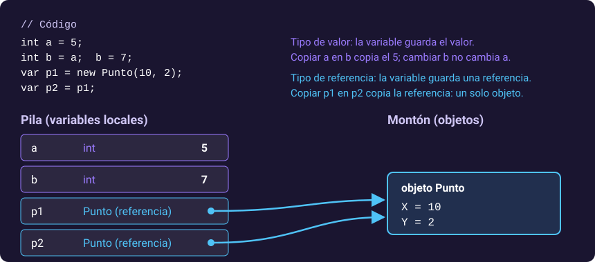

# 3. Estructura de un programa, tipos y operadores

[⬅️ Volver a la unidad](./README.md)

**CE que trabaja este tema:** prepara RA1 e, f.

## Índice

- [3.1. La estructura de un programa](#31-la-estructura-de-un-programa)
  - [3.1.1. Instrucciones de nivel superior](#311-instrucciones-de-nivel-superior)
  - [3.1.2. El método `Main`](#312-el-método-main)
  - [3.1.3. Espacios de nombres y `using`](#313-espacios-de-nombres-y-using)
  - [3.1.4. Comentarios](#314-comentarios)
- [3.2. Variables y tipos](#32-variables-y-tipos)
  - [3.2.1. Los tipos predefinidos](#321-los-tipos-predefinidos)
  - [3.2.2. `var`: el compilador deduce el tipo](#322-var-el-compilador-deduce-el-tipo)
  - [3.2.3. Constantes](#323-constantes)
- [3.3. Tipos de valor y tipos de referencia](#33-tipos-de-valor-y-tipos-de-referencia)
- [3.4. Operadores](#34-operadores)
- [3.5. Conversiones entre tipos](#35-conversiones-entre-tipos)
  - [3.5.1. Conversiones implícitas y explícitas](#351-conversiones-implícitas-y-explícitas)
  - [3.5.2. De texto a número: `Parse`, `TryParse` y `Convert`](#352-de-texto-a-número-parse-tryparse-y-convert)
  - [3.5.3. La cultura: comas y puntos](#353-la-cultura-comas-y-puntos)
- [3.6. Cadenas de texto](#36-cadenas-de-texto)
  - [3.6.1. Interpolación y formato](#361-interpolación-y-formato)
  - [3.6.2. Métodos de `string`](#362-métodos-de-string)
  - [3.6.3. Literales especiales](#363-literales-especiales)
- [3.7. Fechas y horas](#37-fechas-y-horas)
- [3.8. Tipos de valor que admiten `null`](#38-tipos-de-valor-que-admiten-null)
- [3.9. Entrada y salida por consola](#39-entrada-y-salida-por-consola)
- [3.10. Ejemplo integrador: ticket de compra](#310-ejemplo-integrador-ticket-de-compra)
- [Resumen](#resumen)
- [Ejercicios de reflexión](#ejercicios-de-reflexión)

---

## 3.1. La estructura de un programa

### 3.1.1. Instrucciones de nivel superior

El programa más corto en C# es una línea:

```csharp
Console.WriteLine("Hola, 2DAM");
// Salida: Hola, 2DAM
```

Es un fichero `Program.cs` con **instrucciones de nivel superior** (*top-level statements*, C# 9): instrucciones escritas directamente en el fichero, sin clase ni método alrededor. El compilador genera por ti la clase y el método de entrada. Solo un fichero del proyecto puede tenerlas, y es el que se ejecuta al arrancar.

Dentro de ese fichero puedes declarar variables, escribir bucles y **funciones locales**:

```csharp
var nombre = "Ana";
Saludar(nombre);

void Saludar(string quien)
{
    Console.WriteLine($"Hola, {quien}");
}
// Salida: Hola, Ana
```

### 3.1.2. El método `Main`

Lo que el compilador genera es la forma clásica, que verás en mucho código y en la documentación antigua:

```csharp
namespace Saludo;

internal class Program
{
    private static void Main(string[] args)
    {
        Console.WriteLine("Hola, 2DAM");
    }
}
```

`Main` es el **punto de entrada**: el método que el CLR llama al arrancar. `args` contiene los argumentos que se pasan al programa desde la terminal. En esta unidad se usan las instrucciones de nivel superior en los programas de consola.

> 🔁 **Transferencia**: Casi todos los lenguajes tienen un punto de entrada: `main` en C, C++, Java o Kotlin, `if __name__ == "__main__":` en Python. Las instrucciones de nivel superior de C# se parecen a un *script* de Python: el fichero empieza a ejecutarse por arriba.

### 3.1.3. Espacios de nombres y `using`

Un **espacio de nombres** (*namespace*) agrupa tipos relacionados y evita choques de nombres: puede haber una clase `Factura` en `Facturacion.Modelos` y otra en `Contabilidad`. Se declara al principio del fichero, con **ámbito de fichero** (C# 10):

```csharp
namespace NotaFinal.Logica;

public static class CalculadoraNota
{
    // …
}
```

Para usar un tipo de otro espacio de nombres, se escribe su nombre completo o se importa con `using`:

```csharp
using System.Globalization;   // a partir de aquí, CultureInfo se puede usar sin prefijo
using NotaFinal.Logica;

CultureInfo.CurrentCulture = new CultureInfo("es-ES");
var nota = CalculadoraNota.Calcular(6, 8, 7, 9);
```

Con `<ImplicitUsings>enable</ImplicitUsings>` en el `.csproj`, el compilador añade solo los `using` más comunes (`System`, `System.IO`, `System.Linq`, `System.Collections.Generic`, `System.Threading.Tasks`…). Por eso puedes usar `Console` o `List<T>` sin escribir ningún `using`.

> ✅ **Buena práctica**: El nombre del espacio de nombres sigue la estructura de carpetas: el fichero `NotaFinal.Logica/Modelos/Alumno.cs` declara `namespace NotaFinal.Logica.Modelos;`. Visual Studio lo hace así al crear una clase.

### 3.1.4. Comentarios

```csharp
// Comentario de una línea

/* Comentario
   de varias líneas */

/// <summary>
/// Comentario de documentación: describe un miembro público. Visual Studio lo
/// muestra en IntelliSense y se puede convertir en documentación (tema 12).
/// </summary>
```

---

## 3.2. Variables y tipos

C# es un lenguaje de **tipado estático**: cada variable tiene un tipo que se conoce al compilar y no cambia. El compilador detecta así muchos errores antes de ejecutar.

### 3.2.1. Los tipos predefinidos

| Tipo C# | Tipo .NET | Para qué | Literal |
|---------|-----------|----------|---------|
| `int` | `Int32` | Enteros (±2 100 millones) | `42`, `1_000_000` |
| `long` | `Int64` | Enteros grandes | `42L` |
| `double` | `Double` | Decimales para cálculo científico o medidas | `3.14`, `1e-3` |
| `float` | `Single` | Decimales con menos precisión (gráficos) | `3.14f` |
| `decimal` | `Decimal` | **Dinero** y cálculos que deben ser exactos en base 10 | `19.99m` |
| `bool` | `Boolean` | Verdadero o falso | `true`, `false` |
| `char` | `Char` | Un carácter Unicode | `'A'` |
| `string` | `String` | Texto | `"Hola"` |
| `object` | `Object` | Cualquier cosa (todos los tipos derivan de él) | |

Las dos columnas son lo mismo: `int` es un **alias** de `System.Int32`. Por convención, se usa el alias.

> ⚠️ **Cuidado**: `double` guarda los números en binario y no puede representar exactamente valores como 0,1. Por eso `0.1 + 0.2 == 0.3` es `false`. Para dinero usa siempre **`decimal`**: `0.1m + 0.2m == 0.3m` es `true`.

**Los sufijos de los literales.** La letra que va pegada al final de un número (la `m` de `19.99m`, la `L` de `42L` o la `f` de `3.14f`) es un **sufijo**: le dice al compilador de qué tipo es ese literal. Sin sufijo, un número entero es `int` y un número con punto decimal es `double`. Por eso:

```csharp
decimal precio = 19.99;     // ❌ no compila: 19.99 es un double
decimal precio = 19.99m;    // ✅ la m hace que el literal sea decimal
float ancho = 3.14;         // ❌ no compila por lo mismo
float ancho = 3.14f;        // ✅
```

El primer error es el CS0664, y el propio mensaje propone añadir el sufijo `M`. C# no convierte solo de `double` a `decimal` porque no es una conversión exacta: el `double` ya podría haber perdido precisión. La `m` se suele recordar como la de *money* («dinero»). Los sufijos se pueden escribir en mayúscula o en minúscula (`19.99M` es lo mismo que `19.99m`), pero en `long` se usa siempre la `L` mayúscula, porque la `l` minúscula se confunde con un 1.

### 3.2.2. `var`: el compilador deduce el tipo

```csharp
var edad = 20;              // int
var precio = 19.99m;        // decimal
var nombre = "Ana";         // string
var alumnos = new List<string>();   // List<string>
```

`var` **no** es un tipo dinámico: el compilador deduce el tipo de la parte derecha y la variable queda con ese tipo para siempre. `edad = "veinte";` no compila.

> ✅ **Buena práctica**: Usa `var` cuando el tipo es evidente por la parte derecha (`new`, un literal, una conversión). Escribe el tipo cuando no lo es: `decimal total = CalcularTotal();` se lee mejor que `var total = CalcularTotal();`.

### 3.2.3. Constantes

```csharp
const double Iva = 0.21;
const string Prefijo = "ES-";
```

Una constante (`const`) se fija al compilar y no puede cambiar. Solo puede ser de un tipo predefinido (números, `bool`, `char`, `string`). Las constantes se nombran en `PascalCase`. En el tema 5 verás `readonly`, para valores que se fijan al crear un objeto.

---

## 3.3. Tipos de valor y tipos de referencia

Esta es una de las diferencias más importantes de C# respecto a otros lenguajes, y la causa de muchos errores difíciles de ver. Los tipos de .NET se dividen en dos grupos:

| | Tipos de valor | Tipos de referencia |
|---|----------------|---------------------|
| Ejemplos | `int`, `double`, `decimal`, `bool`, `char`, `DateTime`, `DateOnly`, `TimeSpan`, los `enum` y los `struct` | `string`, los arrays, las `class`, las interfaces, los delegados |
| La variable guarda | El **valor** | Una **referencia** al objeto, que está en el montón |
| Al asignar o pasar a un método | Se **copia** el valor | Se copia la referencia: **las dos variables apuntan al mismo objeto** |
| Valor por defecto | `0`, `false`… | `null` |



La figura muestra lo que ocurre en memoria: `a` y `b` tienen cada una su valor; `p1` y `p2` comparten el mismo objeto. Cambiar `p2.X` cambia también lo que ve `p1`.

```csharp
public class PuntoClase { public int X; }      // tipo de referencia
public struct PuntoStruct { public int X; }    // tipo de valor

var c1 = new PuntoClase { X = 1 };
var c2 = c1;            // copia la referencia
c2.X = 99;
Console.WriteLine(c1.X); // 99: c1 y c2 son el mismo objeto

var s1 = new PuntoStruct { X = 1 };
var s2 = s1;            // copia el valor
s2.X = 99;
Console.WriteLine(s1.X); // 1: s2 es una copia independiente
```

`string` es un tipo de referencia, pero es **inmutable**: ningún método lo modifica, todos devuelven una cadena nueva. Por eso se comporta como un valor:

```csharp
var original = "hola";
var mayusculas = original.ToUpper();
Console.WriteLine(original);   // hola: no ha cambiado
Console.WriteLine(mayusculas); // HOLA
```

> 📝 **Nota del Profesor**: No hace falta que sepas cómo se organiza la memoria por dentro. Lo que importa es la **consecuencia**: si pasas un objeto de una clase a un método y el método lo cambia, **el cambio se ve fuera**. Si pasas un `int`, un `DateTime` o un `struct`, el método trabaja con una copia.

> 💡 **Tip del Examinador**: «¿Qué muestra este código: `var lista1 = new List<int> { 1 }; var lista2 = lista1; lista2.Add(2); Console.WriteLine(lista1.Count);`?» Muestra **2**: `List<T>` es una clase, así que `lista1` y `lista2` son la misma lista.

---

## 3.4. Operadores

Los operadores de C# son los de la familia de C, así que te resultarán conocidos:

| Tipo | Operadores | Particularidades |
|------|-----------|------------------|
| Aritméticos | `+ - * / %` | `/` entre enteros es **división entera**: `7 / 2` es `3` |
| Incremento | `++ --` | `i++` devuelve el valor anterior; `++i`, el nuevo |
| Asignación compuesta | `+= -= *= /= %= ??=` | `total += precio;` |
| Comparación | `== != < > <= >=` | Con `string`, `==` compara el **contenido** |
| Lógicos | `&& \|\| !` | Cortocircuito: `b` no se evalúa en `a && b` si `a` es `false` |
| Condicional | `condicion ? si : no` | `var texto = nota >= 5 ? "Aprobado" : "Suspenso";` |
| Fusión de `null` | `?? ??=` | `nombre ?? "Anónimo"`: el de la izquierda, o el de la derecha si es `null` (tema 7) |
| Acceso condicional | `?.` | `cliente?.Nombre`: `null` si `cliente` es `null` (tema 7) |
| Tipo | `is as typeof` | `if (archivo is Documento doc)` (tema 6) |

> ⚠️ **Cuidado**: La división entera es la causa de muchos errores en cálculos: `int aprobados = 3, total = 4; double porcentaje = aprobados / total * 100;` da **0**, porque `3 / 4` es 0 antes de convertirse en `double`. Basta con que uno de los operandos sea decimal: `aprobados * 100.0 / total` da 75.

---

## 3.5. Conversiones entre tipos

### 3.5.1. Conversiones implícitas y explícitas

```csharp
int entero = 42;
long largo = entero;          // implícita: no se pierde información
double real = entero;         // implícita

double precio = 19.99;
int truncado = (int)precio;   // explícita (cast): se pierden los decimales → 19
decimal exacto = (decimal)precio;
```

El compilador permite sin más las conversiones que no pierden información. Las que pueden perderla exigen un **cast** `(tipo)`: es tu forma de decir «sé lo que hago».

### 3.5.2. De texto a número: `Parse`, `TryParse` y `Convert`

Todo lo que escribe el usuario llega como **texto**. Para usarlo como número hay que convertirlo, y el usuario puede escribir cualquier cosa.

| Forma | Si el texto no es válido | Cuándo usarla |
|-------|--------------------------|---------------|
| `int.Parse(texto)` | Lanza `FormatException` | Cuando el texto **tiene** que ser válido (por ejemplo, viene de un fichero tuyo) |
| `int.TryParse(texto, out var n)` | Devuelve `false` y deja `n` a 0 | **Siempre que el texto venga del usuario** |
| `Convert.ToInt32(texto)` | Lanza `FormatException` (y con `null` devuelve 0) | Para convertir entre tipos variados (`object`, `bool`…); poco útil con texto |

```csharp
Console.Write("Edad: ");
var texto = Console.ReadLine();

if (int.TryParse(texto, out var edad))
{
    Console.WriteLine($"El año que viene tendrás {edad + 1} años");
}
else
{
    Console.WriteLine($"❌ «{texto}» no es un número");
}
```

`TryParse` devuelve un `bool` (si ha podido convertir) y deja el resultado en el parámetro **`out`** (tema 4). `out var edad` declara la variable en el mismo sitio.

> 🔁 **Transferencia**: La idea de «intentar convertir sin lanzar excepción» aparece en todos los entornos: `Integer.parseInt` con `try`/`catch` en Java, `toIntOrNull()` en Kotlin, `int()` con `try` en Python.

### 3.5.3. La cultura: comas y puntos

¿«7,5» es un número? Depende del país: en España el separador decimal es la coma; en Estados Unidos, el punto. .NET usa la **cultura** del sistema para convertir y mostrar números y fechas:

```csharp
using System.Globalization;

CultureInfo.CurrentCulture = new CultureInfo("es-ES");
Console.WriteLine(double.Parse("7,5"));   // 7,5
Console.WriteLine(1234.5m.ToString("N2")); // 1.234,50

// Para datos que no son del usuario (ficheros, JSON), cultura invariable:
var valor = double.Parse("7.5", CultureInfo.InvariantCulture);
```

Los programas de consola de la unidad fijan la cultura `es-ES` al principio para que se comporten igual en cualquier ordenador.

> ⚠️ **Cuidado**: Un programa que funciona en tu equipo puede fallar en otro configurado en otro idioma. Para los datos que lee o escribe el propio programa (ficheros de configuración, JSON, bases de datos) usa siempre `CultureInfo.InvariantCulture`; para lo que ve y escribe el usuario, su cultura.

---

## 3.6. Cadenas de texto

### 3.6.1. Interpolación y formato

La **interpolación** (`$"…"`) inserta expresiones en un texto entre llaves. Detrás de `:` va el **formato**, y detrás de `,`, el **ancho** (positivo, alineado a la derecha; negativo, a la izquierda):

```csharp
var producto = "Teclado";
var precio = 1234.5m;
var unidades = 3;

Console.WriteLine($"{producto}: {precio:N2} € × {unidades} = {precio * unidades:C}");
// Teclado: 1.234,50 € × 3 = 3.703,50 €

Console.WriteLine($"|{producto,-10}|{precio,10:F1}|");
// |Teclado   |    1234,5|
```

| Formato | Significado | `1234.567` con `es-ES` |
|---------|-------------|------------------------|
| `F2` | Dos decimales | `1234,57` |
| `N2` | Separador de miles y dos decimales | `1.234,57` |
| `C` | Moneda de la cultura | `1.234,57 €` |
| `P1` | Porcentaje (multiplica por 100) | Con `0.256`: `25,6 %` |
| `D4` | Entero con al menos cuatro cifras | Con `7`: `0007` |

### 3.6.2. Métodos de `string`

| Método | Ejemplo | Resultado |
|--------|---------|-----------|
| `Trim()` | `"  Ana  ".Trim()` | `"Ana"` |
| `ToUpper()`, `ToLower()` | `"Ana".ToUpper()` | `"ANA"` |
| `Contains`, `StartsWith`, `EndsWith` | `"Ana López".Contains("lóp", StringComparison.OrdinalIgnoreCase)` | `true` |
| `Replace` | `"1234 BCD".Replace(" ", "")` | `"1234BCD"` |
| `Split` | `"a;b;c".Split(';')` | `["a", "b", "c"]` |
| `string.Join` | `string.Join(", ", nombres)` | `"Ana, Luis"` |
| `IndexOf` | `"ana@correo.es".IndexOf('@')` | `3` |
| Rangos e índices | `"C15"[1..]`, `"Hola"[^1]` | `"15"`, `'a'` |
| `string.IsNullOrWhiteSpace` | `string.IsNullOrWhiteSpace("  ")` | `true` |
| `Length` | `"Hola".Length` | `4` |

> ✅ **Buena práctica**: Para comparar textos que escribe el usuario (nombres, correos, matrículas), indica siempre si importan las mayúsculas: `string.Equals(a, b, StringComparison.OrdinalIgnoreCase)`. Comparar con `==` hace que «Ana» y «ana» sean distintos.

Como `string` es inmutable, construir un texto largo con `+=` dentro de un bucle crea muchas cadenas intermedias. Para eso existe **`StringBuilder`**:

```csharp
using System.Text;

var texto = new StringBuilder();
for (var i = 1; i <= 3; i++)
{
    texto.Append($"Fila {i}").AppendLine();
}

Console.Write(texto.ToString());
```

### 3.6.3. Literales especiales

```csharp
var ruta = @"C:\Users\ana\Documentos";        // literal literal: \ no escapa nada
var json = """
    { "nombre": "Ana", "edad": 20 }
    """;                                      // literal sin procesar (C# 11): comillas sin escapar
var plantilla = $$"""{ "nombre": "{{nombre}}" }""";   // sin procesar e interpolado
```

---

## 3.7. Fechas y horas

| Tipo | Representa | Ejemplo |
|------|------------|---------|
| `DateTime` | Fecha y hora | `new DateTime(2024, 10, 7, 18, 30, 0)`, `DateTime.Now` |
| `DateOnly` | Solo fecha (.NET 6) | `new DateOnly(2024, 10, 7)`, `DateOnly.FromDateTime(DateTime.Today)` |
| `TimeOnly` | Solo hora (.NET 6) | `new TimeOnly(18, 30)` |
| `TimeSpan` | Una duración | `TimeSpan.FromMinutes(90)`, `fin - inicio` |

```csharp
var alta = new DateOnly(2024, 9, 1);
var hoy = new DateOnly(2024, 10, 7);
Console.WriteLine($"{alta:dd/MM/yyyy} · {hoy.DayNumber - alta.DayNumber} días");
// 01/09/2024 · 36 días

var duracion = TimeSpan.FromSeconds(330);
Console.WriteLine($"{duracion:mm\\:ss}");   // 05:30
```

Todos son **tipos de valor** e **inmutables**: `fecha.AddDays(1)` devuelve otra fecha y no cambia la original.

> ✅ **Buena práctica**: En la lógica, no uses `DateTime.Now` directamente: recibe la fecha como parámetro. Así las pruebas no dependen del día en que se ejecutan.

---

## 3.8. Tipos de valor que admiten `null`

A veces un dato puede **no tener valor**: la nota de un examen que aún no se ha hecho, la fecha de baja de un socio que sigue activo. Un `int` no puede ser `null`, pero un **`int?`** sí:

```csharp
int? notaExamen = null;
DateOnly? fechaBaja = null;

if (notaExamen.HasValue)
{
    Console.WriteLine($"Nota: {notaExamen.Value}");
}

var nota = notaExamen ?? 0;                     // 0 si no hay nota
Console.WriteLine(notaExamen?.ToString() ?? "sin nota");
```

`int?` es una forma corta de escribir `Nullable<int>`. En el tema 7 verás lo mismo para los tipos de referencia (`string?`).

---

## 3.9. Entrada y salida por consola

| Método | Hace |
|--------|------|
| `Console.WriteLine(texto)` | Escribe y salta de línea |
| `Console.Write(texto)` | Escribe sin saltar de línea (para preguntas) |
| `Console.ReadLine()` | Lee una línea. Devuelve `string?`: `null` si no hay más entrada |

Dos ajustes que verás al principio de todos los programas de consola de la unidad:

```csharp
using System.Globalization;
using System.Text;

Console.OutputEncoding = Encoding.UTF8;               // para que los emojis se vean en Windows
CultureInfo.CurrentCulture = new CultureInfo("es-ES"); // coma decimal y formato español
```

> 📝 **Nota del Profesor**: En esta unidad, la consola es la forma de pedir y mostrar datos. Por eso es tan importante que la lógica no dependa de ella: en la UD3, con interfaces gráficas, la entrada y la salida cambiarán y la lógica tendrá que seguir sirviendo.

---

## 3.10. Ejemplo integrador: ticket de compra

Un programa que junta lo del tema: constantes, `decimal`, conversión segura, interpolación con formato y ancho, y `string.Join`.

```csharp
using System.Globalization;
using System.Text;

Console.OutputEncoding = Encoding.UTF8;
CultureInfo.CurrentCulture = new CultureInfo("es-ES");

const decimal Iva = 0.21m;
string[] productos = ["Teclado", "Ratón", "Monitor"];
decimal[] precios = [25.90m, 12.50m, 189.99m];

Console.Write("Unidades de cada producto (separadas por espacios): ");
var partes = (Console.ReadLine() ?? "").Split(' ', StringSplitOptions.RemoveEmptyEntries);

decimal baseImponible = 0;
for (var i = 0; i < productos.Length; i++)
{
    var unidades = i < partes.Length && int.TryParse(partes[i], out var n) ? n : 0;
    var importe = precios[i] * unidades;
    baseImponible += importe;
    Console.WriteLine($"{productos[i],-10}{unidades,3} × {precios[i],7:N2} € = {importe,8:N2} €");
}

var iva = Math.Round(baseImponible * Iva, 2);
Console.WriteLine($"{"Base",-25}{baseImponible,10:N2} €");
Console.WriteLine($"{"IVA (21 %)",-25}{iva,10:N2} €");
Console.WriteLine($"{"Total",-25}{baseImponible + iva,10:N2} €");
```

Si el usuario escribe `2 1 1`:

```text
Teclado     2 ×   25,90 € =    51,80 €
Ratón       1 ×   12,50 € =    12,50 €
Monitor     1 ×  189,99 € =   189,99 €
Base                         254,29 €
IVA (21 %)                    53,40 €
Total                        307,69 €
```

| Concepto | Dónde |
|----------|-------|
| `const` y `decimal` para dinero | `Iva`, `precios` |
| Arrays con expresión de colección (C# 12) | `["Teclado", "Ratón", "Monitor"]` |
| `??` con `ReadLine` | `Console.ReadLine() ?? ""` |
| `Split` sin entradas vacías | `StringSplitOptions.RemoveEmptyEntries` |
| `TryParse` y operador condicional | Si falta el dato o no es número, 0 unidades |
| Formato y ancho | `{precios[i],7:N2}` |

---

## Resumen

- Un programa de consola se escribe con **instrucciones de nivel superior**; el compilador genera la clase y el método **`Main`**.
- Los **espacios de nombres** organizan los tipos; `using` los importa y los *implicit usings* añaden los más comunes.
- C# tiene **tipado estático**. **`var`** deduce el tipo al compilar, pero no lo cambia. Para dinero, **`decimal`**.
- Los **tipos de valor** se copian al asignar; los **tipos de referencia** comparten el objeto. `string` es de referencia pero **inmutable**.
- `/` entre enteros es **división entera**.
- Lo que escribe el usuario se convierte con **`TryParse`**, nunca con `Parse`. La **cultura** decide el separador decimal.
- La **interpolación** `$"{valor,ancho:formato}"` construye textos con formato; `StringBuilder`, textos largos.
- `DateOnly`, `TimeOnly`, `DateTime` y `TimeSpan` para fechas y duraciones.
- **`int?`** es un entero que admite `null`; `??` da un valor por defecto.

## Ejercicios de reflexión

1. Ejecuta `Console.WriteLine(0.1 + 0.2);` y `Console.WriteLine(0.1m + 0.2m);`. Explica la diferencia y pon un ejemplo de aplicación en la que usar `double` sería un error grave.
2. Escribe un método que reciba un `int` y lo incremente, y otro que reciba una `List<int>` y le añada un elemento. Llama a los dos y muestra los valores fuera. ¿Qué cambia y qué no? Relaciónalo con el apartado 3.3.
3. Cambia la cultura del ticket de compra a `en-US` y a `fr-FR`. ¿Qué cambia en la salida? ¿Y si el usuario escribe `1,5` como unidades?
4. ¿Por qué `TryParse` usa un parámetro `out` en lugar de devolver el número? ¿Qué alternativa usa C# 7 para devolver varios valores? (Pista: tuplas, tema 4).
5. Investiga qué diferencia hay entre `DateTime.Now` y `DateTime.UtcNow`. ¿Cuál guardarías en una base de datos compartida por usuarios de varios países?

---

[⬅️ Volver a la unidad](./README.md)
