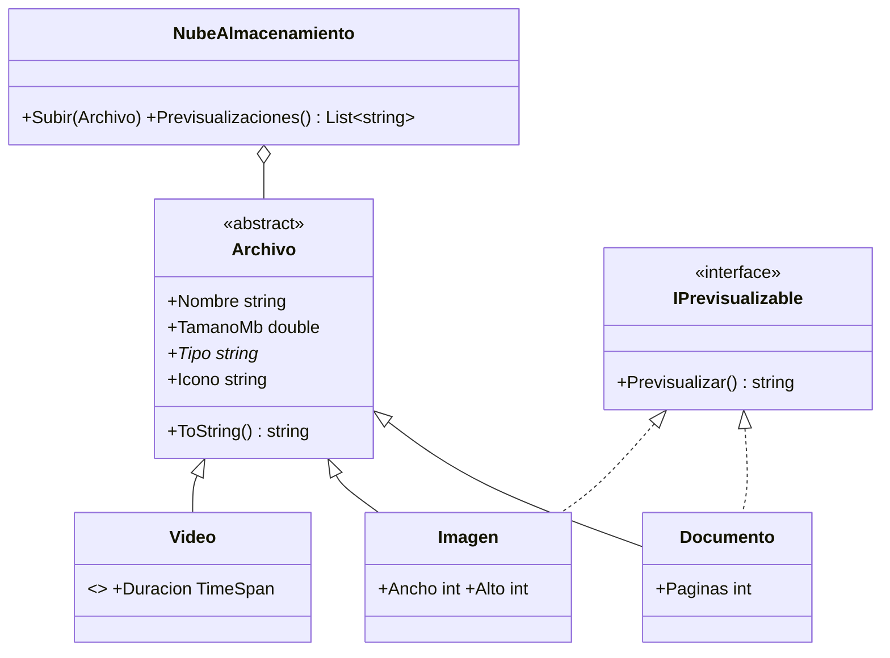
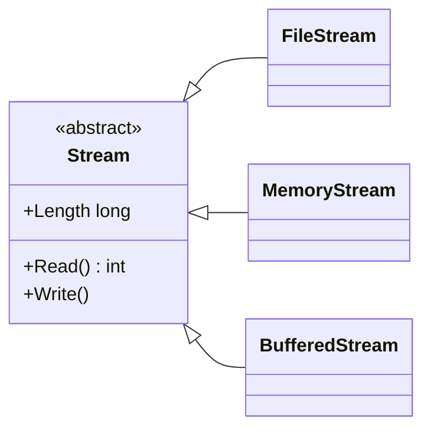

# 6. Herencia, interfaces y polimorfismo

[⬅️ Volver a la unidad](./README.md)

**CE que trabaja este tema:** prepara RA1 a, e (contenidos «clases, propiedades, métodos»).

## Índice

- [6.1. El problema: clases que se repiten](#61-el-problema-clases-que-se-repiten)
- [6.2. Herencia](#62-herencia)
  - [6.2.1. Heredar y llamar al constructor base](#621-heredar-y-llamar-al-constructor-base)
  - [6.2.2. `protected`](#622-protected)
- [6.3. Sobrescribir: `virtual` y `override`](#63-sobrescribir-virtual-y-override)
- [6.4. Clases y miembros abstractos](#64-clases-y-miembros-abstractos)
- [6.5. `sealed`: impedir la herencia](#65-sealed-impedir-la-herencia)
- [6.6. Interfaces](#66-interfaces)
  - [6.6.1. Declarar e implementar](#661-declarar-e-implementar)
  - [6.6.2. Varias interfaces](#662-varias-interfaces)
  - [6.6.3. Interfaces de .NET que usarás](#663-interfaces-de-net-que-usarás)
  - [6.6.4. Implementación por defecto](#664-implementación-por-defecto)
- [6.7. Polimorfismo](#67-polimorfismo)
  - [6.7.1. Trabajar con la clase base](#671-trabajar-con-la-clase-base)
  - [6.7.2. Comprobar el tipo: `is`, `as` y patrones](#672-comprobar-el-tipo-is-as-y-patrones)
- [6.8. Clase abstracta o interfaz](#68-clase-abstracta-o-interfaz)
- [6.9. Composición frente a herencia](#69-composición-frente-a-herencia)
- [6.10. La herencia en la biblioteca de .NET](#610-la-herencia-en-la-biblioteca-de-net)
- [Resumen](#resumen)
- [Ejercicios de reflexión](#ejercicios-de-reflexión)

---

## 6.1. El problema: clases que se repiten

Una aplicación de almacenamiento en la nube guarda documentos, imágenes y vídeos. Todos tienen nombre y tamaño, todos se validan igual y todos se muestran en una lista. Pero cada uno tiene datos propios (páginas, dimensiones, duración) y se muestra con un icono distinto.

Si escribes tres clases independientes, repites el nombre, el tamaño, la validación y el `ToString` tres veces. Y la nube necesitaría tres listas y tres versiones de cada método. Ya conoces las herramientas para evitarlo: **herencia**, **interfaces** y **polimorfismo**. Este tema muestra cómo se expresan en C# y qué tiene C# de particular.

| Concepto conocido | En C# | Lo particular |
|-------------------|-------|---------------|
| Heredar | `class Imagen : Archivo` | Un solo símbolo, `:`, para heredar e implementar |
| Llamar al constructor de la clase base | `: base(nombre, tamanoMb)` | Detrás de la firma del constructor |
| Sobrescribir | `virtual` en la base y `override` en la hija | **Los métodos no se pueden sobrescribir salvo que la base lo permita** |
| Clase o método abstracto | `abstract` | |
| Impedir la herencia | `sealed` | |
| Interfaz | `interface IPrevisualizable` | Nombre con `I`; pueden tener propiedades y eventos |

---

## 6.2. Herencia

### 6.2.1. Heredar y llamar al constructor base

```csharp
public class Archivo
{
    public Archivo(string nombre, double tamanoMb)
    {
        ArgumentException.ThrowIfNullOrWhiteSpace(nombre);
        ArgumentOutOfRangeException.ThrowIfNegativeOrZero(tamanoMb);
        Nombre = nombre.Trim();
        TamanoMb = tamanoMb;
    }

    public string Nombre { get; }
    public double TamanoMb { get; }
}

public class Documento : Archivo
{
    public Documento(string nombre, double tamanoMb, int paginas)
        : base(nombre, tamanoMb)       // primero se ejecuta el constructor de Archivo
    {
        Paginas = paginas;
    }

    public int Paginas { get; }
}
```

- **`: Archivo`** detrás del nombre de la clase indica de quién hereda. Una clase solo puede heredar de **una** clase.
- **`: base(…)`** detrás de la firma del constructor llama al constructor de la clase base, que se ejecuta **antes** que el de la hija.
- Todas las clases heredan, directa o indirectamente, de **`object`**: por eso todas tienen `ToString`, `Equals` y `GetHashCode`.

Con constructores primarios (C# 12), la llamada a la base va en la declaración de la clase:

```csharp
public class Imagen(string nombre, double tamanoMb, int ancho, int alto)
    : Archivo(nombre, tamanoMb)
{
    public int Ancho { get; } = ancho;
    public int Alto { get; } = alto;
}
```

### 6.2.2. `protected`

Un miembro **`protected`** lo ven la clase y sus hijas, pero no el resto. Es útil para dar a las hijas algo que el resto del programa no necesita:

```csharp
public abstract class Archivo
{
    protected Archivo(string nombre, double tamanoMb) { /* … */ }  // solo las hijas pueden llamarlo
}
```

---

## 6.3. Sobrescribir: `virtual` y `override`

Para que una hija pueda cambiar el comportamiento de un método o una propiedad, la clase base lo tiene que **permitir** marcándolo como **`virtual`**. La hija lo sustituye con **`override`**:

```csharp
public class Archivo
{
    // …
    public virtual string Icono => "📄";                  // valor por defecto, se puede sobrescribir

    public override string ToString()                      // object.ToString es virtual
    {
        return $"{Icono} {Nombre} · {TamanoMb:N1} MB";
    }
}

public class Imagen : Archivo
{
    // …
    public override string Icono => "🖼️";
}

public sealed class Video : Archivo
{
    // …
    public override string Icono => "🎬";

    public override string ToString()
    {
        return $"{base.ToString()} · {Duracion:mm\\:ss}";  // amplía la versión de la base
    }
}
```

**`base.Miembro`** llama a la versión de la clase base: así la hija **amplía** el comportamiento en lugar de repetirlo.

> ⚠️ **Cuidado**: En C#, los métodos **no** son virtuales por defecto. Si la base no marca un método como `virtual`, la hija no lo puede sobrescribir. Y si escribes en la hija un método con el mismo nombre **sin** `override`, no sobrescribe: **oculta** el de la base (el compilador avisa con `CS0108` o `CS0114`). Con un método oculto, el polimorfismo no funciona: si tratas la imagen como `Archivo`, se usa el icono de `Archivo`.

> 💡 **Tip del Examinador**: «¿Qué hace falta en C# para que una clase hija pueda cambiar un método de la base?» Que la base lo declare **`virtual`** (o `abstract`) y que la hija lo declare **`override`**.

---

## 6.4. Clases y miembros abstractos

¿Tiene sentido crear un `Archivo` a secas, que no es ni documento ni imagen ni vídeo? No. Una clase **`abstract`** no se puede instanciar: solo sirve de base. Puede tener miembros **`abstract`**, sin implementación, que las hijas **tienen** que implementar:

```csharp
public abstract class Archivo
{
    protected Archivo(string nombre, double tamanoMb) { /* … */ }

    public string Nombre { get; }
    public double TamanoMb { get; }

    public abstract string Tipo { get; }       // cada hija dice cuál es su tipo
    public virtual string Icono => "📄";       // las hijas pueden cambiarlo
}

public class Documento(string nombre, double tamanoMb, int paginas) : Archivo(nombre, tamanoMb)
{
    public override string Tipo => "documento";   // obligatorio
    public int Paginas { get; } = paginas;
}

// var a = new Archivo("x", 1);   // error CS0144: no se puede crear una instancia de una clase abstracta
```

| | `virtual` | `abstract` |
|---|-----------|------------|
| Tiene implementación en la base | Sí | No |
| La hija… | **Puede** sobrescribirlo | **Tiene que** implementarlo |
| La clase puede instanciarse | Sí (si no es abstracta) | No: la clase tiene que ser abstracta |

---

## 6.5. `sealed`: impedir la herencia

Una clase **`sealed`** no se puede heredar:

```csharp
public sealed class Video : Archivo { /* … */ }
// public class VideoHd : Video { }   // error CS0509
```

Se usa cuando heredar no tiene sentido o podría romper el comportamiento de la clase. Muchas clases de .NET son `sealed`, como `string`.

---

## 6.6. Interfaces

### 6.6.1. Declarar e implementar

Una **interfaz** es un contrato: dice **qué** sabe hacer un objeto, sin decir **cómo**. Por convención, su nombre empieza por **`I`**:

```csharp
public interface IPrevisualizable
{
    string Previsualizar();
}

public class Documento(string nombre, double tamanoMb, int paginas)
    : Archivo(nombre, tamanoMb), IPrevisualizable          // hereda de Archivo e implementa la interfaz
{
    public int Paginas { get; } = paginas;
    public override string Tipo => "documento";

    public string Previsualizar() => Paginas == 1 ? "1 página" : $"{Paginas} páginas";
}
```

Los miembros de una interfaz son públicos. Una interfaz puede declarar **métodos**, **propiedades** y **eventos**:

```csharp
public interface IOrigenFacturas
{
    int Total { get; }
    Task<Factura> LeerAsync(int numero, CancellationToken cancelacion = default);
}
```

> ✅ **Buena práctica**: Si la clase no implementa todos los miembros de la interfaz, Visual Studio subraya el nombre de la interfaz. Pulsa Ctrl+. y elige **Implementar interfaz**: genera todos los miembros.

### 6.6.2. Varias interfaces

Una clase hereda de **una** clase como mucho, pero puede implementar **muchas** interfaces:

```csharp
public class Contacto : IConClave, IEquatable<Contacto>, IComparable<Contacto>
{
    // …
}
```

### 6.6.3. Interfaces de .NET que usarás

| Interfaz | Contrato | Quién la usa |
|----------|----------|--------------|
| `IEnumerable<T>` | Se puede recorrer con `foreach` | `foreach`, LINQ (tema 10) |
| `IReadOnlyList<T>` | Lista que se puede leer por índice pero no modificar | Exponer colecciones privadas (tema 8) |
| `IComparable<T>` | Tiene un orden natural (`CompareTo`) | `List<T>.Sort()`, `Order()` |
| `IEquatable<T>` | Sabe compararse con otro del mismo tipo | `Dictionary`, `HashSet`, `Contains` |
| `IDisposable` | Libera recursos (`Dispose`) | `using` (tema 7) |
| `IProgress<T>` | Recibe avisos de progreso | Tareas largas (tema 11) |

> 🔁 **Transferencia**: El mismo patrón —«dime qué sabes hacer y te usaré»— está en todos los *frameworks*: los *listeners* de Android, los `Comparable` y `Iterable` de Java, los protocolos de Swift, los *traits* de Rust. Un *framework* define interfaces y tu código las implementa para que el *framework* lo use.

### 6.6.4. Implementación por defecto

Desde C# 8, una interfaz puede dar una implementación por defecto a un miembro. Las clases que no lo implementan usan esa:

```csharp
public interface IConClave
{
    string Clave { get; }
    string ClaveNormalizada => Clave.Trim().ToUpperInvariant();   // implementación por defecto
}
```

Se usa sobre todo para **añadir** un miembro a una interfaz que ya implementan muchas clases sin obligarlas a cambiar. En el módulo lo usarás poco.

---

## 6.7. Polimorfismo

### 6.7.1. Trabajar con la clase base

El **polimorfismo** permite escribir código que trabaja con la clase base (o con una interfaz) y que, en ejecución, usa el comportamiento de la **clase real** de cada objeto:

```csharp
Archivo[] archivos =
[
    new Documento("memoria.pdf", 2.5, 34),
    new Imagen("portada.png", 4.2, 1920, 1080),
    new Video("clase.mp4", 320, TimeSpan.FromMinutes(42.5)),
];

foreach (var archivo in archivos)
{
    Console.WriteLine(archivo);    // cada uno con su icono y su formato
}
// 📄 memoria.pdf · documento · 2,5 MB
// 🖼️ portada.png · imagen · 4,2 MB
// 🎬 clase.mp4 · vídeo · 320,0 MB · 42:30
```

La nube no sabe que existen documentos, imágenes o vídeos: guarda una `List<Archivo>`. Si mañana se añade la clase `Audio`, la nube no cambia.



El diagrama muestra la jerarquía del ejercicio E03: las flechas continuas son herencia, las discontinuas implementan la interfaz, y el rombo indica que la nube contiene archivos. La nube solo depende de `Archivo`.

### 6.7.2. Comprobar el tipo: `is`, `as` y patrones

A veces necesitas saber si un objeto es de un tipo concreto o implementa una interfaz:

```csharp
foreach (var archivo in archivos)
{
    if (archivo is IPrevisualizable previsualizable)      // comprueba y convierte a la vez
    {
        Console.WriteLine($"{archivo.Nombre}: {previsualizable.Previsualizar()}");
    }
}

var doc = archivo as Documento;                           // null si no es un Documento
var paginas = archivo is Documento { Paginas: > 100 } ? "largo" : "corto";   // patrón de propiedad

var descripcion = archivo switch                          // patrón de tipo en una expresión switch
{
    Documento d => $"{d.Paginas} páginas",
    Imagen i => $"{i.Ancho}×{i.Alto}",
    Video v => $"{v.Duracion.TotalMinutes:N0} min",
    _ => "desconocido",
};
```

| Forma | Si no es del tipo | Úsala para |
|-------|-------------------|------------|
| `x is T t` | `false` | Comprobar y usar en el mismo `if` (la más habitual) |
| `x as T` | `null` | Convertir cuando el `null` se va a comprobar después |
| `(T)x` | Lanza `InvalidCastException` | Convertir cuando **sabes** que es de ese tipo |

> ⚠️ **Cuidado**: Si te encuentras muchos `is Documento`, `is Imagen`, `is Video` repartidos por el código, probablemente falte polimorfismo: ese comportamiento debería ser un método `virtual` o `abstract` de `Archivo`, o una interfaz. Cada `is` con un tipo concreto es un sitio que habrá que cambiar cuando aparezca un tipo nuevo.

---

## 6.8. Clase abstracta o interfaz

| | Clase abstracta | Interfaz |
|---|-----------------|----------|
| Puede tener estado (campos) | Sí | No |
| Puede tener constructores | Sí | No |
| Una clase puede tener… | Una sola base | Muchas interfaces |
| Representa | **Qué es** (un documento *es* un archivo) | **Qué sabe hacer** (*se puede* previsualizar) |
| Úsala cuando | Las clases comparten datos y código | Clases sin relación comparten una capacidad |

En el E03 se usan las dos: `Archivo` es una clase abstracta porque todos los archivos comparten nombre, tamaño, validación y `ToString`; `IPrevisualizable` es una interfaz porque la capacidad de previsualizarse la tienen algunos archivos y no otros.

---

## 6.9. Composición frente a herencia

La herencia expresa una relación **«es un»**: un documento *es* un archivo. Cuando la relación es **«tiene un»** o **«usa un»**, la solución es la **composición**: un objeto guarda otro y le delega trabajo.

```csharp
// ❌ Herencia mal usada: una agenda no «es» un repositorio
public class Agenda : Repositorio<Contacto> { }

// ✅ Composición: la agenda «tiene» un repositorio y decide qué expone
public class Agenda(int capacidad = 10)
{
    private readonly Repositorio<Contacto> _contactos = new(capacidad);

    public int Cantidad => _contactos.Cantidad;
    public bool Existe(string nombre) => _contactos.Existe(nombre);
}
```

Con herencia, la agenda expondría **todos** los métodos públicos del repositorio, incluidos los que no tienen sentido para una agenda, y cualquier cambio del repositorio afectaría a la agenda. Con composición, la agenda decide qué ofrece.

> ✅ **Buena práctica**: «Favorece la composición sobre la herencia». Usa herencia cuando haya una relación «es un» clara y quieras polimorfismo; en los demás casos, compón.

---

## 6.10. La herencia en la biblioteca de .NET

Las clases de .NET forman jerarquías que usas sin darte cuenta. Ya conoces la de las excepciones (tema 7). Otra muy útil es la de los **flujos de datos**: la clase abstracta `Stream` representa «algo de lo que se leen o en lo que se escriben bytes», y cada hija lo hace sobre un soporte distinto.



`StreamReader` lee texto de **cualquier** `Stream`: un fichero, un bloque de memoria o una conexión de red. Es polimorfismo: trabaja con la clase base y no le importa cuál es la hija.

```csharp
using System.Text;

Stream[] origenes =
[
    new MemoryStream(Encoding.UTF8.GetBytes("Primera línea en memoria\nSegunda")),
    File.OpenRead("datos.txt"),          // un fichero de texto junto al programa
];

foreach (var origen in origenes)
{
    using var lector = new StreamReader(origen);   // el mismo código para los dos
    Console.WriteLine(lector.ReadLine());
}
```

> 📝 **Nota del Profesor**: Cuando no encuentres un método o una propiedad en la documentación de una clase de .NET, sube por su jerarquía de herencia: casi siempre está definido en una clase base. La documentación de Microsoft muestra la jerarquía de cada clase. Lo mismo te pasará en la UD3 con los componentes de las interfaces gráficas.

---

## Resumen

- **`:`** sirve para heredar de una clase (solo una) e implementar interfaces (las que quieras).
- **`: base(…)`** llama al constructor de la clase base, que se ejecuta primero. Todas las clases heredan de **`object`**.
- **`protected`**: visible para la clase y sus hijas.
- Un miembro solo se puede sobrescribir si la base lo declara **`virtual`** o **`abstract`**; la hija usa **`override`**. Sin `override`, se **oculta** y el polimorfismo no funciona.
- **`base.Miembro`** llama a la versión de la clase base.
- Una clase **`abstract`** no se instancia; sus miembros `abstract` los implementan las hijas. Una clase **`sealed`** no se hereda.
- Una **interfaz** (con `I` delante) es un contrato de métodos, propiedades y eventos. Ctrl+. implementa todos sus miembros.
- El **polimorfismo** permite trabajar con la clase base o la interfaz y obtener el comportamiento de la clase real.
- **`is T t`** comprueba y convierte; **`as`** devuelve `null` si no puede; los patrones de tipo funcionan en `switch`. Muchos `is` con tipos concretos indican que falta polimorfismo.
- Clase abstracta para lo que las clases **son** y comparten; interfaz para lo que **saben hacer**. **Composición** para «tiene un».
- Las clases de .NET forman **jerarquías de herencia** (`Exception`, `Stream`) que se aprovechan con polimorfismo.

## Ejercicios de reflexión

1. Quita `override` de `Icono` en `Imagen` y ejecuta el E03. ¿Qué icono aparece y por qué? ¿Qué aviso da el compilador?
2. Diseña con un diagrama de clases la jerarquía de los usuarios de una aplicación: `Usuario`, `Alumno`, `Profesor` y `Administrador`. ¿Qué sería abstracto? ¿Qué capacidades serían interfaces (por ejemplo, `IPuedeCalificar`)?
3. En un proyecto alguien escribe `class Coche : Motor` «porque el coche usa el motor». ¿Qué problema tiene? ¿Cómo lo resolverías?
4. Busca en la documentación de Microsoft la jerarquía de herencia de `FileStream`. ¿En qué clase está definido `Length`? ¿Y `ReadByte`? ¿Por qué crees que `Stream` es abstracta?
5. ¿Por qué crees que los diseñadores de C# decidieron que los métodos **no** fueran virtuales por defecto? Busca argumentos a favor y en contra.

---

[⬅️ Volver a la unidad](./README.md)
