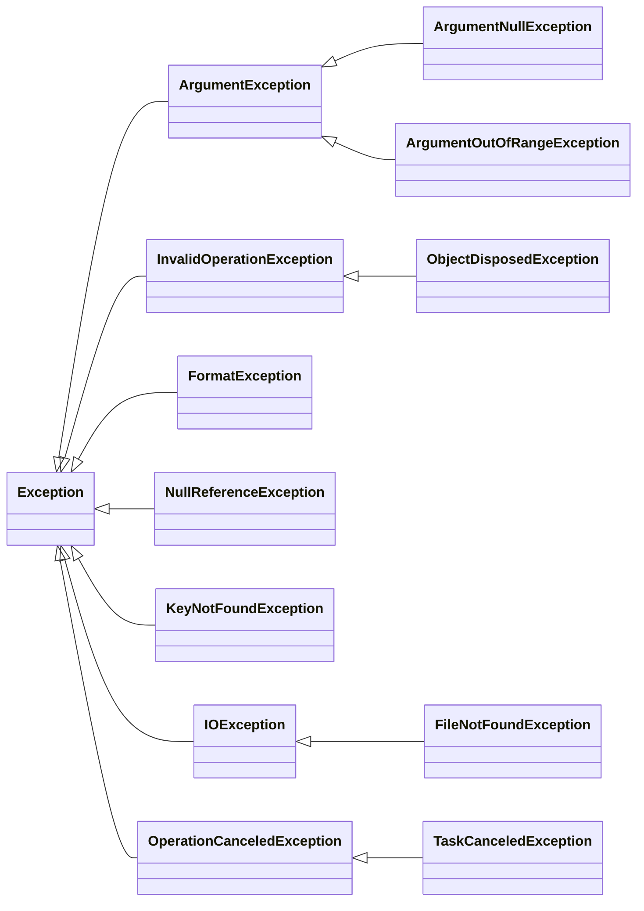

# 7. Excepciones y tipos que admiten null

[⬅️ Volver a la unidad](./README.md)

**CE que trabaja este tema:** prepara RA1 f (contenidos «clases, propiedades, métodos»).

## Índice

- [7.1. Excepciones en C#](#71-excepciones-en-c)
- [7.2. La jerarquía de excepciones](#72-la-jerarquía-de-excepciones)
- [7.3. Lanzar excepciones](#73-lanzar-excepciones)
  - [7.3.1. Qué excepción lanzar](#731-qué-excepción-lanzar)
  - [7.3.2. Métodos de ayuda y `throw` como expresión](#732-métodos-de-ayuda-y-throw-como-expresión)
- [7.4. Capturar excepciones](#74-capturar-excepciones)
  - [7.4.1. `try`, `catch` y `finally`](#741-try-catch-y-finally)
  - [7.4.2. Filtros con `when`](#742-filtros-con-when)
  - [7.4.3. Volver a lanzar](#743-volver-a-lanzar)
  - [7.4.4. Qué capturar y qué no](#744-qué-capturar-y-qué-no)
- [7.5. `using` y la liberación de recursos](#75-using-y-la-liberación-de-recursos)
- [7.6. Excepciones propias](#76-excepciones-propias)
- [7.7. ¿Excepción, `bool` o `null`?](#77-excepción-bool-o-null)
- [7.8. Tipos de referencia que admiten `null`](#78-tipos-de-referencia-que-admiten-null)
  - [7.8.1. El problema](#781-el-problema)
  - [7.8.2. `string` y `string?`](#782-string-y-string)
  - [7.8.3. Los operadores para `null`](#783-los-operadores-para-null)
  - [7.8.4. Los avisos más comunes](#784-los-avisos-más-comunes)
- [7.9. Ejemplo integrador: leer una configuración](#79-ejemplo-integrador-leer-una-configuración)
- [Resumen](#resumen)
- [Ejercicios de reflexión](#ejercicios-de-reflexión)

---

## 7.1. Excepciones en C#

Ya conoces las excepciones: un mecanismo para señalar que algo ha ido mal y que el código que llama decida qué hacer. En C# funcionan como en otros lenguajes, con tres particularidades:

| Concepto conocido | En C# | Lo particular |
|-------------------|-------|---------------|
| Lanzar | `throw new X(…)` | `throw` también puede ser una **expresión** (dentro de `??` o `? :`) |
| Capturar | `try`, `catch`, `finally` | Filtros con **`when`** |
| Declarar las excepciones de un método | — | **No se declaran**: ninguna excepción es «comprobada» por el compilador. Se documentan con `/// <exception>` |
| Liberar recursos | `using` | `using var` libera al final del bloque |

Y un mecanismo del compilador que no tienen muchos lenguajes: los **avisos de `null`** (apartado 7.8).

---

## 7.2. La jerarquía de excepciones

Todas las excepciones heredan de **`System.Exception`**. Las que más verás:



Como la jerarquía es de **herencia**, un `catch (ArgumentException)` captura también las `ArgumentNullException` y las `ArgumentOutOfRangeException`.

Toda excepción tiene un **`Message`** (qué ha pasado), una **`StackTrace`** (dónde: la pila de llamadas) y, a veces, una **`InnerException`** (la excepción original que la causó).

---

## 7.3. Lanzar excepciones

### 7.3.1. Qué excepción lanzar

Usa la excepción de .NET que mejor describa el problema. Así quien llama sabe qué capturar sin leer tu código:

| Situación | Excepción |
|-----------|-----------|
| Un argumento es `null` y no puede serlo | `ArgumentNullException` |
| Un argumento está fuera del rango permitido (importe negativo, nota mayor que 10) | `ArgumentOutOfRangeException` |
| Un argumento no es válido por otro motivo (texto vacío, correo con mal formato) | `ArgumentException` |
| El objeto no está en un estado que permita la operación (reparar un coche que no está en el taller, añadir una tarea repetida) | `InvalidOperationException` |
| Se busca por clave algo que no existe | `KeyNotFoundException` |
| Un texto no tiene el formato esperado al convertirlo | `FormatException` |
| Una operación se ha cancelado | `OperationCanceledException` |
| Un método aún no está hecho | `NotImplementedException` |

> ⚠️ **Cuidado**: Nunca lances `Exception` a secas (`throw new Exception("error")`): quien llama no puede distinguirla de cualquier otra y tendría que capturarlas todas.

### 7.3.2. Métodos de ayuda y `throw` como expresión

.NET trae métodos que comprueban y lanzan en una línea, con el nombre del parámetro y un mensaje estándar:

```csharp
public void Reservar(Socio socio, int horas, string pista)
{
    ArgumentNullException.ThrowIfNull(socio);
    ArgumentOutOfRangeException.ThrowIfNegativeOrZero(horas);
    ArgumentOutOfRangeException.ThrowIfGreaterThan(horas, 3);
    ArgumentException.ThrowIfNullOrWhiteSpace(pista);
    // …
}
```

Para un mensaje propio, lanza la excepción a mano. Pasa el **nombre del parámetro** con **`nameof`**, que se mantiene correcto si renombras el parámetro:

```csharp
if (!Socio.EsEmailValido(email))
{
    throw new ArgumentException($"El correo «{email}» no es válido.", nameof(email));
}
```

`throw` también puede ser una **expresión** dentro de `??`, `? :` o un cuerpo `=>`:

```csharp
var socio = BuscarSocio(id) ?? throw new KeyNotFoundException($"No existe el socio {id}.");

public int Paginas { get; } = paginas > 0 ? paginas : throw new ArgumentOutOfRangeException(nameof(paginas));
```

---

## 7.4. Capturar excepciones

### 7.4.1. `try`, `catch` y `finally`

```csharp
try
{
    cuenta.Retirar(500);
    Console.WriteLine("✅ Retirada hecha");
}
catch (SaldoInsuficienteException ex)
{
    Console.WriteLine($"❌ {ex.Message}");
}
catch (ArgumentOutOfRangeException)
{
    Console.WriteLine("❌ El importe debe ser mayor que cero");
}
finally
{
    Console.WriteLine("Operación terminada");   // se ejecuta siempre, haya excepción o no
}
```

- Los `catch` se prueban **en orden** y se ejecuta el primero que encaja. Pon primero las excepciones **más concretas**: si `catch (ArgumentException)` va antes que `catch (ArgumentOutOfRangeException)`, el segundo no se ejecuta nunca (el compilador lo detecta: error `CS0160`).
- La variable (`ex`) es opcional si no la usas.
- **`finally`** se ejecuta siempre: para liberar recursos o dejar el programa en un estado correcto (por ejemplo, cerrar un fichero).

### 7.4.2. Filtros con `when`

Un filtro decide si un `catch` se aplica, mirando la excepción:

```csharp
catch (Exception ex) when (ex is ArgumentException or InvalidOperationException)
{
    Console.WriteLine($"❌ {ex.Message}");
}

catch (IOException ex) when (ex.Message.Contains("espacio"))
{
    Console.WriteLine("❌ El disco está lleno");
}
```

### 7.4.3. Volver a lanzar

A veces capturas para hacer algo (anotar el error) y quieres que la excepción **siga subiendo**:

```csharp
catch (IOException ex)
{
    registro.Anotar(ex);
    throw;          // ✅ relanza la misma excepción, con su pila de llamadas intacta
}
```

> ⚠️ **Cuidado**: `throw ex;` también relanza, pero **borra la pila de llamadas original**: la traza dirá que el error nació en tu `catch`, y perderás dónde ocurrió de verdad. Usa siempre `throw;`.

Si quieres lanzar una excepción **distinta** que explique el problema en términos de tu aplicación, guarda la original como `InnerException`:

```csharp
catch (JsonException ex)
{
    throw new InvalidDataException($"El fichero {ruta} no tiene el formato esperado.", ex);
}
```

### 7.4.4. Qué capturar y qué no

| ✅ Captura | ❌ No captures |
|-----------|---------------|
| Las excepciones que **esperas** y sabes tratar (saldo insuficiente, fichero que no existe, texto mal escrito) | `Exception` a secas «por si acaso», en mitad de la lógica |
| En el **borde** de la aplicación (el menú de la consola) para mostrar un mensaje claro | `NullReferenceException` o `IndexOutOfRangeException`: son **errores de programación**; se corrigen, no se capturan |
| | Una excepción para no hacer nada (`catch { }`): el error desaparece y el programa sigue en un estado incorrecto |

> 💡 **Tip del Examinador**: «¿Dónde se capturan las excepciones de la lógica?» **Lo más arriba posible**, donde se puede hacer algo útil con ellas: normalmente, la parte que habla con el usuario (en esta unidad, el menú de la consola), que le informa. La lógica **lanza**; la interfaz **captura y explica**.

---

## 7.5. `using` y la liberación de recursos

Algunos objetos tienen recursos que hay que liberar en cuanto se dejan de usar: un fichero abierto, una conexión a una base de datos. Implementan **`IDisposable`** (un método `Dispose`). La instrucción **`using`** garantiza que se llama a `Dispose` al terminar, **incluso si hay una excepción**:

```csharp
using (var lector = new StreamReader("datos.txt"))
{
    Console.WriteLine(lector.ReadLine());
}   // aquí se cierra el fichero

// Declaración using (C# 8): se libera al terminar el bloque que la contiene
using var escritor = new StreamWriter("salida.txt");
escritor.WriteLine("Hola");
```

Es equivalente a un `try`/`finally` que llama a `Dispose`. Lo usarás con ficheros, con `CancellationTokenSource` (tema 11) y con conexiones.

> 🔁 **Transferencia**: Es el `try-with-resources` de Java y el `with` de Python.

---

## 7.6. Excepciones propias

Cuando un error es **propio de tu dominio** y quien llama puede querer tratarlo de forma especial, crea una excepción propia. Hereda de `Exception` y puede llevar datos del error:

```csharp
public class SaldoInsuficienteException : Exception
{
    public SaldoInsuficienteException(decimal disponible)
        : base($"Saldo insuficiente: {disponible:N2} € disponibles")
    {
        Disponible = disponible;
    }

    public decimal Disponible { get; }
}
```

```csharp
try
{
    cuenta.Retirar(500);
}
catch (SaldoInsuficienteException ex)
{
    Console.WriteLine($"❌ Solo puedes retirar {ex.Disponible:N2} €");
}
```

- El nombre termina en **`Exception`**.
- El mensaje se pasa al constructor de la base con **`: base(mensaje)`**.
- Las propiedades extra (`Disponible`) permiten a quien captura actuar sin analizar el texto del mensaje.

> ✅ **Buena práctica**: No crees una excepción propia para cada error. Si ya existe una en .NET que lo describe (`ArgumentOutOfRangeException`, `InvalidOperationException`), úsala. Crea una propia cuando el error tenga significado en tu dominio (`ReservaSolapadaException`, `SaldoInsuficienteException`).

---

## 7.7. ¿Excepción, `bool` o `null`?

No todo resultado negativo es una excepción. Una regla práctica:

| Situación | Forma | Ejemplo |
|-----------|-------|---------|
| Es un **error**: quien llama lo hace mal o el sistema falla | Excepción | Importe negativo, fichero corrupto |
| Es un resultado **normal y esperado** de la operación | `bool`, `null` o una enumeración | Buscar algo que no existe (`null`), añadir un contacto repetido (`ResultadoAlta.Duplicado`), reservar un asiento ocupado (`false`) |
| Convertir algo que viene del usuario | El patrón `TryXxx` | `int.TryParse`, `SalaCine.TryParseCodigo` |

Lanzar y capturar excepciones es **lento** comparado con devolver un valor, y las excepciones usadas para el flujo normal hacen el código difícil de seguir.

---

## 7.8. Tipos de referencia que admiten `null`

### 7.8.1. El problema

El error más frecuente en la mayoría de lenguajes orientados a objetos es usar una referencia que vale `null`:

```csharp
Socio socio = club.BuscarSocio(99);    // no existe: devuelve null
Console.WriteLine(socio.Nombre);       // 💥 NullReferenceException
```

Su inventor, Tony Hoare, lo llamó «mi error de los mil millones de dólares». C# 8 añadió una ayuda del compilador: los **tipos de referencia que admiten `null`** (*nullable reference types*). Con `<Nullable>enable</Nullable>` en el `.csproj` (activado en todas las plantillas modernas), el compilador **analiza el código** y te avisa de dónde puede aparecer un `null`.

### 7.8.2. `string` y `string?`

Con los avisos activados, cada tipo de referencia dice si admite `null`:

| Declaración | Significa | El compilador… |
|-------------|-----------|----------------|
| `string nombre` | Nunca debería ser `null` | Avisa si le asignas algo que puede ser `null` |
| `string? apodo` | Puede ser `null` | Avisa si lo usas sin comprobarlo |

```csharp
public Socio? BuscarSocio(int id) { /* … */ }   // puede devolver null: el ? lo documenta

var socio = club.BuscarSocio(99);
Console.WriteLine(socio.Nombre);                 // ⚠️ CS8602: posible desreferencia de null

if (socio is not null)
{
    Console.WriteLine(socio.Nombre);             // ✅ el compilador sabe que aquí no es null
}
```

Es el mismo `?` de `int?` (tema 3), pero con una diferencia: en los tipos de referencia, el `?` **no cambia el tipo** ni el comportamiento al ejecutar; solo informa al compilador para que te avise.

> 📝 **Nota del Profesor**: Trata los avisos de `null` como errores. Cada `CS86xx` que ignoras es un `NullReferenceException` que puede aparecer en el peor momento, por ejemplo, delante del usuario.

### 7.8.3. Los operadores para `null`

| Operador | Ejemplo | Resultado |
|----------|---------|-----------|
| `?.` acceso condicional | `socio?.Nombre` | `null` si `socio` es `null`; si no, el nombre |
| `?[]` índice condicional | `lista?[0]` | `null` si la lista es `null` |
| `??` fusión | `socio?.Nombre ?? "desconocido"` | El de la izquierda, o el de la derecha si es `null` |
| `??=` asignación de fusión | `_cache ??= CargarDatos();` | Asigna solo si es `null` |
| `is null`, `is not null` | `if (socio is null)` | Comprobación (mejor que `== null`) |
| `!` (perdón de null) | `codigo!.Trim()` | Le dices al compilador «sé que no es `null`»: quita el aviso, **no** comprueba nada |

```csharp
var nombre = club.BuscarSocio(id)?.Nombre ?? "socio desconocido";
CambioEstado?.Invoke(this, EventArgs.Empty);    // lanza el evento solo si hay suscriptores (tema 9)
```

> ⚠️ **Cuidado**: El operador `!` solo silencia el aviso. Si te equivocas y el valor es `null`, el programa falla igual. Úsalo solo cuando sepas algo que el compilador no puede deducir, y nunca para «quitar los avisos» sin pensar.

### 7.8.4. Los avisos más comunes

| Aviso | Qué dice | Solución habitual |
|-------|----------|-------------------|
| `CS8600` | Conviertes un posible `null` en un tipo que no lo admite (`string s = Console.ReadLine();`) | Declara `string?` o da un valor por defecto: `Console.ReadLine() ?? ""` |
| `CS8602` | Usas algo que puede ser `null` (`socio.Nombre`) | Comprueba antes (`if (socio is not null)`) o usa `?.` |
| `CS8604` | Pasas un posible `null` a un parámetro que no lo admite | Comprueba antes o cambia el parámetro a `T?` si `null` es válido |
| `CS8618` | Una propiedad que no admite `null` no se inicializa en el constructor | Inicialízala en el constructor, dale valor inicial (`= ""`) o márcala `required` |
| `CS8625` | Asignas `null` a algo que no lo admite | Decide si debe admitirlo (`?`) o no |

---

## 7.9. Ejemplo integrador: leer una configuración

Un método que lee un número de un fichero de configuración y combina todo lo del tema:

```csharp
/// <summary>
/// Lee el número de puesto de caja del fichero de configuración.
/// </summary>
/// <param name="ruta">Ruta del fichero.</param>
/// <returns>El número de puesto, o <see langword="null"/> si el fichero no lo indica.</returns>
/// <exception cref="InvalidDataException">Si el valor no es un número válido.</exception>
public static int? LeerPuesto(string ruta)
{
    ArgumentException.ThrowIfNullOrWhiteSpace(ruta);
    if (!File.Exists(ruta))
    {
        return null;                                        // no es un error: no hay configuración
    }

    using var lector = new StreamReader(ruta);             // se cierra aunque haya una excepción
    string? linea;
    while ((linea = lector.ReadLine()) is not null)
    {
        if (!linea.StartsWith("puesto="))
        {
            continue;
        }

        var valor = linea["puesto=".Length..];
        return int.TryParse(valor, out var puesto) && puesto > 0
            ? puesto
            : throw new InvalidDataException($"«{valor}» no es un número de puesto válido.");
    }

    return null;
}
```

```csharp
try
{
    var puesto = LeerPuesto("caja.config") ?? 1;            // 1 si no se indica
    Console.WriteLine($"🖥️ Puesto {puesto}");
}
catch (InvalidDataException ex)
{
    Console.WriteLine($"❌ Configuración incorrecta: {ex.Message}");
}
```

| Concepto | Dónde |
|----------|-------|
| Documentar las excepciones con `/// <exception>` | Comentario del método |
| Validar argumentos con métodos de ayuda | `ThrowIfNullOrWhiteSpace` |
| `null` para «no hay dato» (resultado normal) | Fichero inexistente o sin la línea |
| Excepción para «dato incorrecto» (error) | Valor no numérico |
| `using` para liberar el fichero | `using var lector` |
| `string?` y `is not null` | `ReadLine()` puede devolver `null` |
| `throw` como expresión | En el operador condicional |
| `??` para un valor por defecto | `?? 1` |
| La interfaz captura y explica | El `try`/`catch` del final |

---

## Resumen

- Las excepciones de C# heredan de **`Exception`**; un `catch` de una clase base captura también sus hijas.
- Ninguna excepción se declara en la firma; se documentan con **`/// <exception>`**.
- Lanza la excepción de .NET que mejor describa el problema (**`ArgumentException`** y sus hijas para argumentos, **`InvalidOperationException`** para estados), con **`nameof`** y los métodos **`ThrowIfXxx`**. Nunca `Exception` a secas.
- `throw` puede ser una **expresión** dentro de `??` o `? :`.
- Los `catch` se prueban **en orden**: de lo concreto a lo general. **`when`** filtra. **`finally`** se ejecuta siempre. Para relanzar, **`throw;`**, nunca `throw ex;`.
- La lógica **lanza**; la interfaz **captura** y explica al usuario. No captures errores de programación ni dejes `catch` vacíos.
- **`using`** libera los recursos (`IDisposable`) aunque haya excepciones.
- Crea **excepciones propias** para errores del dominio, con datos útiles en propiedades.
- Un resultado esperado (no encontrado, repetido) no es una excepción: `null`, `bool`, una enumeración o el patrón `TryXxx`.
- Con los **tipos que admiten `null`**, `string` no debe ser `null` y `string?` puede serlo; el compilador avisa (`CS8600`, `CS8602`, `CS8618`…). Operadores: `?.`, `??`, `??=`, `is null`, y `!` con mucho cuidado.

## Ejercicios de reflexión

1. Busca en tus programas de primer curso un `catch` que capturaba todas las excepciones. ¿Qué excepciones concretas podían llegar ahí? Reescríbelo capturando solo esas.
2. Prueba la diferencia entre `throw;` y `throw ex;`: provoca una excepción en un método, captúrala en otro y relánzala de las dos formas. Compara la `StackTrace` que se muestra.
3. ¿Por qué `Agenda.Anadir` devuelve una enumeración y `CuentaBancaria.Retirar` lanza una excepción? ¿Cambiarías alguno de los dos? Justifícalo.
4. Activa y desactiva `<Nullable>` en un proyecto y compila un código que use `Console.ReadLine()` sin comprobarlo. ¿Qué avisos aparecen? ¿Qué cambia al ejecutar?
5. En un programa, ¿qué crees que pasa si una excepción no se captura en ningún sitio? ¿Qué debería ver el usuario en su lugar? Relaciónalo con las heurísticas de Nielsen sobre los mensajes de error de la UD1.

---

[⬅️ Volver a la unidad](./README.md)
