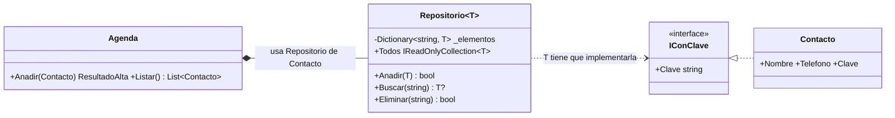

# 8. Genéricos y colecciones

[⬅️ Volver a la unidad](./README.md)

**CE que trabaja este tema:** prepara RA1 h (enlace de componentes a orígenes de datos).

## Índice

- [8.1. El problema: colecciones de cualquier tipo, sin perder el tipo](#81-el-problema-colecciones-de-cualquier-tipo-sin-perder-el-tipo)
- [8.2. `List<T>`](#82-listt)
- [8.3. `Dictionary<TKey, TValue>`](#83-dictionarytkey-tvalue)
- [8.4. `HashSet<T>`](#84-hashsett)
- [8.5. Otras colecciones](#85-otras-colecciones)
- [8.6. Las interfaces de las colecciones](#86-las-interfaces-de-las-colecciones)
  - [8.6.1. Programar contra la interfaz](#861-programar-contra-la-interfaz)
  - [8.6.2. Exponer una colección privada](#862-exponer-una-colección-privada)
- [8.7. Igualdad: `Equals` y `GetHashCode`](#87-igualdad-equals-y-gethashcode)
- [8.8. Orden: `IComparable<T>`](#88-orden-icomparablet)
- [8.9. Genéricos propios](#89-genéricos-propios)
  - [8.9.1. Métodos genéricos](#891-métodos-genéricos)
  - [8.9.2. Clases genéricas](#892-clases-genéricas)
  - [8.9.3. Restricciones](#893-restricciones)
- [8.10. El patrón repositorio](#810-el-patrón-repositorio)
- [8.11. Qué colección elegir](#811-qué-colección-elegir)
- [Resumen](#resumen)
- [Ejercicios de reflexión](#ejercicios-de-reflexión)

---

## 8.1. El problema: colecciones de cualquier tipo, sin perder el tipo

Los arrays tienen tamaño fijo, y casi ninguna aplicación sabe de antemano cuántos socios, tareas o facturas va a tener. Necesitas colecciones que crecen. Y las necesitas para **cualquier tipo**: una lista de socios, otra de reservas, otra de textos.

Una solución sería una lista de `object`, que admite cualquier cosa. Pero entonces el compilador no sabe qué hay dentro: podrías meter una reserva en la lista de socios, y al sacar un elemento tendrías que convertirlo (y fallaría en ejecución si te equivocas).

Los **genéricos** resuelven las dos cosas: una sola clase `List<T>` sirve para cualquier tipo `T`, y una `List<Socio>` **solo** admite socios. El compilador lo comprueba.

```csharp
var socios = new List<Socio>();
socios.Add(new Socio(1, "Ana", "ana@club.es", hoy));
// socios.Add("Luis");          // error CS1503: no se puede convertir string en Socio
Socio primero = socios[0];       // sin conversiones: el tipo se conoce
```

`T` es un **parámetro de tipo**: se sustituye por un tipo concreto al usar la clase. Las colecciones genéricas están en **`System.Collections.Generic`**, incluido en los *implicit usings*.

> 🔁 **Transferencia**: Java, Kotlin, Swift, TypeScript o C++ (con las plantillas) tienen genéricos. Una diferencia de C#: los genéricos existen también **al ejecutar**. Una `List<int>` guarda enteros de verdad, sin convertirlos en objetos, y se puede preguntar en ejecución por el tipo `T`.

---

## 8.2. `List<T>`

La colección que más usarás: una lista ordenada que crece sola y se recorre por posición.

```csharp
List<string> nombres = ["Luis", "Ana"];        // expresión de colección (C# 12)
var notas = new List<double> { 7.5, 6, 9 };     // inicializador de colección

nombres.Add("Marta");                // añade al final
nombres.Insert(0, "Zoe");            // inserta en una posición
nombres.Remove("Luis");              // quita la primera aparición; devuelve si estaba
nombres.RemoveAt(0);                 // quita por posición

Console.WriteLine(nombres.Count);            // 2: número de elementos
Console.WriteLine(nombres[0]);               // Ana
Console.WriteLine(nombres.Contains("Ana"));  // True
Console.WriteLine(nombres.IndexOf("Marta")); // 1 (o -1 si no está)

nombres.Sort();                      // ordena la propia lista
foreach (var nombre in nombres)
{
    Console.WriteLine(nombre);
}
```

| Método o propiedad | Hace |
|--------------------|------|
| `Add`, `AddRange` | Añade uno o varios al final |
| `Insert` | Inserta en una posición |
| `Remove`, `RemoveAt`, `RemoveAll`, `Clear` | Quita uno, por posición, los que cumplen una condición (tema 9), todos |
| `Count` | Número de elementos (**no** `Length`, que es de los arrays) |
| `[i]` | Lee o cambia el elemento de la posición `i` |
| `Contains`, `IndexOf` | Busca un elemento (usa su igualdad, apartado 8.7) |
| `Sort` | Ordena la propia lista (usa su orden, apartado 8.8) |
| `ToArray` | Copia en un array |

> ⚠️ **Cuidado**: `lista[5]` en una lista de 3 elementos lanza `ArgumentOutOfRangeException`. Comprueba `Count` antes, o usa un bucle `foreach`.

---

## 8.3. `Dictionary<TKey, TValue>`

Un **diccionario** guarda pares **clave → valor** y encuentra un valor por su clave al instante, tenga 10 elementos o un millón. Es la colección para «buscar por algo»: socios por su id, contactos por su nombre, precios por código de producto.

```csharp
var precios = new Dictionary<string, decimal>
{
    ["Teclado"] = 25.90m,
    ["Ratón"] = 12.50m,
};

precios["Monitor"] = 189.99m;           // añade o sustituye
precios.Add("Cable", 4.99m);            // añade; lanza ArgumentException si la clave ya existe
var anadido = precios.TryAdd("Cable", 5m);   // false: ya existía, no cambia nada

Console.WriteLine(precios["Teclado"]);  // 25,90
// precios["Silla"];                    // 💥 KeyNotFoundException

if (precios.TryGetValue("Silla", out var precio))
{
    Console.WriteLine(precio);
}

var precioRaton = precios.GetValueOrDefault("Ratón");   // 12,50 (o 0 si no existe)
precios.Remove("Cable");

foreach (var (producto, importe) in precios)            // cada elemento es un KeyValuePair
{
    Console.WriteLine($"{producto}: {importe:N2} €");
}
```

Por defecto, las claves de texto distinguen mayúsculas. Para que «Ana» y «ana» sean la misma clave, pasa un **comparador** al crearlo:

```csharp
var contactos = new Dictionary<string, Contacto>(StringComparer.OrdinalIgnoreCase);
```

> 💡 **Tip del Examinador**: «¿Qué diferencia hay entre `diccionario[clave]` y `TryGetValue`?» El indexador lanza `KeyNotFoundException` si la clave no existe; `TryGetValue` devuelve `false` y no lanza nada. Si la clave puede no existir, usa `TryGetValue` o `GetValueOrDefault`.

---

## 8.4. `HashSet<T>`

Un **conjunto**: elementos **sin repetir** y sin orden, con una comprobación de pertenencia instantánea.

```csharp
var etiquetas = new HashSet<string>(StringComparer.OrdinalIgnoreCase) { "urgente", "casa" };
Console.WriteLine(etiquetas.Add("URGENTE"));   // False: ya estaba
Console.WriteLine(etiquetas.Contains("Casa"));  // True

var a = new HashSet<int> { 1, 2, 3 };
var b = new HashSet<int> { 2, 3, 4 };
a.IntersectWith(b);                            // a = {2, 3}
```

---

## 8.5. Otras colecciones

| Colección | Qué es | Ejemplo de uso |
|-----------|--------|----------------|
| `Queue<T>` | Cola: el primero que entra es el primero que sale (`Enqueue`, `Dequeue`) | Turnos, tareas pendientes de procesar |
| `Stack<T>` | Pila: el último que entra es el primero que sale (`Push`, `Pop`) | Deshacer, historial de navegación |
| `SortedDictionary<TKey, TValue>` | Diccionario ordenado por clave | Un índice alfabético |
| `LinkedList<T>` | Lista doblemente enlazada | Insertar y quitar a menudo en mitad de la lista |
| `ObservableCollection<T>` | Lista que **avisa** cuando se añaden o quitan elementos | Listas que se actualizan solas en una interfaz (UD3) |

> 📝 **Nota del Profesor**: Fíjate en la última: es una `List<T>` que **avisa con un evento** (tema 9) cada vez que cambia. La usarás en la UD3.

---

## 8.6. Las interfaces de las colecciones

### 8.6.1. Programar contra la interfaz

Las colecciones implementan una jerarquía de interfaces (tema 6). Cada una promete algo distinto:

| Interfaz | Promete | La implementan |
|----------|---------|----------------|
| `IEnumerable<T>` | Se puede recorrer con `foreach` (y consultar con LINQ) | Todas |
| `IReadOnlyCollection<T>` | Se puede recorrer y tiene `Count` | Todas |
| `IReadOnlyList<T>` | Además, se lee por posición `[i]` | `List<T>`, arrays |
| `ICollection<T>` | Se puede recorrer, contar, añadir y quitar | `List<T>`, `HashSet<T>`… |
| `IList<T>` | Además, por posición | `List<T>`, arrays |
| `IDictionary<TKey, TValue>` | Pares clave-valor modificables | `Dictionary<TKey, TValue>` |

Un método que solo recorre una colección debería pedir **lo mínimo**, `IEnumerable<T>`. Así acepta listas, arrays, conjuntos o el resultado de una consulta:

```csharp
public static decimal Total(IEnumerable<Factura> facturas)
{
    decimal total = 0;
    foreach (var factura in facturas)
    {
        total += factura.Importe;
    }

    return total;
}

Total(listaDeFacturas);
Total(arrayDeFacturas);
```

### 8.6.2. Exponer una colección privada

Una clase que guarda una lista no debería exponerla tal cual: cualquiera podría añadir o borrar elementos saltándose sus reglas. La solución habitual es guardar una `List<T>` privada y exponerla como **`IReadOnlyList<T>`**:

```csharp
public class AgendaTareas
{
    private readonly List<Tarea> _tareas = [];

    public IReadOnlyList<Tarea> Tareas => _tareas;      // se lee, se recorre, se cuenta…

    public void Agregar(Tarea tarea)                     // …pero solo se modifica por aquí
    {
        // validar, añadir y avisar
    }
}

// agenda.Tareas.Add(…);   // error: IReadOnlyList<T> no tiene Add
```

> ✅ **Buena práctica**: Devolver una **copia** (`new List<T>(_tareas)` o `_tareas.ToList()`) también protege la colección, pero crea una lista nueva cada vez. `IReadOnlyList<T>` no copia nada: es la opción por defecto.

---

## 8.7. Igualdad: `Equals` y `GetHashCode`

¿Cuándo son «iguales» dos contactos? Para una clase, por defecto, `Equals` (y `==`) compara **referencias**: solo es igual a sí mismo. Pero en una agenda, dos contactos con el mismo nombre deberían ser el mismo, aunque sean dos objetos distintos.

`List<T>.Contains`, `HashSet<T>` y las claves de un `Dictionary` usan la igualdad del tipo. Para cambiarla hay que sobrescribir **dos** métodos de forma coherente:

```csharp
public class Contacto : IEquatable<Contacto>
{
    public string Nombre { get; }
    public string Telefono { get; set; }
    // …

    public bool Equals(Contacto? other)
    {
        return other is not null && string.Equals(Nombre, other.Nombre, StringComparison.OrdinalIgnoreCase);
    }

    public override bool Equals(object? obj) => Equals(obj as Contacto);

    public override int GetHashCode() => StringComparer.OrdinalIgnoreCase.GetHashCode(Nombre);
}
```

¿Por qué `GetHashCode`? Un `HashSet` o un `Dictionary` no comparan cada elemento con todos los demás (sería muy lento): primero calculan su **código hash** (un número) y solo comparan con `Equals` los que tienen el mismo código. La regla es: **si dos objetos son iguales, tienen que tener el mismo hash**.

> ⚠️ **Cuidado**: Si sobrescribes `Equals` y no `GetHashCode`, los objetos «iguales» tienen hashes distintos y el `HashSet` los guarda los dos: aparecen duplicados sin ningún error. El compilador te avisa (`CS0659`).

Recuerda que un **`record`** (tema 5) ya trae igualdad por valor sobre **todas** sus propiedades. Sobrescribe la igualdad a mano solo cuando la regla es otra (como aquí: solo el nombre y sin distinguir mayúsculas).

---

## 8.8. Orden: `IComparable<T>`

`List<T>.Sort()` sin argumentos necesita saber cómo se ordenan los elementos. Los números y los textos ya lo saben; tus clases, no. Para darles un **orden natural**, implementa **`IComparable<T>`**:

```csharp
public class Contacto : IComparable<Contacto>
{
    // …
    public int CompareTo(Contacto? other)
    {
        return other is null ? 1 : string.Compare(Nombre, other.Nombre, StringComparison.CurrentCultureIgnoreCase);
    }
}
```

`CompareTo` devuelve un número **negativo** si este va antes, **cero** si van igual y **positivo** si va después.

Si necesitas **otros** órdenes (por teléfono, por fecha de alta), no se cambia la clase: se pasa el criterio al ordenar, con una lambda (tema 9) o con LINQ (tema 10):

```csharp
contactos.Sort((a, b) => a.Telefono.CompareTo(b.Telefono));
var porFecha = socios.OrderBy(s => s.FechaAlta).ToList();
```

---

## 8.9. Genéricos propios

### 8.9.1. Métodos genéricos

Un método puede tener su propio parámetro de tipo:

```csharp
public static T Primero<T>(IReadOnlyList<T> lista, T porDefecto)
{
    return lista.Count > 0 ? lista[0] : porDefecto;
}

var n = Primero([3, 5, 8], 0);             // T es int (lo deduce el compilador)
var s = Primero(new List<string>(), "—");   // T es string
```

### 8.9.2. Clases genéricas

```csharp
public class Par<TPrimero, TSegundo>(TPrimero primero, TSegundo segundo)
{
    public TPrimero Primero { get; } = primero;
    public TSegundo Segundo { get; } = segundo;
}

var par = new Par<string, int>("Ana", 20);
```

Por convención, los parámetros de tipo se llaman `T` o empiezan por `T` (`TKey`, `TValue`, `TResultado`).

### 8.9.3. Restricciones

Dentro de una clase genérica, de `T` solo se sabe que es «algún tipo»: solo puedes usar lo que tiene `object`. Para usar más, se añaden **restricciones** con `where`:

| Restricción | `T` tiene que… | Permite |
|-------------|---------------|---------|
| `where T : class` | Ser un tipo de referencia | Que `T?` signifique «puede ser `null`» |
| `where T : struct` | Ser un tipo de valor | |
| `where T : new()` | Tener un constructor sin parámetros | `new T()` |
| `where T : Archivo` | Ser `Archivo` o una hija | Usar los miembros de `Archivo` |
| `where T : IConClave` | Implementar la interfaz | Usar `elemento.Clave` |

```csharp
public interface IConClave
{
    string Clave { get; }
}

public class Repositorio<T>
    where T : class, IConClave
{
    private readonly Dictionary<string, T> _elementos = new(StringComparer.OrdinalIgnoreCase);

    public bool Anadir(T elemento) => _elementos.TryAdd(elemento.Clave, elemento);   // gracias a IConClave

    public T? Buscar(string clave) => _elementos.GetValueOrDefault(clave);          // gracias a class
}
```

Sin `IConClave`, el compilador no sabría que `elemento` tiene una propiedad `Clave`. Sin `class`, `T?` no significaría «puede ser `null`» para tipos como `int`.

---

## 8.10. El patrón repositorio

El `Repositorio<T>` anterior es un ejemplo del **patrón repositorio**: una clase que guarda y recupera objetos de un tipo y **oculta cómo** se guardan (en memoria, en un fichero, en una base de datos). El resto de la aplicación solo usa sus métodos: `Anadir`, `Buscar`, `Eliminar`, `Todos`.



El diagrama muestra el ejercicio E04: el repositorio sirve para cualquier tipo con clave; la agenda **tiene** uno de contactos (composición, tema 6) y añade las reglas propias de una agenda.

> 🔁 **Transferencia**: El patrón repositorio es estándar en cualquier aplicación con datos: lo verás en Spring (Java), en Room (Android), en Entity Framework (.NET) o en cualquier API REST. En el proyecto del curso, cambiar el repositorio en memoria por uno que guarde en un fichero no afectará al resto de la aplicación.

---

## 8.11. Qué colección elegir

| Necesito… | Colección |
|-----------|-----------|
| Una lista ordenada que crece, recorrida en orden o por posición | `List<T>` |
| Buscar rápidamente por una clave | `Dictionary<TKey, TValue>` |
| Elementos sin repetir, o saber si algo está | `HashSet<T>` |
| Procesar en orden de llegada | `Queue<T>` |
| Deshacer (lo último primero) | `Stack<T>` |
| Un número fijo de elementos, o una matriz | Array (`T[]`, `T[,]`) |
| Una lista que la interfaz muestre y que se actualice sola | `ObservableCollection<T>` (UD3) |
| Exponer una colección sin dejar que la modifiquen | `IReadOnlyList<T>` |
| Recibir «cualquier cosa que se pueda recorrer» | `IEnumerable<T>` |

---

## Resumen

- Los **genéricos** (`List<T>`) permiten escribir una vez una colección o un método para cualquier tipo, **sin perder la comprobación de tipos**.
- **`List<T>`**: lista que crece (`Add`, `Remove`, `Count`, `[i]`, `Sort`). **`Dictionary<TKey, TValue>`**: búsqueda instantánea por clave (`TryAdd`, `TryGetValue`, `GetValueOrDefault`), con comparador para no distinguir mayúsculas. **`HashSet<T>`**: sin repetidos.
- Pide **`IEnumerable<T>`** cuando solo recorres; expón las listas privadas como **`IReadOnlyList<T>`**.
- La igualdad de una clase se cambia sobrescribiendo **`Equals` y `GetHashCode`** a la vez (e implementando `IEquatable<T>`). Si no, `HashSet` y `Dictionary` dejan pasar duplicados.
- **`IComparable<T>`** da un orden natural para `Sort()`; otros órdenes se pasan con lambdas o LINQ.
- Las **restricciones** (`where T : class, IConClave`) permiten usar miembros de `T` dentro de una clase genérica.
- El **patrón repositorio** oculta cómo se guardan los datos detrás de unos pocos métodos.
- `ObservableCollection<T>` es la lista que avisa de sus cambios con eventos.

## Ejercicios de reflexión

1. ¿Por qué una `List<object>` no es una buena alternativa a una `List<Socio>`? Pon dos ejemplos de errores que el compilador detectaría solo con la segunda.
2. Mide (con `System.Diagnostics.Stopwatch`) cuánto se tarda en buscar 1 000 veces un elemento en una `List<string>` de 100 000 textos con `Contains`, y en un `HashSet<string>` con los mismos textos. ¿A qué se debe la diferencia?
3. Comenta el `GetHashCode` de `Contacto` y mete dos contactos «iguales» en un `HashSet`. ¿Cuántos guarda? Explica por qué con lo visto en el apartado 8.7.
4. ¿Qué ventaja tiene que `AgendaTareas` exponga `IReadOnlyList<Tarea>` en lugar de devolver una copia de la lista cada vez? ¿Tiene algún riesgo? (Pista: ¿se puede cambiar una tarea de la lista?).
5. Escribe un método genérico `Maximo<T>(IEnumerable<T> elementos)` que devuelva el mayor elemento. ¿Qué restricción necesitas? ¿Qué pasa si la colección está vacía?

---

[⬅️ Volver a la unidad](./README.md)
