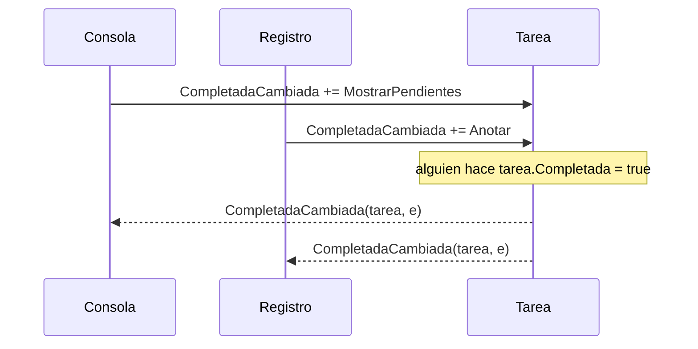

# 9. Delegados, lambdas y eventos

[⬅️ Volver a la unidad](./README.md)

**CE que trabaja este tema:** prepara RA1 g (contenidos «eventos; escuchadores»).

## Índice

- [9.1. Dos problemas: pasar comportamiento y avisar de cambios](#91-dos-problemas-pasar-comportamiento-y-avisar-de-cambios)
- [9.2. Delegados](#92-delegados)
- [9.3. `Action`, `Func` y `Predicate`](#93-action-func-y-predicate)
- [9.4. Lambdas](#94-lambdas)
  - [9.4.1. Sintaxis](#941-sintaxis)
  - [9.4.2. Métodos de `List<T>` que reciben lambdas](#942-métodos-de-listt-que-reciben-lambdas)
  - [9.4.3. Capturar variables](#943-capturar-variables)
- [9.5. Eventos](#95-eventos)
  - [9.5.1. El patrón publicador-suscriptor](#951-el-patrón-publicador-suscriptor)
  - [9.5.2. Declarar y lanzar un evento](#952-declarar-y-lanzar-un-evento)
  - [9.5.3. El patrón de eventos de .NET](#953-el-patrón-de-eventos-de-net)
  - [9.5.4. Suscribirse y darse de baja](#954-suscribirse-y-darse-de-baja)
  - [9.5.5. Por qué `event` y no un delegado público](#955-por-qué-event-y-no-un-delegado-público)
- [9.6. Eventos de la biblioteca de .NET](#96-eventos-de-la-biblioteca-de-net)
- [9.7. Ejemplo integrador: un termostato](#97-ejemplo-integrador-un-termostato)
- [Resumen](#resumen)
- [Ejercicios de reflexión](#ejercicios-de-reflexión)

---

## 9.1. Dos problemas: pasar comportamiento y avisar de cambios

**Primer problema.** Tienes una lista de tareas y quieres las pendientes, las urgentes, las de hoy, las que contienen «examen»… Podrías escribir un método por criterio, todos iguales salvo la condición. Mejor sería un solo método `Filtrar` que reciba **la condición como parámetro**. Pero una condición es **código**, no un dato. ¿Cómo se pasa código a un método?

**Segundo problema.** Una tarea cambia de estado. Al contador de pendientes le interesa saberlo; a la lista que la muestra, también; quizá a un registro. La tarea **no debería conocerlos**: si mañana se añade otro interesado, la tarea no tendría que cambiar. ¿Cómo avisa un objeto de que algo ha pasado sin saber a quién?

C# resuelve los dos con el mismo mecanismo: los **delegados**. Sobre ellos se construyen las **lambdas** (código como valor) y los **eventos** (avisos). Los eventos son también la pieza central de las interfaces gráficas que verás en la UD3: cada acción del usuario llegará a tu código como un evento.

| Concepto conocido | En C# | Lo particular |
|-------------------|-------|---------------|
| Funciones como valores, *callbacks* | **Delegados**: `Action`, `Func<…>`, `Predicate<T>` | Son tipos con comprobación del compilador |
| Funciones anónimas | **Lambdas**: `t => !t.Completada` | |
| Patrón observador, *listeners* | **Eventos**: `event`, `+=`, `-=` | Forman parte del lenguaje; no hacen falta interfaces de *listener* |

---

## 9.2. Delegados

Un **delegado** es un tipo cuyos valores son **métodos**. Una variable de tipo delegado guarda una referencia a un método (o a varios) y se puede invocar como si fuera el método:

```csharp
// Declaración del tipo: «un método que recibe un decimal y devuelve un decimal»
public delegate decimal CalculoDescuento(decimal importe);

decimal SinDescuento(decimal importe) => importe;
decimal Rebajas(decimal importe) => importe * 0.8m;

CalculoDescuento calculo = SinDescuento;   // se asigna un método (sin paréntesis)
Console.WriteLine(calculo(100));           // 100

calculo = Rebajas;                          // ahora apunta a otro método
Console.WriteLine(calculo(100));           // 80,0
```

El compilador comprueba que el método asignado tiene la **firma** del delegado (parámetros y tipo devuelto).

Un delegado puede apuntar a **varios** métodos a la vez (**multidifusión**): con `+=` se añaden y, al invocarlo, se llaman todos en orden. Es la base de los eventos.

```csharp
Action avisos = () => Console.WriteLine("📧 correo");
avisos += () => Console.WriteLine("📱 notificación");
avisos();
// 📧 correo
// 📱 notificación
```

---

## 9.3. `Action`, `Func` y `Predicate`

Casi nunca hace falta declarar tus propios tipos de delegado: .NET trae unos genéricos que cubren todos los casos.

| Delegado | Firma | Ejemplo |
|----------|-------|---------|
| `Action` | Sin parámetros, no devuelve nada | `Action saludar = () => Console.WriteLine("Hola");` |
| `Action<T1, T2…>` | Recibe parámetros, no devuelve nada | `Action<string> mostrar = texto => Console.WriteLine(texto);` |
| `Func<TResultado>` | Sin parámetros, devuelve algo | `Func<DateTime> ahora = () => DateTime.Now;` |
| `Func<T1, T2…, TResultado>` | Recibe parámetros y devuelve algo (el **último** tipo es el resultado) | `Func<decimal, decimal> conIva = p => p * 1.21m;` |
| `Predicate<T>` | Recibe un `T` y devuelve `bool` | `Predicate<Tarea> pendiente = t => !t.Completada;` |
| `Comparison<T>` | Recibe dos `T` y devuelve un `int` (orden) | `Comparison<Contacto> porNombre = (a, b) => a.Nombre.CompareTo(b.Nombre);` |

Con ellos, el método `Filtrar` del primer problema se escribe una sola vez:

```csharp
public static List<T> Filtrar<T>(IEnumerable<T> elementos, Func<T, bool> condicion)
{
    var resultado = new List<T>();
    foreach (var elemento in elementos)
    {
        if (condicion(elemento))
        {
            resultado.Add(elemento);
        }
    }

    return resultado;
}

var pendientes = Filtrar(tareas, t => !t.Completada);
var deExamen = Filtrar(tareas, t => t.Titulo.Contains("examen", StringComparison.OrdinalIgnoreCase));
```

> 📝 **Nota del Profesor**: Este `Filtrar` es, casi letra por letra, el `Where` de LINQ (tema 10). LINQ es una colección de métodos como este, que reciben delegados.

---

## 9.4. Lambdas

### 9.4.1. Sintaxis

Una **lambda** es una función anónima escrita en el sitio donde se usa. Se lee «**va a**»:

```csharp
x => x * 2                                  // un parámetro, una expresión
(a, b) => a + b                             // varios parámetros
() => Console.WriteLine("Hola")             // sin parámetros
(string texto) => texto.Trim()              // con el tipo explícito
t =>
{
    var dias = (t.Fecha.DayNumber - hoy.DayNumber);
    return dias is >= 0 and <= 7;
}                                           // con cuerpo de bloque
```

El compilador deduce los tipos de los parámetros por el delegado al que se asigna la lambda.

**Métodos anónimos.** Antes de las lambdas (C# 3, 2007), C# 2 ya permitía escribir un método sin nombre en el sitio donde se usa, con la palabra `delegate`. Lo verás en código heredado y en materiales antiguos:

```csharp
// Método anónimo (C# 2): tipos de los parámetros obligatorios y cuerpo siempre entre llaves
Func<int, int> doblarAntes = delegate (int x) { return x * 2; };

// La misma función con una lambda: es la forma que se usa hoy
Func<int, int> doblar = x => x * 2;

Console.WriteLine(doblarAntes(21) == doblar(21));
// Salida: True
```

Hacen lo mismo y se pueden asignar a los mismos delegados. La lambda es más corta, deduce los tipos y admite una sola expresión sin llaves; por eso los métodos anónimos ya casi no se escriben. Su única particularidad es que, si no necesitan los parámetros, pueden omitirlos: `Console.CancelKeyPress += delegate { Console.WriteLine("Saliendo…"); };` se suscribe sin escribir los dos parámetros del evento, mientras que la lambda tendría que escribirlos (`(_, _) => …`).

> 🔁 **Transferencia**: Son las lambdas de Java (`t -> !t.isCompletada()`), Kotlin (`{ t -> !t.completada }`), Python (`lambda t: not t.completada`) o las funciones flecha de JavaScript (`t => !t.completada`).

### 9.4.2. Métodos de `List<T>` que reciben lambdas

| Método | Recibe | Hace |
|--------|--------|------|
| `Find(predicado)` | `Predicate<T>` | El primer elemento que cumple la condición, o `default` |
| `FindAll(predicado)` | `Predicate<T>` | Una lista nueva con los que la cumplen |
| `Exists(predicado)` | `Predicate<T>` | Si alguno la cumple |
| `RemoveAll(predicado)` | `Predicate<T>` | Quita los que la cumplen y devuelve cuántos |
| `Sort(comparacion)` | `Comparison<T>` | Ordena con ese criterio |
| `ForEach(accion)` | `Action<T>` | Ejecuta la acción con cada elemento |

```csharp
var urgente = tareas.Find(t => t.Titulo.StartsWith("URGENTE"));
var hayPendientes = tareas.Exists(t => !t.Completada);
var borradas = tareas.RemoveAll(t => t.Completada);
tareas.Sort((a, b) => string.Compare(a.Titulo, b.Titulo, StringComparison.CurrentCulture));
```

### 9.4.3. Capturar variables

Una lambda puede usar las variables del método donde se escribe. Las **captura**: se queda con la variable, no con una copia de su valor.

```csharp
var minimo = 5;
Func<double, bool> aprobado = nota => nota >= minimo;

Console.WriteLine(aprobado(5.5));   // True
minimo = 6;
Console.WriteLine(aprobado(5.5));   // False: la lambda ve el valor actual de minimo
```

Es muy útil (una lambda que sabe a qué asiento o a qué cuenta se refiere), pero tenlo en cuenta: si la variable cambia después, la lambda verá el valor nuevo.

---

## 9.5. Eventos

### 9.5.1. El patrón publicador-suscriptor

Un **evento** es un aviso que lanza un objeto (el **publicador** o **emisor**) cuando ocurre algo. Otros objetos (los **suscriptores** o **escuchadores**) se apuntan para recibirlo. El publicador **no sabe** quién le escucha ni cuántos son.



El diagrama muestra dos suscriptores apuntados al mismo evento: cuando la tarea cambia, los dos reciben el aviso, en el orden en que se suscribieron. La tarea no conoce ni a la consola ni al registro.

> 💡 **Tip del Examinador**: «¿Qué ventaja tiene que un objeto avise con un evento en lugar de llamar directamente a quien le interesa?» **Desacoplamiento**: el emisor no depende de los suscriptores; se pueden añadir o quitar suscriptores sin cambiar el emisor. Por eso el temporizador de .NET (apartado 9.6) sirve para cualquier programa: no sabe qué hará tu código cuando avise.

### 9.5.2. Declarar y lanzar un evento

```csharp
public class Tarea(string titulo)
{
    private bool _completada;

    public event EventHandler? CompletadaCambiada;        // 1. declarar

    public string Titulo { get; } = titulo;

    public bool Completada
    {
        get => _completada;
        set
        {
            if (_completada == value)
            {
                return;                                    // sin cambio, sin aviso
            }

            _completada = value;                           // 2. primero cambiar…
            CompletadaCambiada?.Invoke(this, EventArgs.Empty);   // 3. …y después avisar
        }
    }
}
```

- **`event`** + un tipo de delegado + el nombre. El `?` indica que puede ser `null`: **no hay suscriptores** hasta que alguien se apunte.
- **`?.Invoke(…)`** lanza el evento solo si hay suscriptores. Sin el `?.`, si nadie se ha suscrito, se lanza `NullReferenceException`.
- Se avisa **después** de cambiar el estado: el suscriptor que lea `Completada` tiene que ver el valor nuevo.

### 9.5.3. El patrón de eventos de .NET

Todos los eventos de .NET siguen la misma forma: el manejador recibe **dos parámetros**:

| Parámetro | Tipo | Qué es |
|-----------|------|--------|
| `sender` | `object?` | El objeto que lanza el evento (la tarea, el sensor) |
| `e` | `EventArgs` o una clase que hereda de él | Los datos del evento |

Si el evento no tiene datos, se usa **`EventHandler`** y `EventArgs.Empty`. Si tiene datos, se crea una clase que hereda de `EventArgs` y se usa **`EventHandler<TEventArgs>`**:

```csharp
public class TareaEventArgs(Tarea tarea) : EventArgs
{
    public Tarea Tarea { get; } = tarea;
}

public class AgendaTareas
{
    private readonly List<Tarea> _tareas = [];

    public event EventHandler<TareaEventArgs>? TareaAnadida;

    public void Agregar(Tarea tarea)
    {
        _tareas.Add(tarea);
        TareaAnadida?.Invoke(this, new TareaEventArgs(tarea));
    }
}
```

| Convención | Ejemplo |
|------------|---------|
| Nombre del evento: lo que ha pasado, en participio o sustantivo | `TareaAnadida`, `CompletadaCambiada`, `Click`, `TextChanged` |
| Clase de datos: termina en `EventArgs` | `TareaEventArgs`, `ConsoleCancelEventArgs` |
| Manejador: `Al…`, `On…` u `<objeto>_<Evento>` | `AlCambiarTarea`, `temporizador_Elapsed` |

### 9.5.4. Suscribirse y darse de baja

```csharp
var agenda = new AgendaTareas();

// Con una lambda
agenda.TareaAnadida += (sender, e) => Console.WriteLine($"📢 Añadida: {e.Tarea.Titulo}");

// Con un método (necesario si después hay que darse de baja)
agenda.TareaAnadida += MostrarPendientes;

void MostrarPendientes(object? sender, TareaEventArgs e)
{
    if (sender is AgendaTareas origen)
    {
        Console.WriteLine($"🔢 Pendientes: {origen.Pendientes}");
    }
}

// Darse de baja
agenda.TareaAnadida -= MostrarPendientes;
```

- **`+=`** suscribe; **`-=`** da de baja. Un manejador suscrito dos veces se ejecuta dos veces.
- Para darse de baja hay que pasar **el mismo método**. Con una lambda no se puede (cada lambda es distinta), salvo que la guardes en una variable.

> ⚠️ **Cuidado**: Mientras un suscriptor está apuntado al evento de otro objeto, ese objeto **guarda una referencia** al suscriptor y el recolector de basura no puede liberarlo. Si un objeto de vida larga (un gestor) tiene suscritos objetos de vida corta (por ejemplo, informes que se crean, se muestran y se descartan), y no se dan de baja, la memoria crece sin parar: una **fuga de memoria**. Por eso, al eliminar una tarea, la agenda del E05 se da de baja de su evento.

### 9.5.5. Por qué `event` y no un delegado público

Si declaras `public EventHandler? CompletadaCambiada;` (sin `event`), también funciona… y cualquiera podría:

- **Sustituir** a todos los suscriptores con `=`: `tarea.CompletadaCambiada = null;` borraría los avisos de los demás.
- **Lanzar** el evento desde fuera: `tarea.CompletadaCambiada?.Invoke(…)`, aunque la tarea no haya cambiado.

La palabra **`event`** lo impide: desde fuera de la clase solo se permite **`+=` y `-=`** (error `CS0070` si intentas otra cosa). Solo la propia clase puede lanzar su evento.

---

## 9.6. Eventos de la biblioteca de .NET

Muchas clases de .NET avisan con eventos que siguen exactamente el patrón de este tema. Dos que puedes usar en un programa de consola:

| Evento | Se lanza cuando… | Datos (`e`) |
|--------|------------------|-------------|
| `System.Timers.Timer.Elapsed` | Pasa el intervalo del temporizador | `ElapsedEventArgs` (con `SignalTime`, el momento del aviso) |
| `Console.CancelKeyPress` | El usuario pulsa Ctrl+C | `ConsoleCancelEventArgs` (con `Cancel`, para impedir que el programa se cierre) |

```csharp
using System.Text;

Console.OutputEncoding = Encoding.UTF8;

var temporizador = new System.Timers.Timer(1000);       // avisa cada segundo
var segundos = 0;
temporizador.Elapsed += (sender, e) => Console.WriteLine($"⏱️ {++segundos} s ({e.SignalTime:HH:mm:ss})");

Console.CancelKeyPress += (sender, e) =>
{
    e.Cancel = true;                                       // no cerrar el programa de golpe
    temporizador.Stop();
    Console.WriteLine("🛑 Ctrl+C: temporizador detenido. Pulsa Intro para salir.");
};

temporizador.Start();
Console.WriteLine("Pulsa Ctrl+C para detener el temporizador o Intro para salir");
Console.ReadLine();
```

Ni el temporizador ni la consola saben qué hará tu código cuando avisen: solo lanzan el evento. Tu programa decide la acción suscribiéndose. Las dos clases de datos heredan de `EventArgs`, y los manejadores reciben `sender` y `e`, como los de tus clases.

En la UD3, las interfaces gráficas funcionarán igual: cada acción del usuario llegará a tu código como un evento, y **asociar a cada evento su acción** es el **CE g del RA1**. Lo que acabas de aprender es exactamente eso.

> 🔁 **Transferencia**: Android (`setOnClickListener`), la web (`addEventListener`), JavaFX (`setOnAction`) o Flutter (`onPressed:`) usan el mismo modelo: un objeto lanza el evento y tu código se suscribe. Lo que aprendes aquí sirve en cualquier tecnología.

---

## 9.7. Ejemplo integrador: un termostato

Un sensor publica los cambios de temperatura; un panel los muestra y una alarma avisa si se supera un límite. Ni el panel ni la alarma se conocen entre sí, y el sensor no conoce a ninguno.

```csharp
public class TemperaturaEventArgs(double anterior, double actual) : EventArgs
{
    public double Anterior { get; } = anterior;
    public double Actual { get; } = actual;
}

public class Sensor
{
    private double _temperatura = 20;

    public event EventHandler<TemperaturaEventArgs>? TemperaturaCambiada;

    public double Temperatura
    {
        get => _temperatura;
        set
        {
            if (Math.Abs(_temperatura - value) < 0.05)
            {
                return;
            }

            var anterior = _temperatura;
            _temperatura = value;
            TemperaturaCambiada?.Invoke(this, new TemperaturaEventArgs(anterior, value));
        }
    }
}
```

```csharp
using System.Globalization;
using System.Text;

Console.OutputEncoding = Encoding.UTF8;
CultureInfo.CurrentCulture = new CultureInfo("es-ES");

var sensor = new Sensor();
var limite = 25.0;

// Suscriptor 1: el panel
sensor.TemperaturaCambiada += (sender, e) =>
    Console.WriteLine($"🌡️ {e.Anterior:F1} → {e.Actual:F1} °C");

// Suscriptor 2: la alarma, que usa la variable capturada «limite»
EventHandler<TemperaturaEventArgs> alarma = (sender, e) =>
{
    if (e.Actual > limite && e.Anterior <= limite)
    {
        Console.WriteLine($"🚨 Se ha superado el límite de {limite:F1} °C");
    }
};
sensor.TemperaturaCambiada += alarma;

sensor.Temperatura = 22.5;
sensor.Temperatura = 22.52;     // cambio menor de 0,05: no avisa
sensor.Temperatura = 26;
limite = 30;                    // la alarma ve el nuevo límite
sensor.Temperatura = 31;
sensor.TemperaturaCambiada -= alarma;
sensor.Temperatura = 35;        // ya solo avisa el panel
```

```text
🌡️ 20,0 → 22,5 °C
🌡️ 22,5 → 26,0 °C
🚨 Se ha superado el límite de 25,0 °C
🌡️ 26,0 → 31,0 °C
🚨 Se ha superado el límite de 30,0 °C
🌡️ 31,0 → 35,0 °C
```

| Concepto | Dónde |
|----------|-------|
| Clase de datos del evento que hereda de `EventArgs` | `TemperaturaEventArgs` |
| Evento con `EventHandler<T>` y lanzamiento con `?.Invoke` después de cambiar | `Sensor` |
| Avisar solo si hay un cambio real | `Math.Abs(…) < 0.05` |
| Dos suscriptores independientes | Panel y alarma |
| Lambda que captura una variable | `limite` |
| Guardar la lambda para poder darse de baja | `alarma` y `-=` |

---

## Resumen

- Un **delegado** es un tipo cuyos valores son métodos; se invoca como un método y puede apuntar a varios (`+=`).
- .NET trae los delegados genéricos **`Action`** (no devuelve), **`Func<…, TResultado>`** (devuelve), **`Predicate<T>`** (devuelve `bool`) y **`Comparison<T>`**.
- Una **lambda** (`x => …`) es una función anónima; **captura** las variables del método donde se escribe. `List<T>` tiene métodos que reciben lambdas: `Find`, `FindAll`, `Exists`, `RemoveAll`, `Sort`.
- Un **evento** permite a un objeto avisar sin saber a quién: patrón **publicador-suscriptor**, base del **desacoplamiento**.
- Se declara con **`event EventHandler?`** o **`event EventHandler<TEventArgs>?`**, se lanza con **`?.Invoke(this, e)`** **después** de cambiar el estado, y los datos van en una clase que hereda de **`EventArgs`**.
- El manejador recibe **`sender`** (quién) y **`e`** (los datos). Se suscribe con **`+=`** y se da de baja con **`-=`** (con el mismo método). No darse de baja puede causar **fugas de memoria**.
- **`event`** impide que desde fuera se sustituyan los suscriptores o se lance el evento.
- La biblioteca de .NET usa el mismo patrón (`Timer.Elapsed`, `Console.CancelKeyPress`). En la UD3, las interfaces gráficas también: asociar a cada evento su acción es el **CE g del RA1**.

## Ejercicios de reflexión

1. Reescribe el método `Filtrar` para que reciba un `Predicate<T>` en lugar de un `Func<T, bool>`. ¿Cambia algo al usarlo? ¿Por qué crees que LINQ usa `Func<T, bool>`?
2. En el termostato, quita el `?.` y lanza el evento con `TemperaturaCambiada(this, …)`. Crea un sensor sin suscriptores y cambia la temperatura. ¿Qué pasa y por qué?
3. Explica qué problema habría si el sensor lanzara el evento **antes** de asignar `_temperatura`. Pruébalo con un suscriptor que lea `sensor.Temperatura`.
4. Cada vez que el usuario pide un informe, el programa crea un objeto `Informe` que se suscribe al evento `ReservaRealizada` de un gestor que vive mientras el programa está abierto. Se piden cincuenta informes. ¿Qué pasa con la memoria si los informes no se dan de baja? ¿Dónde pondrías el `-=`?
5. Busca en la documentación de .NET el evento `Elapsed` de `System.Timers.Timer`. ¿De qué tipo es su delegado? ¿Qué datos trae su `e`? Compáralo con los eventos de este tema.

---

[⬅️ Volver a la unidad](./README.md)
