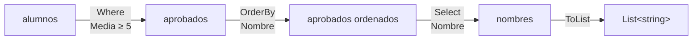

# 10. LINQ

[⬅️ Volver a la unidad](./README.md)

**CE que trabaja este tema:** prepara RA1 h (enlace de componentes a orígenes de datos).

## Índice

- [10.1. El problema: bucles que se parecen mucho](#101-el-problema-bucles-que-se-parecen-mucho)
- [10.2. Qué es LINQ](#102-qué-es-linq)
- [10.3. Filtrar, transformar y ordenar](#103-filtrar-transformar-y-ordenar)
- [10.4. Elementos concretos y partes de una colección](#104-elementos-concretos-y-partes-de-una-colección)
- [10.5. Agregados y cuantificadores](#105-agregados-y-cuantificadores)
- [10.6. Agrupar](#106-agrupar)
- [10.7. Ejecución diferida](#107-ejecución-diferida)
- [10.8. La sintaxis de consulta](#108-la-sintaxis-de-consulta)
- [10.9. Cómo funciona por dentro: métodos de extensión](#109-cómo-funciona-por-dentro-métodos-de-extensión)
- [10.10. Leer y escribir JSON](#1010-leer-y-escribir-json)
- [10.11. Ejemplo integrador: informe de reservas](#1011-ejemplo-integrador-informe-de-reservas)
- [Resumen](#resumen)
- [Ejercicios de reflexión](#ejercicios-de-reflexión)

---

## 10.1. El problema: bucles que se parecen mucho

Tienes una lista de alumnos y quieres los nombres de los aprobados, ordenados alfabéticamente. Con bucles:

```csharp
var aprobados = new List<Alumno>();
foreach (var alumno in alumnos)
{
    if (alumno.Media >= 5)
    {
        aprobados.Add(alumno);
    }
}

aprobados.Sort((a, b) => string.Compare(a.Nombre, b.Nombre, StringComparison.CurrentCulture));

var nombres = new List<string>();
foreach (var alumno in aprobados)
{
    nombres.Add(alumno.Nombre);
}
```

Funciona, pero hay que **leer todo** para entender **qué** hace, y cada consulta nueva (los suspensos, la media por curso, los tres mejores) es otro bucle muy parecido. Con LINQ:

```csharp
var nombres = alumnos
    .Where(a => a.Media >= 5)
    .OrderBy(a => a.Nombre)
    .Select(a => a.Nombre)
    .ToList();
```

Se lee como lo que hace: **de** los alumnos, **los que** tienen media de 5 o más, **ordenados** por nombre, **su** nombre.

---

## 10.2. Qué es LINQ

**LINQ** (*Language Integrated Query*, consultas integradas en el lenguaje) es un conjunto de métodos para consultar **cualquier colección** que se pueda recorrer (`IEnumerable<T>`): listas, arrays, diccionarios, el resultado de otra consulta… Están en el espacio de nombres `System.Linq`, incluido en los *implicit usings*.

Cada método recibe una **lambda** (tema 9) que dice **qué** hacer con cada elemento, y devuelve otra secuencia, así que se pueden **encadenar** como una tubería:



Cada paso recibe la secuencia del anterior y produce una nueva. **Ninguno modifica la colección original.**

> 🔁 **Transferencia**: La misma idea está en las *Streams* de Java (`filter`, `map`, `sorted`, `collect`), en las colecciones de Kotlin, en las listas por comprensión y `sorted` de Python, en los métodos `filter`/`map`/`reduce` de JavaScript y, sobre todo, en **SQL** (`WHERE`, `ORDER BY`, `SELECT`, `GROUP BY`). Saber LINQ te ayuda a pensar en consultas en cualquier lenguaje, y en la UD5 te servirá para preparar los datos de los informes.

---

## 10.3. Filtrar, transformar y ordenar

| Método | Hace | SQL |
|--------|------|-----|
| `Where(condición)` | Los elementos que cumplen la condición | `WHERE` |
| `Select(transformación)` | Transforma cada elemento en otra cosa | `SELECT` |
| `OrderBy`, `OrderByDescending` | Ordena por una clave | `ORDER BY … ASC/DESC` |
| `ThenBy`, `ThenByDescending` | Criterio de desempate | `ORDER BY a, b` |
| `Order()`, `OrderDescending()` | Ordena por el propio valor (.NET 7) | |

```csharp
// Solo los de 2DAM, del mejor al peor y, si empatan, por nombre
var ranking = alumnos
    .Where(a => a.Curso == "2DAM")
    .OrderByDescending(a => a.Media)
    .ThenBy(a => a.Nombre)
    .ToList();

// Transformar en tuplas con nombre o en un record
var fichas = alumnos.Select(a => (a.Nombre, a.Media)).ToList();
var resumen = alumnos.Select(a => new ResumenAlumno(a.Nombre, a.Media >= 5)).ToList();

// Transformar en un tipo anónimo (solo para usarlo dentro del método)
var etiquetas = alumnos.Select(a => new { a.Nombre, Etiqueta = $"{a.Nombre} ({a.Curso})" });
```

> ⚠️ **Cuidado**: Dos `OrderBy` seguidos no ordenan por dos criterios: el segundo **sustituye** al primero. El desempate se hace con **`ThenBy`**.

---

## 10.4. Elementos concretos y partes de una colección

| Método | Devuelve | Si no hay ninguno |
|--------|----------|-------------------|
| `First(condición)` | El primero que cumple | Lanza `InvalidOperationException` |
| `FirstOrDefault(condición)` | El primero que cumple | `null` (o `default`) |
| `Single(condición)` | El **único** que cumple | Lanza si hay cero **o más de uno** |
| `SingleOrDefault(condición)` | El único que cumple | `null`; lanza si hay más de uno |
| `Last`, `LastOrDefault` | El último | Igual que `First` |
| `ElementAt(i)` | El de la posición `i` | Lanza |
| `Take(n)`, `Skip(n)` | Los `n` primeros / todos menos los `n` primeros | Los que haya |
| `Distinct()`, `DistinctBy(clave)` | Sin repetidos | |

```csharp
var socio = socios.FirstOrDefault(s => s.Id == id);           // null si no existe
var tresMejores = alumnos.OrderByDescending(a => a.Media).Take(3).ToList();

// Paginación: la página 2 de 10 elementos
var pagina2 = facturas.OrderBy(f => f.Numero).Skip(10).Take(10).ToList();

var cursos = alumnos.Select(a => a.Curso).Distinct().Order().ToList();
```

> 💡 **Tip del Examinador**: «¿Qué diferencia hay entre `First` y `FirstOrDefault`?» Si no hay ningún elemento que cumpla la condición, `First` lanza una excepción y `FirstOrDefault` devuelve `null` (o el valor por defecto del tipo). Usa `First` solo si **tiene** que haber uno.

---

## 10.5. Agregados y cuantificadores

| Método | Devuelve |
|--------|----------|
| `Count()`, `Count(condición)` | Cuántos (que cumplen la condición) |
| `Sum(selector)` | La suma |
| `Average(selector)` | La media (lanza si la secuencia está vacía) |
| `Min(selector)`, `Max(selector)` | El valor mínimo o máximo |
| `MinBy(selector)`, `MaxBy(selector)` | El **elemento** con el valor mínimo o máximo (.NET 6) |
| `Any()`, `Any(condición)` | Si hay alguno (que cumpla la condición) |
| `All(condición)` | Si todos la cumplen |
| `Contains(valor)` | Si contiene ese valor |

```csharp
var total = facturas.Sum(f => f.Importe);
var mediaGeneral = alumnos.Count == 0 ? 0 : alumnos.Average(a => a.Media);
var mejor = alumnos.MaxBy(a => a.Media);                   // el alumno, no la nota
var hayCeros = alumnos.Any(a => a.Notas.Any(n => n == 0));  // consultas anidadas
var todosMayores = alumnos.All(a => a.Edad >= 18);
var pendientes = tareas.Count(t => !t.Completada);
```

> ✅ **Buena práctica**: Para saber si una secuencia tiene elementos, usa `Any()`, no `Count() > 0`: `Any` para en cuanto encuentra el primero; `Count` los cuenta todos.

---

## 10.6. Agrupar

**`GroupBy`** reparte los elementos en grupos según una clave. Cada grupo tiene su **`Key`** y es, a su vez, una secuencia con sus elementos, sobre la que se pueden hacer agregados:

```csharp
var porCurso = alumnos
    .GroupBy(a => a.Curso)
    .Select(g => new ResumenCurso(
        g.Key,                          // el curso
        g.Count(),                      // cuántos alumnos
        Math.Round(g.Average(a => a.Media), 2),
        g.Count(a => a.Media >= 5)))    // cuántos aprobados
    .OrderBy(r => r.Curso)
    .ToList();

foreach (var r in porCurso)
{
    Console.WriteLine($"{r.Curso}: {r.Alumnos} alumnos, media {r.Media:F2}, {r.Aprobados} aprobados");
}
```

Es el `GROUP BY` de SQL, y la base de cualquier informe: ventas por mes, reservas por pista, gastos por categoría.

Otras formas de agrupar o indexar:

```csharp
var porId = socios.ToDictionary(s => s.Id);                     // diccionario por clave (lanza si se repite)
var cuantosPorCurso = alumnos.CountBy(a => a.Curso);             // pares (curso, número) (.NET 9)
```

---

## 10.7. Ejecución diferida

Una consulta LINQ **no se ejecuta al escribirla**, sino al **recorrerla**: con un `foreach`, con `ToList()`, con `Count()`… Es la **ejecución diferida**.

```csharp
var numeros = new List<int> { 1, 2, 3 };
var pares = numeros.Where(n => n % 2 == 0);   // aquí no se ha filtrado nada todavía

numeros.Add(4);
Console.WriteLine(string.Join(", ", pares));  // 2, 4: se filtra ahora, con el 4 incluido
```

Tiene ventajas (no se calcula lo que no se usa, y `Take(3)` deja de recorrer en cuanto tiene tres), pero también riesgos:

- Si la colección original cambia, el resultado también.
- Si recorres la consulta dos veces, **se ejecuta dos veces**.

> ✅ **Buena práctica**: Cuando un método devuelve el resultado de una consulta, termina con **`ToList()`** (o `ToArray()`): así el resultado se calcula una vez y queda fijo. Las consultas sin materializar, déjalas para usarlas dentro del mismo método.

---

## 10.8. La sintaxis de consulta

LINQ tiene una segunda sintaxis, parecida a SQL:

```csharp
var nombres =
    from a in alumnos
    where a.Media >= 5
    orderby a.Nombre
    select a.Nombre;
```

El compilador la traduce a la sintaxis de métodos. Las dos son equivalentes; en el módulo se usa la de **métodos**, que es la más habitual y tiene todos los operadores (`Take`, `Any`, `MaxBy`… no tienen palabra clave).

---

## 10.9. Cómo funciona por dentro: métodos de extensión

`List<T>` no tiene un método `Where`. Entonces, ¿cómo es posible escribir `lista.Where(…)`? Porque `Where` es un **método de extensión**: un método estático, en una clase estática, cuyo primer parámetro lleva **`this`**. El compilador permite llamarlo como si fuera un método del tipo:

```csharp
public static class ExtensionesTexto
{
    public static string Capitalizar(this string texto)
    {
        return texto.Length == 0 ? texto : char.ToUpper(texto[0]) + texto[1..].ToLower();
    }
}

Console.WriteLine("hOLA mundo".Capitalizar());   // Hola mundo
```

LINQ es una clase estática, `Enumerable`, llena de métodos de extensión sobre `IEnumerable<T>`. Por eso funciona con cualquier colección.

> 📝 **Nota del Profesor**: Los métodos de extensión son útiles, pero no abuses: si un método es parte natural de tu clase, ponlo en la clase. Úsalos para añadir utilidades a tipos que no son tuyos (como `string`).

---

## 10.10. Leer y escribir JSON

Antes de las bases de datos, el origen de datos más sencillo para una aplicación es un fichero **JSON**. .NET lo lee y escribe con **`System.Text.Json`**:

```json
[
  { "nombre": "Ana López", "curso": "2DAM", "edad": 20, "notas": [8, 7.5, 9] },
  { "nombre": "Luis Pérez", "curso": "2DAM", "edad": 19, "notas": [4, 5.5, 3] }
]
```

```csharp
using System.Text.Json;

public record Alumno(string Nombre, string Curso, int Edad, List<double> Notas);

// Web: propiedades en camelCase en el JSON y en PascalCase en C#
var opciones = new JsonSerializerOptions(JsonSerializerDefaults.Web) { WriteIndented = true };

var json = File.ReadAllText("alumnos.json");
var alumnos = JsonSerializer.Deserialize<List<Alumno>>(json, opciones) ?? [];

var aprobados = alumnos.Where(a => a.Notas.Average() >= 5).ToList();
File.WriteAllText("aprobados.json", JsonSerializer.Serialize(aprobados, opciones));
```

- **`Deserialize<T>`** convierte texto JSON en objetos; **`Serialize`** hace lo contrario. `Deserialize` devuelve `T?`: `null` si el JSON es `null`.
- Las propiedades se emparejan por nombre. Con **`JsonSerializerDefaults.Web`**, `"nombre"` encaja con `Nombre` (sin distinguir mayúsculas).
- Funciona con clases con `{ get; set; }`, con propiedades `init` y con `record` o constructores cuyos parámetros se llaman como las propiedades.
- Si el texto no es JSON válido, lanza **`JsonException`**.

> ⚠️ **Cuidado**: Para que el fichero de datos esté junto al ejecutable, en el `.csproj` hay que indicar que se copie (`<None Update="alumnos.json" CopyToOutputDirectory="PreserveNewest" />`) y abrirlo con `Path.Combine(AppContext.BaseDirectory, "alumnos.json")`. Con una ruta relativa como `"alumnos.json"`, funciona o no según desde qué carpeta se ejecute el programa.

---

## 10.11. Ejemplo integrador: informe de reservas

Las reservas de un club deportivo durante un mes, con varias consultas típicas de un informe:

```csharp
using System.Globalization;
using System.Text;

Console.OutputEncoding = Encoding.UTF8;
CultureInfo.CurrentCulture = new CultureInfo("es-ES");

List<Reserva> reservas =
[
    new("Ana", "Pádel 1", new DateOnly(2024, 10, 7), 2, 24m),
    new("Luis", "Tenis", new DateOnly(2024, 10, 7), 1, 15m),
    new("Ana", "Pádel 2", new DateOnly(2024, 10, 9), 1, 12m),
    new("Marta", "Fútbol 7", new DateOnly(2024, 10, 12), 2, 120m),
    new("Luis", "Pádel 1", new DateOnly(2024, 10, 14), 2, 24m),
    new("Ana", "Tenis", new DateOnly(2024, 10, 21), 1, 15m),
];

Console.WriteLine($"💶 Total del mes: {reservas.Sum(r => r.Importe):N2} € en {reservas.Count} reservas");

Console.WriteLine("📊 Horas por pista:");
foreach (var pista in reservas
    .GroupBy(r => r.Pista)
    .Select(g => (Pista: g.Key, Horas: g.Sum(r => r.Horas)))
    .OrderByDescending(p => p.Horas)
    .ThenBy(p => p.Pista))
{
    Console.WriteLine($"   {pista.Pista,-9} {pista.Horas} h");
}

var mejorSocio = reservas
    .GroupBy(r => r.Socio)
    .Select(g => (Socio: g.Key, Gasto: g.Sum(r => r.Importe)))
    .MaxBy(s => s.Gasto);
Console.WriteLine($"🏆 Socio con más gasto: {mejorSocio.Socio} ({mejorSocio.Gasto:N2} €)");

var semanaDel7 = reservas.Where(r => r.Fecha >= new DateOnly(2024, 10, 7) && r.Fecha < new DateOnly(2024, 10, 14));
Console.WriteLine($"📅 Reservas de la semana del 7: {semanaDel7.Count()}");
Console.WriteLine($"❓ ¿Alguna reserva de más de 100 €? {(reservas.Any(r => r.Importe > 100) ? "Sí" : "No")}");

public record Reserva(string Socio, string Pista, DateOnly Fecha, int Horas, decimal Importe);
```

```text
💶 Total del mes: 210,00 € en 6 reservas
📊 Horas por pista:
   Pádel 1   4 h
   Fútbol 7  2 h
   Tenis     2 h
   Pádel 2   1 h
🏆 Socio con más gasto: Marta (120,00 €)
📅 Reservas de la semana del 7: 4
❓ ¿Alguna reserva de más de 100 €? Sí
```

| Concepto | Dónde |
|----------|-------|
| Agregado sobre toda la colección | `Sum`, `Count` |
| Agrupar, agregar por grupo y ordenar con desempate | Horas por pista |
| El elemento con el valor máximo | `MaxBy` |
| Filtrar por un rango de fechas | Semana del 7 |
| Cuantificador | `Any` |
| Tuplas con nombre como resultado intermedio | `(Pista, Horas)`, `(Socio, Gasto)` |

En la UD5, consultas como estas alimentarán los informes; en la UD3, las búsquedas y los filtros de la interfaz.

---

## Resumen

- **LINQ** consulta cualquier `IEnumerable<T>` con métodos que reciben **lambdas** y se **encadenan** como una tubería, sin modificar la colección original.
- **`Where`** filtra, **`Select`** transforma, **`OrderBy`/`ThenBy`** ordenan (con desempate), **`Take`/`Skip`** cortan, **`Distinct`** quita repetidos.
- **`First`** lanza si no hay ninguno; **`FirstOrDefault`** devuelve `null`. **`Single`** exige que haya exactamente uno.
- Agregados: **`Count`, `Sum`, `Average`, `Min`, `Max`, `MinBy`, `MaxBy`**. Cuantificadores: **`Any`, `All`, `Contains`**. `Average` lanza con una secuencia vacía.
- **`GroupBy`** + `Select` resume cada grupo (`g.Key`, `g.Count()`, `g.Sum(…)`): la base de los informes.
- **Ejecución diferida**: la consulta se ejecuta al recorrerla. **`ToList()`** fija el resultado.
- LINQ son **métodos de extensión** (`this` en el primer parámetro) sobre `IEnumerable<T>`.
- **`System.Text.Json`** lee y escribe JSON (`Deserialize<T>`, `Serialize`), con **`JsonSerializerDefaults.Web`** para `camelCase`.

## Ejercicios de reflexión

1. Reescribe con LINQ tres bucles de algún programa tuyo de primer curso (búsqueda del máximo, filtrado, cálculo de una media). ¿Cuál queda más claro? ¿Hay alguno que prefieras con bucle?
2. Explica por qué este código muestra «3» y no «2»: `var lista = new List<int> { 1, 2 }; var consulta = lista.Where(n => n > 0); lista.Add(3); Console.WriteLine(consulta.Count());`. ¿Cómo harías que mostrara 2?
3. Traduce a LINQ esta consulta SQL: `SELECT curso, COUNT(*), AVG(media) FROM alumnos WHERE edad >= 18 GROUP BY curso ORDER BY curso`.
4. ¿Qué pasa si llamas a `Average` sobre las notas de un alumno que todavía no tiene ninguna? ¿Cómo lo evitarías? Busca otra forma en la documentación (pista: `DefaultIfEmpty`).
5. En el informe de reservas, ¿cómo obtendrías el **día** con más reservas? ¿Y los socios que solo han reservado pádel?

---

[⬅️ Volver a la unidad](./README.md)
