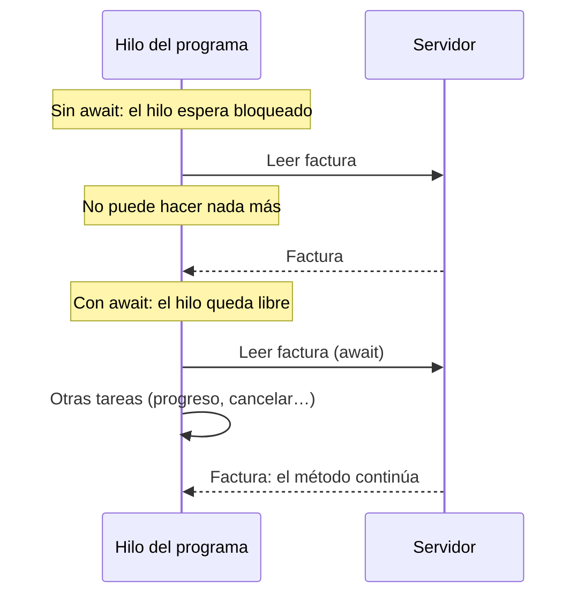
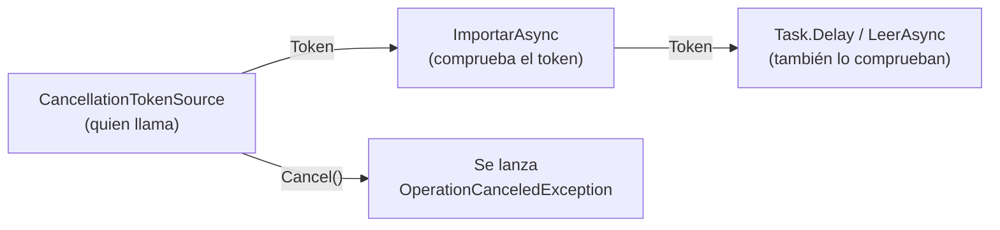

# 11. Programación asíncrona

[⬅️ Volver a la unidad](./README.md)

**CE que trabaja este tema:** prepara RA1 g, h.

## Índice

- [11.1. El problema: un programa que espera bloqueado](#111-el-problema-un-programa-que-espera-bloqueado)
- [11.2. `Task`, `async` y `await`](#112-task-async-y-await)
  - [11.2.1. Una tarea es una promesa de resultado](#1121-una-tarea-es-una-promesa-de-resultado)
  - [11.2.2. Qué hace `await`](#1122-qué-hace-await)
  - [11.2.3. Escribir un método asíncrono](#1123-escribir-un-método-asíncrono)
- [11.3. Excepciones](#113-excepciones)
- [11.4. Varias tareas a la vez](#114-varias-tareas-a-la-vez)
- [11.5. Trabajo de cálculo: `Task.Run`](#115-trabajo-de-cálculo-taskrun)
- [11.6. Informar del progreso](#116-informar-del-progreso)
- [11.7. Cancelar](#117-cancelar)
- [11.8. Errores frecuentes](#118-errores-frecuentes)
- [11.9. Ejemplo integrador: una descarga con progreso y cancelación](#119-ejemplo-integrador-una-descarga-con-progreso-y-cancelación)
- [Resumen](#resumen)
- [Ejercicios de reflexión](#ejercicios-de-reflexión)

---

## 11.1. El problema: un programa que espera bloqueado

Un programa tiene que importar cien facturas de un servidor, y leer cada una tarda medio segundo. Si las lee una tras otra **esperando bloqueado**, durante 50 segundos no puede hacer nada más: ni mostrar cuánto le falta, ni atender una orden de cancelar, ni leer varias facturas a la vez.

¿Por qué? Porque el código se ejecuta en un **hilo**, y un hilo que espera bloqueado no puede hacer otra cosa:

```csharp
Console.WriteLine("Empiezo");
Thread.Sleep(3000);            // el hilo se bloquea 3 segundos: no puede hacer nada más
Console.WriteLine("Termino");
```

Lo que necesitamos es **esperar sin bloquear el hilo**: «avísame cuando llegue la respuesta y, mientras tanto, sigue con otras cosas». Eso es la **programación asíncrona**, y C# la tiene integrada en el lenguaje con **`async`** y **`await`**.



El diagrama compara las dos formas: sin `await`, el hilo no hace nada hasta que llega la factura; con `await`, el hilo queda libre mientras tanto.

En la UD3 esto será todavía más importante: en una interfaz gráfica, un hilo bloqueado hace que la aplicación se quede «congelada» y no responda al usuario.

---

## 11.2. `Task`, `async` y `await`

### 11.2.1. Una tarea es una promesa de resultado

Una **`Task`** representa una operación que **está en marcha** y terminará en el futuro. Una **`Task<T>`** terminará con un resultado de tipo `T`:

| Método síncrono (bloquea) | Método asíncrono (no bloquea) |
|---------------------------|-------------------------------|
| `void Guardar()` | `Task GuardarAsync()` |
| `string LeerTexto()` | `Task<string> LeerTextoAsync()` |
| `Thread.Sleep(1000)` | `Task.Delay(1000)` |
| `File.ReadAllText(ruta)` | `File.ReadAllTextAsync(ruta)` |

Por convención, los métodos asíncronos terminan en **`Async`**.

### 11.2.2. Qué hace `await`

**`await`** espera a que una tarea termine **sin bloquear el hilo**: el método se «pausa» en ese punto, el hilo queda libre para otras cosas y, cuando la tarea termina, el método **continúa** en la línea siguiente con el resultado.

```csharp
Console.WriteLine("Empiezo");
await Task.Delay(3000);        // espera 3 segundos sin bloquear el hilo
Console.WriteLine("Termino");

string texto = await File.ReadAllTextAsync("datos.txt");   // await «desenvuelve» el resultado
```

El código se **lee** igual que el síncrono, de arriba abajo, pero no bloquea. Es la gran ventaja de `async`/`await` frente a otras formas de programación asíncrona (*callbacks*, promesas encadenadas).

### 11.2.3. Escribir un método asíncrono

```csharp
public async Task<Factura> LeerAsync(int numero, CancellationToken cancelacion = default)
{
    await Task.Delay(500, cancelacion);                 // simula un servidor lento
    return new Factura(numero, $"Servicio {numero:D3}", numero * 12.5m);
}

public async Task<List<Factura>> ImportarAsync()
{
    var facturas = new List<Factura>();
    for (var numero = 1; numero <= 10; numero++)
    {
        facturas.Add(await LeerAsync(numero));           // una a una, sin bloquear
    }

    return facturas;
}
```

Las reglas:

1. Un método que usa `await` lleva **`async`** en la firma.
2. Devuelve **`Task`** (si no devuelve nada) o **`Task<T>`** (si devuelve un `T`). El `return` devuelve un `T` normal: el compilador lo envuelve en la tarea.
3. Quien lo llama, normalmente, también hace `await`: la asincronía «sube» por las llamadas hasta el manejador del evento o el `Program.cs`.
4. En `Program.cs` se puede usar `await` directamente en las instrucciones de nivel superior.

> 💡 **Tip del Examinador**: «¿`await` crea un hilo nuevo?» **No**. `await` no crea hilos: libera el hilo actual mientras se espera a que termine una operación (una lectura de disco, una respuesta de red, un temporizador). Si quieres ejecutar **cálculo** en otro hilo, eso es `Task.Run` (apartado 11.5).

> 🔁 **Transferencia**: JavaScript y TypeScript (`async`/`await` con `Promise`), Python (`async def` y `await` con `asyncio`), Kotlin (corrutinas con `suspend`) y Swift (`async`/`await`) adoptaron la misma idea, muchos inspirados en C#. En Java, `CompletableFuture` y, desde Java 21, los hilos virtuales resuelven el mismo problema.

---

## 11.3. Excepciones

Si dentro de una tarea se lanza una excepción, queda guardada en la tarea y **sale al hacer `await`**. Se captura con un `try`/`catch` normal:

```csharp
try
{
    var facturas = await importador.ImportarAsync();
    Console.WriteLine($"✅ {facturas.Count} facturas");
}
catch (InvalidDataException ex)
{
    Console.WriteLine($"❌ {ex.Message}");
}
```

---

## 11.4. Varias tareas a la vez

Si las operaciones no dependen unas de otras, se pueden **lanzar todas** y esperar a que terminen. Con 20 lecturas de medio segundo, una a una se tarda 10 segundos; a la vez, medio segundo.

```csharp
var tareas = new List<Task<Factura>>();
for (var numero = 1; numero <= 20; numero++)
{
    tareas.Add(LeerAsync(numero));       // se lanza, pero no se espera
}

Factura[] facturas = await Task.WhenAll(tareas);   // espera a todas; resultados en el mismo orden
```

| Método | Espera a… | Devuelve |
|--------|-----------|----------|
| `Task.WhenAll(tareas)` | Que terminen **todas** | Los resultados, en el orden de las tareas |
| `Task.WhenAny(tareas)` | Que termine **la primera** | La tarea que ha terminado |

---

## 11.5. Trabajo de cálculo: `Task.Run`

`await` brilla con operaciones que **esperan** algo externo (disco, red, base de datos). Pero si lo lento es un **cálculo** (procesar una imagen, generar un informe con millones de filas), el hilo no espera: trabaja. Para que el hilo actual quede libre, ese cálculo se manda a **otro hilo** con **`Task.Run`**:

```csharp
var total = await Task.Run(() => CalcularEstadisticasPesadas(datos));   // en otro hilo
```

> ⚠️ **Cuidado**: `Task.Run` no hace más rápido un cálculo: lo ejecuta en otro hilo para que el actual quede libre. Si el código solo **espera** (disco, red, `Task.Delay`), no hace falta `Task.Run`: basta con `await`.

---

## 11.6. Informar del progreso

Una operación larga debería decir cuánto le falta. La lógica no debe saber **cómo** se muestra (una barra de texto en la consola, una línea en un registro…): solo informa. Para eso existe **`IProgress<T>`**:

```csharp
public async Task<List<Factura>> ImportarAsync(IProgress<int>? progreso = null)
{
    var facturas = new List<Factura>();
    for (var numero = 1; numero <= Total; numero++)
    {
        facturas.Add(await LeerAsync(numero));
        progreso?.Report(numero * 100 / Total);          // porcentaje completado
    }

    return facturas;
}
```

Quien llama decide qué hacer con cada aviso. .NET trae **`Progress<T>`**, que recibe una lambda:

```csharp
var progreso = new Progress<int>(porcentaje => Console.WriteLine($"{porcentaje} %"));
await importador.ImportarAsync(progreso);
```

> ⚠️ **Cuidado**: En un programa de consola, `Progress<T>` ejecuta cada aviso **en otro hilo** y sin esperar a que termine: las líneas pueden salir desordenadas o después del resultado. Por eso, en la consola, se implementa `IProgress<T>` con una clase propia que escribe en el momento, como en el E08 y en el ejemplo integrador de este tema. (En las interfaces gráficas de la UD3, `Progress<T>` avisará en el hilo de la interfaz y sí será la opción adecuada.)

---

## 11.7. Cancelar

El usuario tiene que poder cancelar una operación larga (heurística de Nielsen «control y libertad del usuario», UD1). En .NET, la cancelación es **cooperativa**: quien llama **pide** cancelar y el método asíncrono **comprueba** si se lo han pedido.



```csharp
public async Task<List<Factura>> ImportarAsync(CancellationToken cancelacion = default)
{
    var facturas = new List<Factura>();
    for (var numero = 1; numero <= Total; numero++)
    {
        cancelacion.ThrowIfCancellationRequested();                // ¿me han pedido parar?
        facturas.Add(await origen.LeerAsync(numero, cancelacion));  // se lo paso a quien espero
    }

    return facturas;
}
```

```csharp
using var cancelacion = new CancellationTokenSource();
cancelacion.CancelAfter(TimeSpan.FromSeconds(5));   // o cancelacion.Cancel() cuando el usuario lo pida

try
{
    var facturas = await importador.ImportarAsync(cancelacion.Token);
}
catch (OperationCanceledException)
{
    Console.WriteLine("⛔ Importación cancelada");
}
```

1. Quien llama crea un **`CancellationTokenSource`** y pasa su **`Token`**.
2. El método comprueba el token (**`ThrowIfCancellationRequested`**) y **lo pasa** a todo lo que espera (`Task.Delay`, lecturas de ficheros, peticiones de red), para que también se interrumpan.
3. Al cancelar, se lanza **`OperationCanceledException`**: quien llama la captura y, normalmente, no la trata como un error.

---

## 11.8. Errores frecuentes

| Error | Qué pasa | Solución |
|-------|----------|----------|
| `.Result` o `.Wait()` en lugar de `await` | Bloquea el hilo mientras espera; en una interfaz gráfica la congela y puede dejarla **bloqueada para siempre** (*deadlock*) | `await`, siempre |
| `async void` en un método normal | No se puede esperar; sus excepciones no se pueden capturar y pueden cerrar la aplicación | `async Task`. `async void` solo en **manejadores de eventos** |
| Olvidar el `await` (`GuardarAsync();`) | La tarea se lanza pero nadie la espera: el código sigue antes de que termine y sus errores se pierden. El compilador avisa (`CS4014`) | Escribe `await` |
| `async` sin ningún `await` dentro | El método es síncrono aunque lo parezca. El compilador avisa (`CS1998`) | Quita `async` o usa versiones asíncronas |
| No pasar el `CancellationToken` a lo que se espera | La cancelación no se nota hasta que termina la espera | Pásalo siempre que el método lo acepte |
| Capturar `TaskCanceledException` | No captura las cancelaciones de `ThrowIfCancellationRequested` | Captura `OperationCanceledException` (es la base) |

---

## 11.9. Ejemplo integrador: una descarga con progreso y cancelación

```csharp
using System.Globalization;
using System.Text;

Console.OutputEncoding = Encoding.UTF8;
CultureInfo.CurrentCulture = new CultureInfo("es-ES");

var descargador = new Descargador();

Console.WriteLine("⬇️ Descarga completa:");
var bytes = await descargador.DescargarAsync(5, new ProgresoTexto());
Console.WriteLine($"✅ {bytes:N0} bytes");

Console.WriteLine("⬇️ Descarga con límite de tiempo:");
using var cancelacion = new CancellationTokenSource(TimeSpan.FromMilliseconds(250));
try
{
    await descargador.DescargarAsync(10, new ProgresoTexto(), cancelacion.Token);
}
catch (OperationCanceledException)
{
    Console.WriteLine("⛔ Cancelada por tiempo");
}

Console.WriteLine("⚡ Tres descargas a la vez:");
var resultados = await Task.WhenAll(
    descargador.DescargarAsync(3),
    descargador.DescargarAsync(2),
    descargador.DescargarAsync(4));
Console.WriteLine($"✅ {string.Join(" + ", resultados)} = {resultados.Sum():N0} bytes");

public class Descargador
{
    private const int BytesPorBloque = 1024;

    public async Task<int> DescargarAsync(int bloques, IProgress<int>? progreso = null, CancellationToken cancelacion = default)
    {
        var descargados = 0;
        for (var i = 1; i <= bloques; i++)
        {
            cancelacion.ThrowIfCancellationRequested();
            await Task.Delay(100, cancelacion);          // un bloque tarda 100 ms
            descargados += BytesPorBloque;
            progreso?.Report(i * 100 / bloques);
        }

        return descargados;
    }
}

public class ProgresoTexto : IProgress<int>
{
    public void Report(int value) => Console.WriteLine($"   {value,3} %");
}
```

Una posible salida (la segunda descarga se corta tras el segundo bloque, porque 250 ms dan para dos bloques de 100 ms):

```text
⬇️ Descarga completa:
    20 %
    40 %
    60 %
    80 %
   100 %
✅ 5.120 bytes
⬇️ Descarga con límite de tiempo:
    10 %
    20 %
⛔ Cancelada por tiempo
⚡ Tres descargas a la vez:
✅ 3072 + 2048 + 4096 = 9.216 bytes
```

| Concepto | Dónde |
|----------|-------|
| Método `async Task<int>` con `await Task.Delay` | `DescargarAsync` |
| `IProgress<int>` opcional y propio | `progreso?.Report`, `ProgresoTexto` |
| Cancelación por tiempo con `CancellationTokenSource(TimeSpan)` | Segunda descarga |
| El token se comprueba y se pasa a `Task.Delay` | Dentro del bucle |
| `OperationCanceledException` | El `catch` |
| Tareas en paralelo con `Task.WhenAll` | Tres descargas a la vez |
| `await` en las instrucciones de nivel superior | Todo `Program.cs` |

> 📝 **Nota del Profesor**: Fíjate en que la salida de la segunda descarga depende del tiempo: en un ordenador muy cargado podría cortarse en otro punto. Por eso las pruebas automáticas de código asíncrono no usan tiempos reales, sino retardos de cero y cancelaciones provocadas en un momento concreto (lo verás en el E08).

---

## Resumen

- Un hilo que **espera bloqueado** no puede hacer nada más (en una interfaz gráfica, la congela).
- **`Task`** y **`Task<T>`** representan operaciones en marcha. Los métodos asíncronos terminan en **`Async`**.
- **`await`** espera **sin bloquear**: libera el hilo y continúa cuando la tarea termina. No crea hilos.
- Un método con `await` lleva **`async`** y devuelve `Task` o `Task<T>`. **`async void`** solo en manejadores de eventos.
- Las **excepciones** de una tarea salen al hacer `await` y se capturan con `try`/`catch`.
- **`Task.WhenAll`** espera varias tareas lanzadas a la vez; **`Task.Run`** manda un cálculo a otro hilo.
- **`IProgress<T>`** informa del progreso; en la consola, con una clase propia (`Progress<T>` avisa desde otros hilos).
- La **cancelación** es cooperativa: **`CancellationTokenSource`**, su **`Token`**, **`ThrowIfCancellationRequested`** y **`OperationCanceledException`**. El token se pasa a todo lo que se espera.
- Nunca **`.Result`** ni **`.Wait()`**: bloquean el hilo mientras esperan.

## Ejercicios de reflexión

1. Explica con tus palabras, sin usar la palabra «hilo», qué diferencia hay entre `Thread.Sleep(1000)` y `await Task.Delay(1000)`.
2. Mide con un `Stopwatch` cuánto tarda en importar 20 facturas el E08 una a una y en paralelo. ¿Por qué no se tarda exactamente 20 veces menos?
3. ¿Por qué un manejador de un evento puede ser `async void` y un método de tu lógica no debería? ¿Qué pasa con una excepción en cada caso?
4. En el ejemplo integrador, cambia el `CancellationTokenSource` a 50 ms. ¿Cuántos bloques se descargan? ¿Y si no pasas el token a `Task.Delay`?
5. Piensa en tu proyecto del curso: ¿qué operaciones deberían ser asíncronas (cargar datos, guardar, generar un informe…)? ¿Cuáles deberían poder cancelarse?

---

[⬅️ Volver a la unidad](./README.md)
