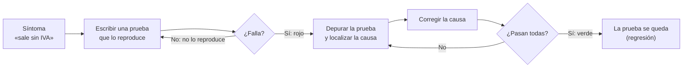

# 12. Depurar, documentar y probar

[⬅️ Volver a la unidad](./README.md)

**CE que trabaja este tema:** prepara RA1 e, f (y las pruebas y la documentación de las UD4, UD6 y UD7).

## Índice

- [12.1. Por qué estas tres cosas van juntas](#121-por-qué-estas-tres-cosas-van-juntas)
- [12.2. Leer una excepción](#122-leer-una-excepción)
- [12.3. El depurador de Visual Studio](#123-el-depurador-de-visual-studio)
  - [12.3.1. Puntos de interrupción](#1231-puntos-de-interrupción)
  - [12.3.2. Avanzar paso a paso](#1232-avanzar-paso-a-paso)
  - [12.3.3. Ver los valores](#1233-ver-los-valores)
  - [12.3.4. La pila de llamadas](#1234-la-pila-de-llamadas)
  - [12.3.5. Detenerse en las excepciones](#1235-detenerse-en-las-excepciones)
- [12.4. Documentar el código](#124-documentar-el-código)
  - [12.4.1. Comentarios de documentación XML](#1241-comentarios-de-documentación-xml)
  - [12.4.2. Qué comentar y qué no](#1242-qué-comentar-y-qué-no)
  - [12.4.3. El README de un proyecto](#1243-el-readme-de-un-proyecto)
- [12.5. Pruebas unitarias con xUnit](#125-pruebas-unitarias-con-xunit)
  - [12.5.1. Anatomía de una prueba: el patrón AAA](#1251-anatomía-de-una-prueba-el-patrón-aaa)
  - [12.5.2. `[Fact]` y `[Theory]`](#1252-fact-y-theory)
  - [12.5.3. Las comprobaciones (`Assert`)](#1253-las-comprobaciones-assert)
  - [12.5.4. Pruebas asíncronas](#1254-pruebas-asíncronas)
  - [12.5.5. Qué probar](#1255-qué-probar)
- [12.6. El Explorador de pruebas](#126-el-explorador-de-pruebas)
- [12.7. Reproducir, depurar, corregir: el ciclo de un fallo](#127-reproducir-depurar-corregir-el-ciclo-de-un-fallo)
- [12.8. Ejemplo integrador: probar un conversor](#128-ejemplo-integrador-probar-un-conversor)
- [Resumen](#resumen)
- [Ejercicios de reflexión](#ejercicios-de-reflexión)

---

## 12.1. Por qué estas tres cosas van juntas

Un usuario dice: «Las facturas salen sin IVA». Para resolverlo, un profesional:

1. **Reproduce** el fallo con una **prueba** automática que falla.
2. **Localiza** la causa con el **depurador**.
3. **Corrige** el código y comprueba que la prueba pasa (y que las demás siguen pasando).
4. Deja el código **documentado**, para que quien lo toque después sepa qué debe hacer cada método.

Depurar, documentar y probar son el día a día de cualquier programador, y en este módulo tienen resultados de aprendizaje propios (pruebas y documentación de componentes en la UD4, pruebas de la aplicación en la UD6, documentación en la UD7). Aquí aprendes lo básico para usarlo en todas las unidades.

---

## 12.2. Leer una excepción

Cuando un programa falla con una excepción no capturada, muestra un mensaje así:

```text
Unhandled exception. System.Collections.Generic.KeyNotFoundException: No hay ningún coche con la matrícula 1234 bcd.
   at GestionTaller.Logica.Taller.BuscarObligatorio(String matricula) in …\Taller.cs:line 145
   at GestionTaller.Logica.Taller.Reparar(String matricula, Decimal horas) in …\Taller.cs:line 114
   at Program.<Main>$(String[] args) in …\Program.cs:line 15
```

- La primera línea dice **qué**: el tipo de excepción y el mensaje.
- Las siguientes son la **pila de llamadas** (*stack trace*): **dónde**, de la más reciente a la más antigua. Se lee de arriba abajo: `BuscarObligatorio` lanzó la excepción; la llamó `Reparar`; a esta, `Program.cs` en la línea 15.

La causa casi nunca está en la línea que lanza la excepción, sino en algo que ocurrió antes: aquí, `Buscar` no encuentra el coche porque compara la matrícula sin normalizar. La traza te dice **por dónde empezar a buscar**.

> ✅ **Buena práctica**: Lee siempre el mensaje completo y la primera línea de la traza que sea **de tu código** (las líneas de clases de .NET rara vez son el problema). Copiar el mensaje en un buscador sin leerlo es la forma más lenta de arreglar un error.

---

## 12.3. El depurador de Visual Studio

El **depurador** permite **detener** el programa en una línea, **avanzar** instrucción a instrucción y **ver** el valor de cada variable en ese momento. Es mucho más eficaz que llenar el código de `Console.WriteLine`.

### 12.3.1. Puntos de interrupción

Un **punto de interrupción** (*breakpoint*) es una línea donde el programa se detendrá. Se pone con **F9** o haciendo clic en el margen izquierdo del editor (aparece un círculo rojo). Después, ejecuta con **F5** (`Depurar > Iniciar depuración`): el programa se detiene **antes** de ejecutar esa línea, que queda resaltada en amarillo.

Con botón derecho sobre el círculo puedes añadir **condiciones**: detenerse solo si `numero == 7`, o solo la décima vez que se pasa por ahí. Muy útil en bucles.

### 12.3.2. Avanzar paso a paso

| Acción | Atajo | Hace |
|--------|-------|------|
| Continuar | F5 | Sigue hasta el siguiente punto de interrupción |
| Paso a paso por procedimientos | F10 | Ejecuta la línea actual **sin entrar** en los métodos que llama |
| Paso a paso por instrucciones | F11 | Ejecuta la línea actual **entrando** en los métodos que llama |
| Paso a paso para salir | Mayús+F11 | Termina el método actual y vuelve a quien lo llamó |
| Ejecutar hasta el cursor | Ctrl+F10 | Sigue hasta la línea donde está el cursor |
| Detener | Mayús+F5 | Termina la depuración |

### 12.3.3. Ver los valores

Mientras el programa está detenido:

- **Pasa el ratón** por encima de cualquier variable o expresión: aparece su valor. Si es un objeto, puedes desplegarlo para ver sus propiedades.
- **Ventana Locales** (`Depurar > Ventanas > Locales`): todas las variables del método actual.
- **Ventana Inspección** (`Depurar > Ventanas > Inspección > Inspección 1`): escribe una expresión (`IvaPorcentaje / 100`, `_coches.Count`, `coche.Matricula == matricula`) y ve su valor mientras avanzas.
- **Ventana Inmediato** (Ctrl+Alt+I): evalúa expresiones o llama a métodos en el momento.

> 💡 **Tip del Examinador**: «¿Cómo comprobarías con el depurador por qué una factura sale sin IVA?» Pondría un **punto de interrupción** en el cálculo, ejecutaría con F5 y, al detenerse, añadiría `IvaPorcentaje / 100` en la ventana **Inspección**: vale 0 porque es una división entera.

### 12.3.4. La pila de llamadas

La ventana **Pila de llamadas** (`Depurar > Ventanas > Pila de llamadas`, Ctrl+Alt+C) muestra los métodos que se están ejecutando, del actual al primero, igual que la traza de una excepción. Doble clic en una línea te lleva a ese método, con sus variables en Locales. Sirve para responder «¿quién ha llamado a este método y con qué valores?».

### 12.3.5. Detenerse en las excepciones

Si se lanza una excepción durante la depuración, Visual Studio **se detiene** en la línea que la lanza y muestra el **asistente de excepciones**, con el tipo, el mensaje y un enlace para ver los detalles. Puedes mirar las variables en ese momento, que es justo lo que necesitas para entender por qué ha ocurrido.

En `Depurar > Ventanas > Configuración de excepciones` (Ctrl+Alt+E) puedes pedir que se detenga en una excepción **aunque se capture** después.

> 🔁 **Transferencia**: Todos los IDE tienen el mismo depurador con los mismos conceptos: puntos de interrupción, paso a paso, inspección de variables y pila de llamadas (IntelliJ, Android Studio, Eclipse, VS Code, las herramientas de desarrollo de los navegadores).

---

## 12.4. Documentar el código

### 12.4.1. Comentarios de documentación XML

En C#, los miembros públicos se documentan con **comentarios XML** que empiezan por `///`. Visual Studio genera la estructura al escribir `///` encima de un método.

```csharp
/// <summary>
/// Saca dinero de la cuenta.
/// </summary>
/// <param name="importe">Importe mayor que cero.</param>
/// <returns>El saldo después de la retirada.</returns>
/// <exception cref="ArgumentOutOfRangeException">Si el importe no es mayor que cero.</exception>
/// <exception cref="SaldoInsuficienteException">Si el saldo no alcanza.</exception>
public decimal Retirar(decimal importe)
```

| Etiqueta | Para qué |
|----------|----------|
| `<summary>` | Qué hace o qué representa (una o dos frases) |
| `<param name="…">` | Qué es cada parámetro y qué valores admite |
| `<returns>` | Qué devuelve |
| `<exception cref="…">` | Qué excepciones lanza y **cuándo** (C# no las declara en la firma) |
| `<remarks>` | Detalles adicionales |
| `<example>` y `<code>` | Un ejemplo de uso |
| `<see cref="…"/>`, `<see langword="null"/>` | Enlace a otro tipo o miembro, o a una palabra clave |
| `<c>` | Código dentro del texto |
| `<inheritdoc/>` | Hereda la documentación de la clase base o la interfaz |

¿Para qué sirven?

- **IntelliSense** los muestra al usar el método: quien lo llama sabe qué hace sin abrir su código.
- Con `<GenerateDocumentationFile>true</GenerateDocumentationFile>` en el `.csproj`, el compilador genera un fichero XML con toda la documentación y **avisa** (`CS1591`) de los miembros públicos sin documentar.
- Herramientas como DocFX convierten esos comentarios en una web de documentación. Lo harás en la UD4 con tus componentes.

### 12.4.2. Qué comentar y qué no

| ✅ Comenta | ❌ No comentes |
|-----------|---------------|
| **Qué** hace un miembro público y sus condiciones (comentario XML) | **Qué** hace cada línea: el código ya lo dice (`i++; // incrementa i`) |
| **Por qué** se ha hecho algo de una forma que no es evidente (`// Redondeo comercial: por defecto .NET redondea al par`) | Código comentado «por si acaso» (para eso está Git) |
| Las decisiones y los límites conocidos | Lo que se puede expresar con un buen nombre de variable o de método |

> ✅ **Buena práctica**: Antes de escribir un comentario que explica qué hace un bloque de código, prueba a sacar ese bloque a un método con un nombre que lo diga. `ComprobarSaldo(importe)` no necesita comentario.

### 12.4.3. El README de un proyecto

Cada proyecto debería tener un `README.md` en Markdown con, al menos: qué es y para qué sirve, cómo se compila y se ejecuta, cómo se ejecutan las pruebas, la estructura de carpetas y las decisiones importantes. El paso 1 del proyecto del curso (E10) trae una plantilla.

---

## 12.5. Pruebas unitarias con xUnit

Una **prueba unitaria** comprueba **un comportamiento** de **una clase**, sin interfaz y sin depender de nada externo (ficheros, red, la hora del sistema). En .NET se escriben con un *framework* de pruebas; en el módulo, **xUnit.net**.

### 12.5.1. Anatomía de una prueba: el patrón AAA

```csharp
using Banco.Logica;

namespace Banco.Pruebas;

public class CuentaBancariaPruebas
{
    [Fact]
    public void Retirar_SinSaldoSuficiente_LanzaSaldoInsuficienteYNoCambiaElSaldo()
    {
        // Arrange (preparar): el escenario
        var cuenta = new CuentaBancaria("Ana", 50);

        // Act (actuar): la operación que se prueba
        var ex = Assert.Throws<SaldoInsuficienteException>(() => cuenta.Retirar(80));

        // Assert (comprobar): el resultado esperado
        Assert.Equal(50, ex.Disponible);
        Assert.Equal(50, cuenta.Saldo);
    }
}
```

- **Arrange, Act, Assert**: preparar, actuar, comprobar. Separa las tres partes con una línea en blanco (los comentarios son opcionales).
- El nombre dice **qué** se prueba, **en qué situación** y **qué** se espera: `Método_Escenario_ResultadoEsperado`. Cuando una prueba falla, su nombre explica qué se ha roto.
- Cada prueba es **independiente**: crea sus propios objetos. xUnit crea una instancia nueva de la clase de pruebas para cada prueba, y puede ejecutar clases distintas **en paralelo**.

### 12.5.2. `[Fact]` y `[Theory]`

**`[Fact]`** es una prueba sin parámetros. **`[Theory]`** es una prueba con parámetros que se ejecuta una vez por cada **`[InlineData]`**: ideal para probar los **límites** sin repetir código.

```csharp
[Theory]
[InlineData(4.99, "Insuficiente")]
[InlineData(5, "Suficiente")]
[InlineData(6.5, "Bien")]
[InlineData(8.99, "Notable")]
[InlineData(9, "Sobresaliente")]
public void Calificacion_SegunLaNota_DevuelveSuTexto(double nota, string esperada)
{
    Assert.Equal(esperada, CalculadoraNota.Calificacion(nota));
}
```

En el Explorador de pruebas, cada `InlineData` aparece como un caso distinto.

### 12.5.3. Las comprobaciones (`Assert`)

| Comprobación | Pasa si |
|--------------|---------|
| `Assert.Equal(esperado, real)` | Son iguales (también colecciones, elemento a elemento) |
| `Assert.NotEqual(a, b)` | Son distintos |
| `Assert.True(c)`, `Assert.False(c)` | La condición es verdadera o falsa |
| `Assert.Null(x)`, `Assert.NotNull(x)` | Es (o no es) `null` |
| `Assert.Same(a, b)` | Son **el mismo objeto** (no solo iguales) |
| `Assert.Empty(c)`, `Assert.Single(c)` | La colección está vacía o tiene un solo elemento (que devuelve) |
| `Assert.Contains(x, c)` | La colección contiene el elemento |
| `Assert.Matches(patron, texto)` | El texto cumple una expresión regular |
| `Assert.Throws<T>(() => …)` | Se lanza exactamente una excepción de tipo `T` (la devuelve) |
| `Assert.ThrowsAny<T>(() => …)` | Se lanza una `T` o una hija |

> ⚠️ **Cuidado**: En `Assert.Equal`, el **primer** argumento es el **esperado** y el segundo el **real**. Si los cambias, la prueba funciona igual, pero el mensaje de error dirá al revés qué se esperaba y qué se obtuvo.

### 12.5.4. Pruebas asíncronas

Para probar métodos `async`, la prueba es **`async Task`** y usa `await`. Pásale a los métodos asíncronos el token de cancelación de la prueba, **`TestContext.Current.CancellationToken`**, para que xUnit pueda detenerla si se cancela la ejecución:

```csharp
[Fact]
public async Task ImportarAsync_DevuelveTodasLasFacturasEnOrdenYSuTotal()
{
    var importador = new ImportadorFacturas(new OrigenSimulado(4, TimeSpan.Zero));

    var resultado = await importador.ImportarAsync(cancelacion: TestContext.Current.CancellationToken);

    Assert.Equal(125m, resultado.ImporteTotal);
}

[Fact]
public async Task ImportarAsync_ConUnaFacturaDanada_PropagaLaExcepcion()
{
    var importador = new ImportadorFacturas(new OrigenSimulado(4, TimeSpan.Zero, facturaDanada: 2));

    await Assert.ThrowsAsync<InvalidDataException>(
        () => importador.ImportarAsync(cancelacion: TestContext.Current.CancellationToken));
}
```

Fíjate en el **retardo de cero**: las pruebas no esperan de verdad. Una prueba lenta es una prueba que nadie ejecuta.

### 12.5.5. Qué probar

Para cada método, piensa en tres tipos de casos:

| Tipo | Ejemplo con `Retirar` |
|------|-----------------------|
| **Normal**: el uso habitual | Retirar 30 de 100 deja 70 |
| **Límite**: los bordes de cada regla | Retirar **todo** el saldo deja 0; retirar 0,01 más de lo que hay falla |
| **Error**: datos o estados incorrectos | Importe negativo, importe cero |

Los errores se esconden en los **límites**: `<` en lugar de `<=`, un bucle que termina uno antes, la división entera. Una prueba con «una nota de 7» no detecta nada; una con 4,99, 5 y 5,01, sí.

> 📝 **Nota del Profesor**: Las pruebas de esta unidad prueban la **lógica**, por eso es tan importante que no dependa de la consola. En la UD3 descubrirás que el código que va unido a una interfaz gráfica es mucho más difícil de probar: por eso conviene que la lógica esté siempre aparte.

---

## 12.6. El Explorador de pruebas

`Prueba > Explorador de pruebas` (Ctrl+E, T):

- **Ejecutar todas** (Ctrl+R, A) o solo las seleccionadas. Las que pasan salen en **verde**; las que fallan, en **rojo**, con el mensaje y la traza.
- **Depurar** una prueba (botón derecho > Depurar): se detiene en los puntos de interrupción. Es la forma más rápida de depurar un fallo que una prueba reproduce.
- Filtrar por estado (solo las que fallan) o buscar por nombre.

Desde la terminal: `dotnet test --solution <Nombre>.slnx`.

---

## 12.7. Reproducir, depurar, corregir: el ciclo de un fallo



El ciclo empieza por una prueba que **falla**: si pasa, no reproduce el fallo y no sirve. Cuando todas pasan, la prueba nueva **se queda** en el proyecto: si algún día alguien vuelve a introducir el error, se pondrá en rojo. Es una **prueba de regresión**. Lo practicarás en el E09 con seis fallos.

> 🔁 **Transferencia**: Escribir la prueba **antes** que el código es la base del **desarrollo guiado por pruebas** (TDD, *Test-Driven Development*): rojo (la prueba falla), verde (el código mínimo para que pase) y refactorizar (mejorar el código con las pruebas como red de seguridad). Muchos equipos trabajan así, en cualquier lenguaje.

---

## 12.8. Ejemplo integrador: probar un conversor

Una clase pequeña, documentada, y sus pruebas con casos normales, límite y de error:

```csharp
namespace Conversor.Logica;

/// <summary>
/// Convierte temperaturas entre grados Celsius y Fahrenheit.
/// </summary>
public static class ConversorTemperatura
{
    /// <summary>Cero absoluto en grados Celsius: no existe una temperatura menor.</summary>
    public const double CeroAbsoluto = -273.15;

    /// <summary>
    /// Convierte de Celsius a Fahrenheit, con un decimal.
    /// </summary>
    /// <param name="celsius">Temperatura en grados Celsius, no menor que el cero absoluto.</param>
    /// <returns>La temperatura en grados Fahrenheit.</returns>
    /// <exception cref="ArgumentOutOfRangeException">Si es menor que el cero absoluto.</exception>
    public static double ACelsiusAFahrenheit(double celsius)
    {
        ArgumentOutOfRangeException.ThrowIfLessThan(celsius, CeroAbsoluto);
        return Math.Round((celsius * 9 / 5) + 32, 1);
    }
}
```

```csharp
using Conversor.Logica;

namespace Conversor.Pruebas;

public class ConversorTemperaturaPruebas
{
    [Theory]
    [InlineData(0, 32)]            // normal: congelación del agua
    [InlineData(100, 212)]         // normal: ebullición
    [InlineData(-40, -40)]         // curioso: la misma en las dos escalas
    [InlineData(36.6, 97.9)]       // con decimales y redondeo
    public void ACelsiusAFahrenheit_ConvierteCorrectamente(double celsius, double esperado)
    {
        Assert.Equal(esperado, ConversorTemperatura.ACelsiusAFahrenheit(celsius));
    }

    [Fact]
    public void ACelsiusAFahrenheit_EnElCeroAbsoluto_NoLanza()
    {
        var resultado = ConversorTemperatura.ACelsiusAFahrenheit(ConversorTemperatura.CeroAbsoluto);

        Assert.Equal(-459.7, resultado);
    }

    [Fact]
    public void ACelsiusAFahrenheit_PorDebajoDelCeroAbsoluto_LanzaArgumentOutOfRange()
    {
        Assert.Throws<ArgumentOutOfRangeException>(
            () => ConversorTemperatura.ACelsiusAFahrenheit(-273.16));
    }
}
```

| Concepto | Dónde |
|----------|-------|
| Comentarios XML con `summary`, `param`, `returns` y `exception` | `ConversorTemperatura` |
| Comentario que explica un **porqué** | `CeroAbsoluto` |
| `[Theory]` con casos normales y de redondeo | Primera prueba |
| Caso **límite** exacto (el cero absoluto está permitido) | Segunda prueba |
| Caso de **error** justo por debajo del límite | Tercera prueba |

---

## Resumen

- Ante un fallo: **reproducir** con una prueba, **localizar** con el depurador, **corregir** y dejar la prueba como **regresión**.
- Una **excepción** dice **qué** pasó (tipo y mensaje) y **dónde** (la pila de llamadas, de lo más reciente a lo más antiguo).
- El **depurador**: puntos de interrupción (**F9**), continuar (**F5**), paso a paso por procedimientos (**F10**) y por instrucciones (**F11**), ventanas **Locales**, **Inspección** y **Pila de llamadas**, y el asistente de excepciones.
- Los **comentarios XML** (`///`) documentan los miembros públicos: `summary`, `param`, `returns`, `exception`. IntelliSense los muestra y se pueden convertir en documentación.
- Comenta el **porqué**, no el **qué**. Un buen nombre ahorra comentarios.
- Una **prueba unitaria** (xUnit) sigue el patrón **AAA**; **`[Fact]`** sin parámetros, **`[Theory]`** con **`[InlineData]`**. Comprobaciones con **`Assert`** (esperado primero). Las pruebas asíncronas son `async Task` y usan `TestContext.Current.CancellationToken`.
- Prueba los casos **normales**, **límite** y de **error**: los fallos se esconden en los límites.
- El **Explorador de pruebas** ejecuta y **depura** las pruebas.

## Ejercicios de reflexión

1. Provoca una excepción en un método que llama a otro que llama a otro. Lee la traza y explica qué te dice cada línea. ¿En qué línea empezarías a buscar la causa?
2. Pon un punto de interrupción condicional en un bucle de 1 000 vueltas que se detenga solo en la vuelta 500. ¿Dónde se configura la condición?
3. Activa `<GenerateDocumentationFile>true</GenerateDocumentationFile>` en la biblioteca de algún ejercicio. ¿Cuántos avisos `CS1591` aparecen? ¿Qué miembros te faltaba documentar?
4. ¿Por qué una prueba que llama a `DateTime.Now` o lee un fichero real no es una buena prueba unitaria? ¿Cómo lo evitarías? (Pista: recibir la fecha o el contenido como parámetro).
5. Escribe primero las pruebas de un método `EsBisiesto(int anio)` (casos normales, límite y de error) y después el método. ¿Te han ayudado las pruebas a no olvidar ningún caso? ¿Cuál era el más fácil de olvidar?

---

[⬅️ Volver a la unidad](./README.md)
