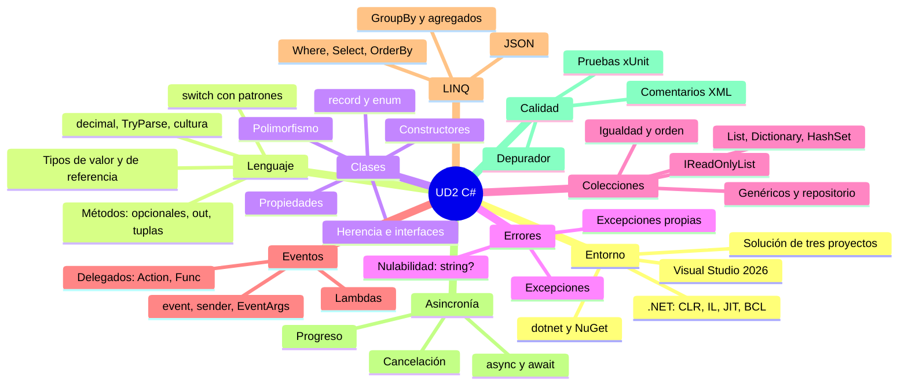

# 13. Resumen y mapa mental

[⬅️ Volver a la unidad](./README.md)

- [13. Resumen y mapa mental](#13-resumen-y-mapa-mental)
  - [Resumen ejecutivo](#resumen-ejecutivo)
  - [Mapa mental](#mapa-mental)
  - [Checklist de la unidad](#checklist-de-la-unidad)
    - [El entorno y el lenguaje](#el-entorno-y-el-lenguaje)
    - [Clases, propiedades y métodos](#clases-propiedades-y-métodos)
    - [Colecciones y consultas](#colecciones-y-consultas)
    - [Eventos y escuchadores](#eventos-y-escuchadores)
    - [Asincronía](#asincronía)
    - [Depurar, documentar y probar](#depurar-documentar-y-probar)
  - [Y ahora, la UD3](#y-ahora-la-ud3)

## Resumen ejecutivo

En esta unidad has aprendido el **C# necesario para construir interfaces gráficas en la UD3**, siempre con programas de consola, partiendo de lo que ya sabías de programación orientada a objetos:

1. **El entorno**: .NET (CLR, IL, JIT, BCL, versiones LTS), Visual Studio 2026 (soluciones, proyectos, plantillas, IntelliSense, acciones rápidas, NuGet), la herramienta `dotnet` y la **solución de tres proyectos**: lógica, consola y pruebas.
2. **Si vienes de otro lenguaje**: lo que se traslada, lo que suele sorprender (propiedades, tipos de valor, nulabilidad, eventos, LINQ, `async`) y las guías por lenguaje de origen.
3. **Estructura, tipos y operadores**: instrucciones de nivel superior, espacios de nombres, `var`, `decimal` para dinero, tipos de valor y de referencia, división entera, `TryParse`, la cultura, interpolación con formato, fechas e `int?`.
4. **Control de flujo y métodos**: expresión `switch` con patrones, `foreach`, matrices, índices y rangos, parámetros opcionales y con nombre, `out` y el patrón `TryXxx`, tuplas y funciones locales.
5. **Clases y propiedades**: encapsulación con **propiedades** (con lógica, `private set`, `init`, calculadas, `required`), constructores (también primarios), `ToString`, `static`, `record`, enumeraciones y clases parciales.
6. **Herencia e interfaces**: `:`, `base`, `virtual`/`override`, `abstract`, `sealed`, interfaces, polimorfismo, `is` con patrones y composición.
7. **Excepciones y nulabilidad**: jerarquía, qué lanzar y qué capturar, `when`, `throw;`, `using`, excepciones propias, y los tipos de referencia que admiten `null` (`string?`, `?.`, `??`).
8. **Genéricos y colecciones**: `List<T>`, `Dictionary<TKey, TValue>`, `HashSet<T>`, `IReadOnlyList<T>`, igualdad (`Equals` y `GetHashCode`), orden (`IComparable<T>`), restricciones y el patrón repositorio.
9. **Delegados, lambdas y eventos**: `Action`, `Func`, `Predicate`, lambdas que capturan variables, y **eventos** con el patrón de .NET (`sender`, `EventArgs`, `+=`, `-=`) y los eventos de la biblioteca de .NET.
10. **LINQ**: `Where`, `Select`, `OrderBy`/`ThenBy`, `First`/`FirstOrDefault`, agregados, `GroupBy`, ejecución diferida y JSON con `System.Text.Json`.
11. **Programación asíncrona**: por qué no conviene esperar bloqueado, `Task`, `async`/`await`, `Task.WhenAll`, `Task.Run`, progreso con `IProgress<T>` y cancelación con `CancellationToken`.
12. **Depurar, documentar y probar**: leer una excepción, el depurador (F9, F10, F11, Inspección, Pila de llamadas), comentarios XML y pruebas con xUnit (AAA, `[Fact]`, `[Theory]`, casos límite, pruebas asíncronas).

## Mapa mental

## Checklist de la unidad

Esta unidad **prepara el RA1**, que se evalúa en la UD3. Usa la lista para comprobar que llegas preparado.

### El entorno y el lenguaje

- [ ] Sé explicar qué hacen el compilador de C#, el IL y el CLR.
- [ ] Sé crear en Visual Studio una solución con una biblioteca, una consola y un proyecto de pruebas, con sus referencias.
- [ ] Sé ejecutar con y sin depuración, cambiar el proyecto de inicio y usar Ctrl+. y Ctrl+K, Ctrl+D.
- [ ] Uso `decimal` para el dinero y sé por qué.
- [ ] Sé qué pasa al copiar o pasar a un método un tipo de valor y un tipo de referencia.
- [ ] Convierto lo que escribe el usuario con `TryParse` y tengo en cuenta la cultura.
- [ ] Sé escribir una expresión `switch` con patrones y un método `TryXxx` con parámetros `out`.

### Clases, propiedades y métodos

- [ ] Expongo el estado de mis clases con propiedades, nunca con campos públicos.
- [ ] Sé elegir entre `{ get; set; }`, `private set`, solo `get`, `init` y una propiedad calculada.
- [ ] Valido los datos en el constructor y en los `set`, con la excepción adecuada.
- [ ] Sé cuándo usar `class`, `record` o `enum`.
- [ ] Sé heredar, sobrescribir (`virtual`/`override`) y llamar a la base (`base`).
- [ ] Sé distinguir cuándo usar una clase abstracta, una interfaz o composición.
- [ ] Capturo las excepciones en la interfaz, no en la lógica, y nunca dejo un `catch` vacío.
- [ ] Trabajo sin avisos de `null` y sé usar `?`, `?.`, `??` e `is not null`.

### Colecciones y consultas

- [ ] Sé elegir entre `List<T>`, `Dictionary<TKey, TValue>` y `HashSet<T>`.
- [ ] Expongo las colecciones privadas como `IReadOnlyList<T>`.
- [ ] Sé por qué hay que sobrescribir `Equals` y `GetHashCode` a la vez.
- [ ] Sé escribir una clase genérica con restricciones.
- [ ] Resuelvo consultas con LINQ: filtrar, ordenar con desempate, transformar, agrupar y agregar.
- [ ] Sé qué es la ejecución diferida y cuándo usar `ToList()`.
- [ ] Sé leer y escribir JSON con `System.Text.Json`.

### Eventos y escuchadores

- [ ] Sé qué es un delegado y usar `Action`, `Func` y `Predicate`.
- [ ] Escribo lambdas y sé qué significa que capturen una variable.
- [ ] Sé declarar un evento, lanzarlo con `?.Invoke` después de cambiar el estado y crear su clase `EventArgs`.
- [ ] Sé suscribirme con `+=`, darme de baja con `-=` y por qué es importante darse de baja.
- [ ] Sé explicar qué son `sender` y `e` en un manejador de eventos.

### Asincronía

- [ ] Sé explicar qué pasa cuando un hilo espera bloqueado y cómo lo evita `await`.
- [ ] Escribo métodos `async Task` y sé por qué `async void` solo es para manejadores de eventos.
- [ ] Sé informar del progreso con `IProgress<T>` y cancelar con un `CancellationToken`.
- [ ] Nunca uso `.Result` ni `.Wait()`.

### Depurar, documentar y probar

- [ ] Sé leer la traza de una excepción.
- [ ] Uso el depurador: puntos de interrupción, F10, F11, Inspección y Pila de llamadas.
- [ ] Documento los miembros públicos con comentarios XML.
- [ ] Escribo pruebas con el patrón AAA, `[Fact]` y `[Theory]`, con casos normales, límite y de error.
- [ ] Ante un fallo, primero escribo una prueba que lo reproduce.

## Y ahora, la UD3

En la UD3 construirás **interfaces gráficas**, y todo lo de esta unidad seguirá sirviendo:

| De esta unidad | En la UD3 |
|----------------|-----------|
| Propiedades | Todo lo que se ajusta de un componente de la interfaz es una propiedad, y tus datos se mostrarán a través de las propiedades de tus clases |
| Eventos y manejadores | Cada acción del usuario llega como un evento: asociarle su acción es el CE g del RA1 |
| Colecciones y LINQ | Los datos que se muestran, se buscan y se filtran |
| `async`/`await` | Cargar y guardar sin que la aplicación se quede congelada |
| La solución de tres proyectos | La lógica no cambia; la consola se sustituye por la interfaz gráfica |
| Pruebas | Probar la lógica sin abrir la interfaz |

Y tu **modelo del dominio** (E10, paso 1 del proyecto) será la base de la aplicación que construirás en el paso 2.

---

[⬅️ Volver a la unidad](./README.md)
