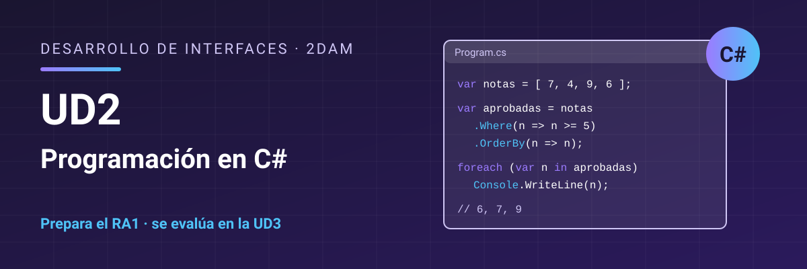

# Desarrollo de Interfaces - UD2 Programación en C#

Unidad 2 Programación en C#. 2DAM.

**Resultado de aprendizaje:** esta unidad prepara el [RA1. Genera interfaces gráficos de usuario mediante editores visuales utilizando las funcionalidades del editor y adaptando el código generado](./resultados-aprendizaje.md), que se evalúa en la UD3.

## Contenidos

1. [El entorno de trabajo: .NET y Visual Studio](./01-entorno-net-visual-studio.md)
2. [Si vienes de otro lenguaje](./02-desde-otros-lenguajes.md)
3. [Estructura de un programa, tipos y operadores](./03-estructura-tipos-operadores.md)
4. [Control de flujo y métodos](./04-control-flujo-metodos.md)
5. [Clases, objetos y propiedades](./05-clases-propiedades.md)
6. [Herencia, interfaces y polimorfismo](./06-herencia-interfaces.md)
7. [Excepciones y tipos que admiten null](./07-excepciones-nulabilidad.md)
8. [Genéricos y colecciones](./08-genericos-colecciones.md)
9. [Delegados, lambdas y eventos](./09-delegados-eventos.md)
10. [LINQ](./10-linq.md)
11. [Programación asíncrona](./11-programacion-asincrona.md)
12. [Depurar, documentar y probar](./12-depurar-documentar-probar.md)
13. [Resumen](./13-resumen.md)

**Guías por lenguaje de origen** (opcionales, enlazadas desde el tema 2):

- [C# para quien viene de Java](./desde-otros-lenguajes/java.md)

## Licencia

Este material se distribuye bajo licencia **Creative Commons BY-NC-SA 4.0**. Consulta las condiciones en [LICENSE.md](./LICENSE.md).
