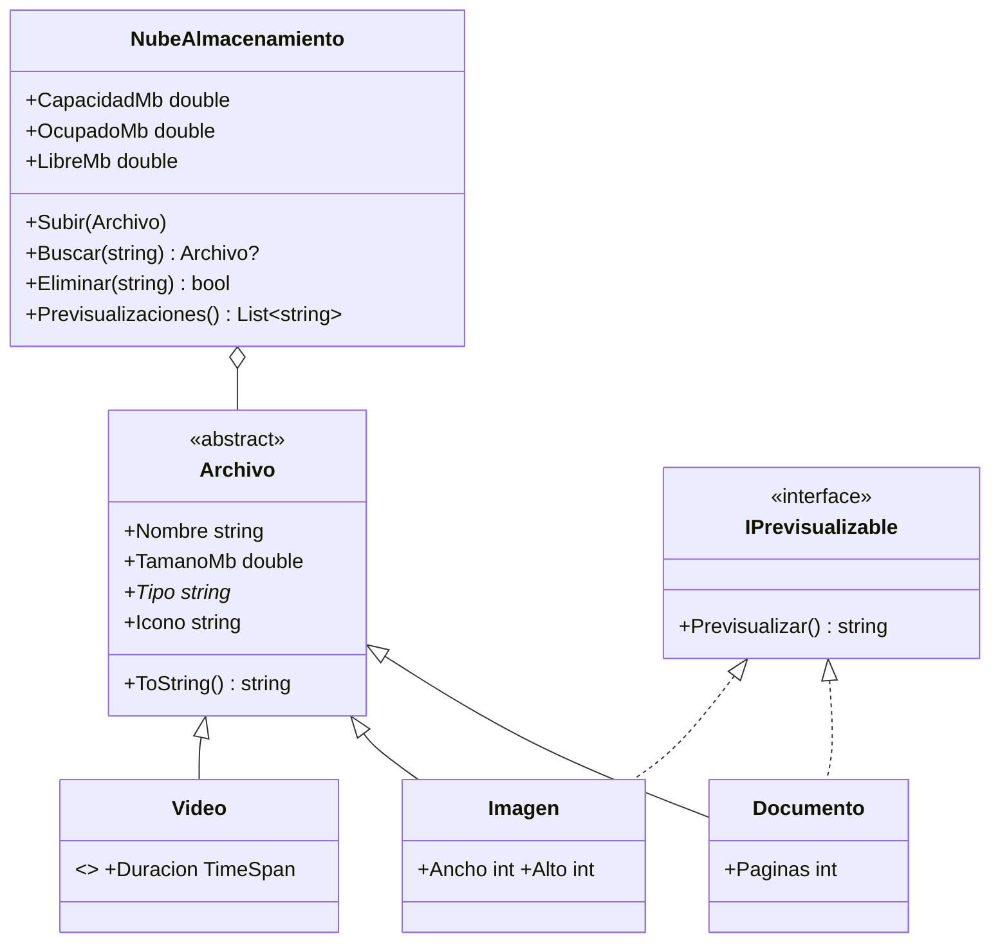

# E03 · Almacenamiento en la nube

**Tipo:** autocorrección

Completa una jerarquía de archivos (documentos, imágenes y vídeos) y una nube con capacidad limitada que trabaja con todos ellos sin saber de qué tipo es cada uno.

**CE:** — (formativo; prepara el RA1: clases, propiedades y métodos) · **Dificultad:** ★★☆ · **Tiempo estimado:** 2 h · **Temas:** 6 y 7

## Punto de partida

- `Nube.Logica`: las clases con sus firmas y su documentación, sin implementar. `EspacioInsuficienteException` e `IPrevisualizable` ya están hechas.
- `Nube.Consola/Program.cs` y `Nube.Pruebas/NubeAlmacenamientoPruebas.cs`: **no los modifiques**.



`Documento` e `Imagen` implementan `IPrevisualizable`; `Video`, no. El asterisco marca lo abstracto.

## Requisitos

### `Archivo` (abstracta)

1. Constructor **`protected`** `(string nombre, double tamanoMb)`: lanza `ArgumentException` si el nombre está vacío (`ArgumentException.ThrowIfNullOrWhiteSpace`) y `ArgumentOutOfRangeException` si el tamaño no es mayor que 0. Guarda el nombre sin espacios en los extremos.
2. `Tipo`: propiedad **abstracta**.
3. `Icono`: propiedad **virtual** que devuelve `📄`.
4. `ToString()`: `<icono> <nombre> · <tipo> · <tamaño con N1> MB`.

### Las clases hijas

| Clase | Constructor (primario) | `Tipo` | `Icono` | Además |
|-------|------------------------|--------|---------|--------|
| `Documento` | `(nombre, tamanoMb, paginas)` | `documento` | el de `Archivo` | `Paginas` (lanza `ArgumentOutOfRangeException` si no es mayor que 0). `Previsualizar()`: `1 página` o `<n> páginas` |
| `Imagen` | `(nombre, tamanoMb, ancho, alto)` | `imagen` | `🖼️` | `Previsualizar()`: `<ancho>×<alto> px` |
| `Video` (**sellada**) | `(nombre, tamanoMb, duracion)` | `vídeo` | `🎬` | `ToString()` añade ` · mm:ss` al texto de `Archivo` usando `base.ToString()` |

### `NubeAlmacenamiento`

| Miembro | Comportamiento |
|---------|----------------|
| Constructor `(double capacidadMb = 500)` | Lanza `ArgumentOutOfRangeException` si no es mayor que 0 |
| `OcupadoMb`, `LibreMb` | Suma de los tamaños (con un `foreach`) y lo que queda libre |
| `Archivos` | `IReadOnlyList<Archivo>` en el orden en que se subieron |
| `Subir(Archivo)` | `InvalidOperationException` si ya hay otro con el mismo nombre (sin distinguir mayúsculas); `EspacioInsuficienteException` si no cabe; si no, lo guarda |
| `Buscar(string)` | El archivo con ese nombre, sin distinguir mayúsculas, o `null` |
| `Eliminar(string)` | `true` si existía y se ha eliminado |
| `Previsualizaciones()` | `<nombre>: <vista previa>` de cada archivo que sea `IPrevisualizable`. Usa el patrón `is IPrevisualizable p` |

La nube **no** pregunta nunca por el tipo concreto (`is Documento`, `GetType()`…): trabaja con `Archivo` y con la interfaz.

## Comprueba tu solución

1. Todas las pruebas en verde.
2. `Nube.Consola` muestra exactamente:

   ```text
   ⬆️ 📄 memoria.pdf · documento · 2,5 MB
   ⬆️ 🖼️ portada.png · imagen · 4,2 MB
   ⬆️ 🎬 clase-csharp.mp4 · vídeo · 320,0 MB · 42:30
   ⬆️ 📄 notas.docx · documento · 0,3 MB
   ❌ No cabe demo.mp4 (180,0 MB): quedan 173,0 MB libres
   ❌ Ya existe un archivo llamado PORTADA.png
   💾 Ocupado: 327,0 de 500 MB · libre: 173,0 MB
   👀 Vistas previas:
      memoria.pdf: 34 páginas
      portada.png: 1920×1080 px
      notas.docx: 1 página
   🔎 Buscar «Notas.DOCX»: 📄 notas.docx · documento · 0,3 MB
   🗑️ Eliminar clase-csharp.mp4: True
   🗑️ Eliminar clase-csharp.mp4 otra vez: False
   💾 Libre: 493,0 MB
   ```

3. Quita temporalmente `override` de `Icono` en `Imagen`. ¿Qué aviso da el compilador? ¿Qué icono sale ahora para las imágenes y por qué?
4. Intenta escribir `class VideoHd : Video { }` y `new Archivo("a", 1)`. ¿Qué error da cada uno?

> **Para qué te servirá:** trabajar con «cualquier archivo» o con «cualquier cosa que sepa previsualizarse» permite añadir tipos nuevos sin tocar el código que los usa.
