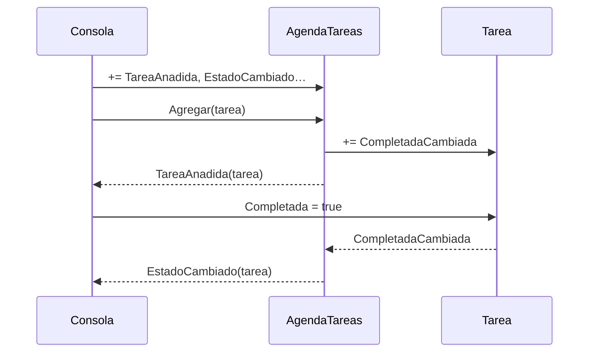

# E05 · Lista de tareas que avisa

**Tipo:** autocorrección

Completa una lista de tareas que **avisa con eventos** de todo lo que pasa: cada tarea avisa cuando cambia su estado y la agenda avisa cuando se añade, se elimina o cambia alguna de sus tareas. La consola se suscribe con dos «oyentes» independientes.

**CE:** — (formativo; prepara el RA1 g: asociar acciones a los eventos) · **Dificultad:** ★★☆ · **Tiempo estimado:** 2 h · **Tema:** 9

## Punto de partida

- `Tareas.Logica`: `TareaEventArgs` ya está hecha. `Tarea` y `AgendaTareas` tienen los eventos declarados, las firmas y la documentación, sin implementar.
- `Tareas.Consola/Program.cs` y `Tareas.Pruebas/AgendaTareasPruebas.cs`: **no los modifiques**.



La consola solo conoce la agenda y la tarea; la agenda escucha a sus tareas y reenvía sus avisos.

## Requisitos

### `Tarea`

1. Constructor primario `(string titulo)`. `Titulo` guarda el título sin espacios en los extremos y lanza `ArgumentException` si está vacío.
2. Evento `CompletadaCambiada` de tipo `EventHandler?`.
3. `Completada`: propiedad con un **campo privado**. El `set` solo hace algo si el valor **cambia**: lo guarda y **después** lanza el evento con `?.Invoke(this, EventArgs.Empty)`.
4. `ToString()`: `[x] Título` si está completada y `[ ] Título` si no.

### `AgendaTareas`

1. Eventos `TareaAnadida`, `TareaEliminada` y `EstadoCambiado`, de tipo `EventHandler<TareaEventArgs>?`.
2. `Tareas` (`IReadOnlyList<Tarea>`) y `Pendientes` (cuántas no están completadas).
3. `Agregar(Tarea)`: lanza `InvalidOperationException` si ya hay una tarea con ese título (sin distinguir mayúsculas). Si no, la guarda, **se suscribe** a su `CompletadaCambiada` y lanza `TareaAnadida`.
4. `Eliminar(string titulo)`: si existe, la quita, **se da de baja** de su evento (`-=`), lanza `TareaEliminada` y devuelve `true`.
5. `Completar(string titulo)`: si existe, pone `Completada = true` y devuelve `true`. No lanza ningún evento directamente: el aviso llega a través de la tarea.
6. `Buscar(string titulo)`: la tarea o `null`.
7. Un **método privado** manejador del evento de las tareas, con la firma `(object? sender, EventArgs e)`, que lanza `EstadoCambiado` con la tarea que envía el aviso.

Ninguna clase de `Tareas.Logica` escribe en la consola.

## Comprueba tu solución

1. Todas las pruebas en verde. Fíjate en `SinSuscriptores_LasOperacionesNoFallan`: si falla con `NullReferenceException`, te falta el `?.`.
2. `Tareas.Consola` muestra exactamente:

   ```text
   📢 Añadida: Instalar Visual Studio
      🔢 Pendientes: 1
   📢 Añadida: Estudiar eventos
      🔢 Pendientes: 2
   📢 Añadida: Hacer el E05
      🔢 Pendientes: 3
   📢 Cambio de estado: [x] Instalar Visual Studio
      🔢 Pendientes: 2
   📢 Cambio de estado: [x] Hacer el E05
      🔢 Pendientes: 1
   ❌ Ya existe la tarea «Estudiar EVENTOS»
   📢 Eliminada: Hacer el E05
      🔢 Pendientes: 1
   📢 Cambio de estado: [x] Estudiar eventos
   📋 Tareas:
      [x] Instalar Visual Studio
      [x] Estudiar eventos
   ```

3. Busca en `Program.cs` las líneas que **no** producen salida (completar dos veces, cambiar una tarea ya eliminada, el último cambio sin contador) y explica en un comentario por qué cada una no avisa o avisa solo a un suscriptor.
4. Quita el `-=` de `Eliminar` y ejecuta las pruebas: ¿cuál falla y por qué?
5. Escribe en `Program.cs` `agenda.TareaAnadida = null;`. ¿Qué error da? ¿Qué protege la palabra `event`?

> **Para qué te servirá:** avisar con eventos de lo que cambia, y responder a esos avisos, es la forma de conectar las partes de un programa sin que dependan unas de otras. En la UD3, cada acción del usuario llegará a tu código como un evento.
